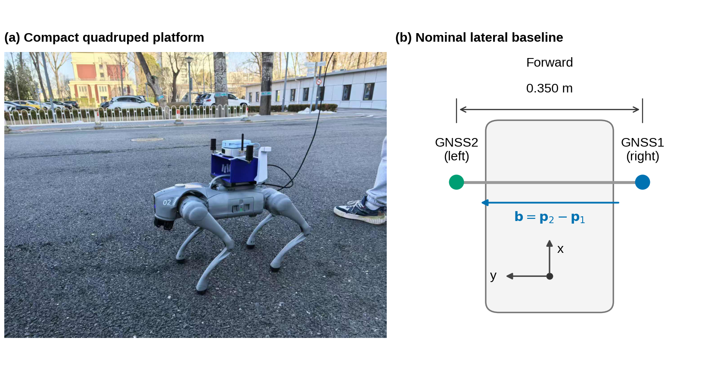
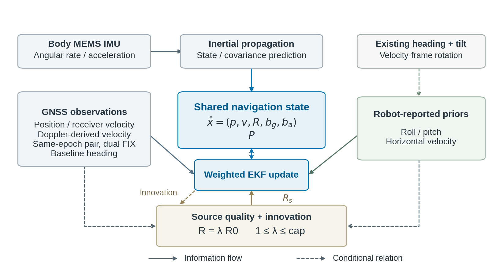
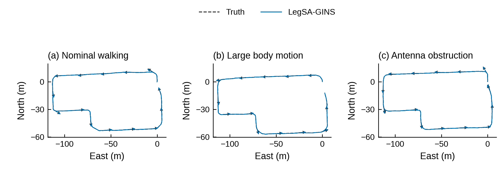
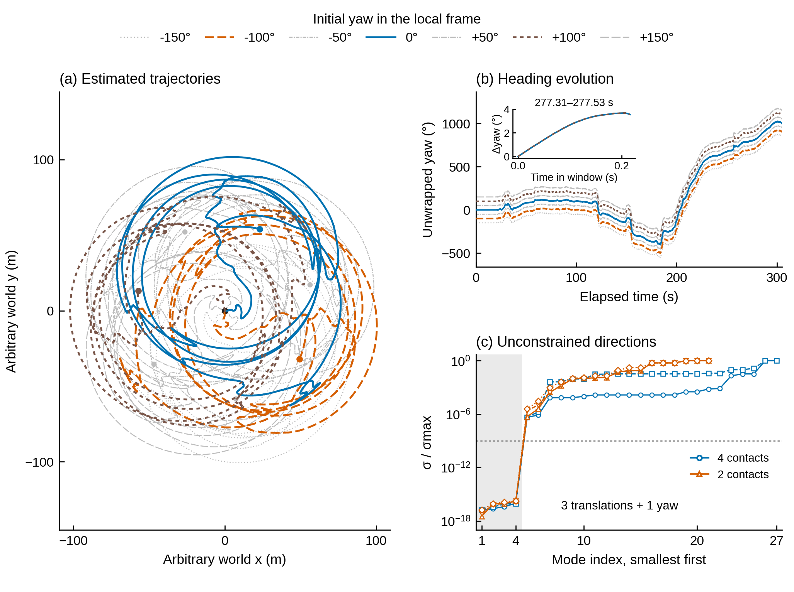
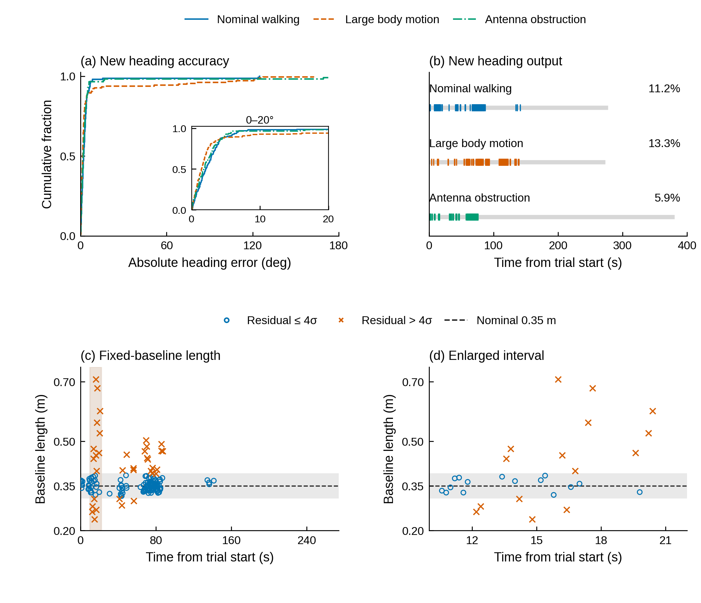
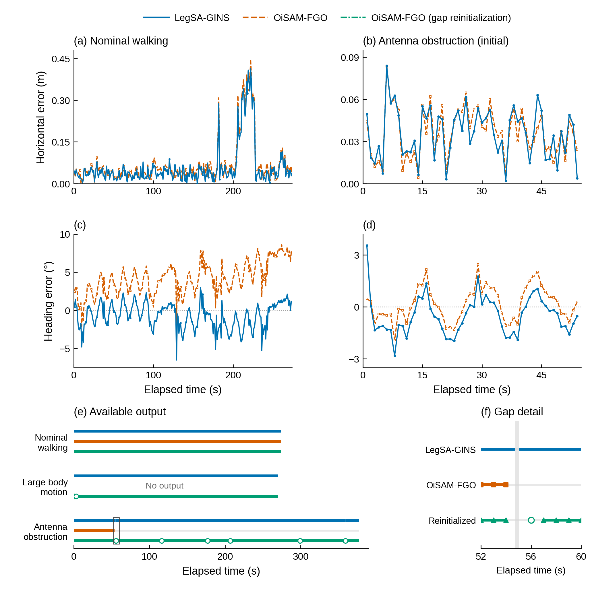

# 正文用图定选：9张

作者要求仅查看选入正文的图。以下为本轮明确选定的正文清单，按现有成图展示；所列修改尚未执行。序号作为当前正文工作编号，不表示图注与排版已经最终定稿。

科学主线：在紧凑四足机器人的GNSS/INS中，短基线方向信息与机身运动观测如何共同改善姿态和平移估计，这种互补在什么观测可用性与质量条件下成立，又在何时失效？

自然IEKF与保留方向IEKF的关键结果进入正文比较表，同时保留位置、航向与输出支持；完整时序放补充。其余补图和历史版本本入口不展示。

## 图1　紧凑四足机器人平台与短基线安装

**正文作用：** 说明平台、传感器布局和0.35 m侧向基线。

**待修改内容：** 整理硬件型号、天线次序和已确认的安装标注。

## 图2　短基线方向与机身观测的共同状态融合

**正文作用：** 说明观测如何更新同一姿态、速度、位置与偏置状态。

**待修改内容：** 把有效GNSS事件与辅助更新调度关系补入图或图注，明确HV坐标转换所用方向。

## 图3　实测路线与沿程机身朝向

**正文作用：** 让读者把三场景的位置和机身朝向放到实际空间中理解。

**待修改内容：** 加入少量与后续结果共用的关键事件和局部放大，明确等长箭头表示朝向。

## 图4　机器人自身观测中的绝对方向自由度

**正文作用：** 用同输入多初始方向及奇异值谱解释外部方向约束需求。

**待修改内容：** 减少轨迹视觉拥挤，清楚解释展开航向和四维全局自由度。

## 图5　短基线方向的输出可用性与物理一致性

**正文作用：** 区分有无新方向输出与已有输出是否满足物理一致性。

**待修改内容：** 补充本文实际位置产品航向链的有效/接纳情况，优先取已有记录，与后续融合结果衔接。

## 图6　短基线航向与机载倾角对姿态估计的作用

**正文作用：** 分别显示yaw、roll、pitch的收益及场景差异。

**待修改内容：** 确认局部窗口与实际运动事件的对应，定稿标题和图注。

## 图7　方向保留条件下的机身速度辅助与平移估计

**正文作用：** 给出内部单开关速度辅助的条件平移收益。

**待修改内容：** 优先标清屏蔽/保留的观测及实际更新状态，区分全窗RMSE与中断末端误差。

## 图8　观测质量变化下的来源加权收益与代价

**正文作用：** 同时呈现航向保护、位置代价、发散和共同完成样本的取舍。

**待修改内容：** 让代表例位置代价可见，整理完成/发散/无初始化及仍大误差的状态说明。

## 图9　与OiSAM的导航精度及输出连续性比较

**正文作用：** 将共同时间精度与全程输出支持放在一起检验。

**待修改内容：** 明确单次初始化精度与重初始化时间线的协议差异、IMU缺口及初段54点的范围。

## 修改顺序

第一优先：图7的条件说明；第二优先：图3的事件和局部放大、图5的本文航向观测衔接；第三优先：图8的收益与代价表达。随后统一其他图的标题、图注和编号。

本轮只收敛正文选择，未重绘图件、未启动实验。下一步由作者针对这九张决定补充和修改内容。
