# 全部已完成图件与逐图审阅

本次恢复 **52 个已完成图件版本**：早期22组、过程图重设计11组、当前结果15组、新姿态合图1组、两幅集中展示来源图，以及早期参考路线核对图。版本之间存在复用和替代，不等于同样数量的独立实验。本文前24项按当前科学问题阅读，后续保留其余历史统计及来源版本。

> 在紧凑四足机器人的 GNSS/INS 中，短基线方向信息与机身运动观测如何共同改善姿态和平移估计，这种互补在什么观测可用性与质量条件下成立，又在何时失效？

建议先把平台/路线讲清，再按“自身观测的方向自由度 → 短基线方向质量 → 姿态作用 → 条件平移收益 → 质量代价 → 外部验证”阅读。前24项是本轮重点讨论，不是最终论文图号或已决定的正文图数。

已经完成的图包括平台、方法、轨迹和沿程航向；当前需要的是筛选、对齐事件、合并重复内容及整理图注。原始图片不重绘，数值不重算。

本次核对纠正一处说明：S5重新初始化航向图的现用共同动态历元为 **274/267/367**，原说明369与现用CSV及JSON不符。图中数据不变。

图中“Truth”沿用之前的显示标签，科学评价仍使用Fixposition来源参考；其共享GNSS来源及非独立真值属性在方法部分交代。

## 1. 旧M01 · 紧凑平台与侧向短基线几何

**建议位置：** 正文平台图。

**子图怎么读：** 左侧实机安装，右侧定义GNSS1/2和0.35 m侧向基线。

**合理性判断：** 把紧凑平台的几何约束讲具体。0.35 m为名义相位中心间距，不能从照片推定已测IMU杆臂。

**下一步：** 保留，与一幅路线/观测时段图组成实验平台入口。

**原图注：** (a) Original author-supplied installation photograph, placed without retouching. (b) Nominal top-view baseline: GNSS1 is robot-right, GNSS2 robot-left; the vector GNSS2 minus GNSS1 follows body +Y in FLU. The 0.350 m value is the manufacturer nominal phase-center separation. The body frame is illustrative; no surveyed IMU offset, antenna height or output point is inferred from photograph scale.

来源阶段：历史初版；原PDF：`G:/LegSA-GINS-project/V3论文组图_20261008/figures/M01_platform.pdf`。

## 2. D01 · 融合方法总览

**建议位置：** 正文方法图。

**子图怎么读：** IMU传播共同状态；GNSS和机载先验进入共同更新；来源质量/创新调大量测协方差。

**合理性判断：** 当前图已有共享状态和HV使用既有航向/倾角的关系，但GNSS事件调度还需明确。

**下一步：** 保留，补一句有效GNSS事件如何触发辅助更新；R倍率越大表示降权。

**原图注：** GNSS/INS估计器的信息流。MEMS传播与加权量测更新共同维护导航状态和协方差，双天线航向与接收机位置、速度、多普勒速度及机器人倾角、水平速度提供互补约束。实线表示信息流，虚线表示条件关系。

来源阶段：过程图重设计；原PDF：`G:/LegSA-GINS-project/V3论文组图_20261008/redesign_20261009/figures/D01_method_overview.pdf`。

## 3. P01 · 不同实验工况下的轨迹与局部放大

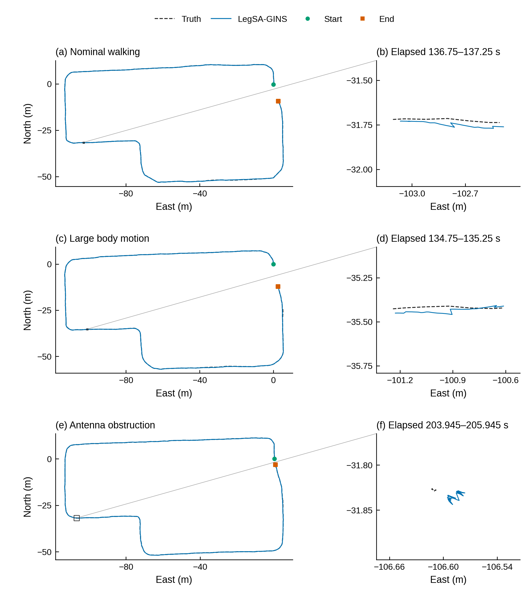

**建议位置：** 正文场景候选。

**子图怎么读：** 三行完整路线与对应局部放大，黑虚线参考，蓝线估计。

**合理性判断：** 已有真实轨迹与局部图。前两窗各0.5 s、第三窗2 s，局部时间尚未与主要科学事件一致。

**下一步：** 与P03合并，优先在已确认转弯/大幅动作/遮挡事件选择统一阅读窗口。

**原图注：** 三条记录的完整轨迹与对应局部放大。黑色虚线为Truth，蓝线为LegSA-GINS；位置框和连线指出右侧放大的路段，面板上方给出相对记录窗口起点的固定时间。完整路径说明运动场景，局部视图显示全局尺度下重叠的细小位置差异。

来源阶段：过程图重设计；原PDF：`G:/LegSA-GINS-project/V3论文组图_20261008/redesign_20261009/figures/P01_trajectory_local_views.pdf`。

## 4. P02 · 不同实验工况下的航向估计与误差

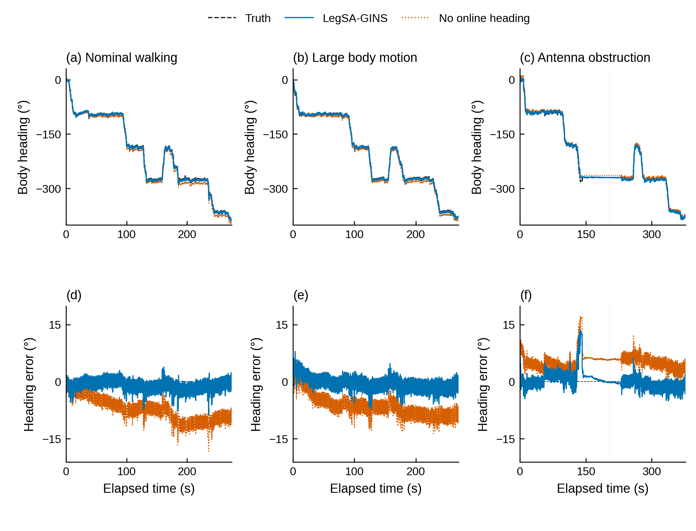

**建议位置：** 保留绝对航向部分；旧误差对照退回来源。

**子图怎么读：** 上排连续展开的机身航向显示转弯，下排显示带符号航向误差。

**合理性判断：** 上排有独特信息；旧No online heading实际是F01，除航向还改变其他辅助开关，不是单一航向消融。

**下一步：** 修正旧标签含义；因果比较使用新姿态图F01/F03/F04，上排可与路线事件合并。

**原图注：** 常规行走、大幅机身运动和单侧天线遮挡实验中的航向估计与误差。大幅机身运动实验沿同一路线进行，包含大幅度机身运动并伴随明显振动。上排为连续展开的航向角，下排为有符号航向误差；黑色虚线、蓝线和橙线分别表示参考值、LegSA-GINS及无在线航向更新的对照。浅色条带对应轨迹图的局部放大时段。

来源阶段：过程图重设计；原PDF：`G:/LegSA-GINS-project/V3论文组图_20261008/redesign_20261009/figures/P02_body_heading_turns.pdf`。

## 5. P03 · 运动轨迹与沿程机身航向

**建议位置：** 与轨迹图合并候选。

**子图怎么读：** 在真实路径上画参考与估计机身朝向，箭头方向来自yaw。

**合理性判断：** 箭长固定8 m只是图形大小，不是速度；稀疏箭头不是全时序精度统计。三列当前高度重合。

**下一步：** 保留用户要求的沿程航向功能，与P01组合，放大有明确动作的局部。

**原图注：** 沿完整轨迹显示机体前向方向。黑线与蓝线分别为Truth和LegSA-GINS，统一箭头表示机体航向。箭头方向由机体航向决定，而非轨迹切线，因此可以解释原地转动以及侧向、后退运动；箭长仅用于显示，不表示速度或位移。

来源阶段：过程图重设计；原PDF：`G:/LegSA-GINS-project/V3论文组图_20261008/redesign_20261009/figures/P03_body_heading_along_route.pdf`。

## 6. M1 · 机器人自身观测与绝对航向

**建议位置：** 正文动机/结构证据。

**子图怎么读：** a同输入七个初始航向的轨迹；b展开航向及0.216 s增量；c五窗口归一化奇异值。

**合理性判断：** 等价旋转与四维自由度支持绝对方向需求，不是接触估计精度排行榜。七轨迹整体偏密，1000°来自展开角。

**下一步：** 保留，图注说明全局自由度；可减少视觉突出轨迹数量，全部七条仍保留。

**原图注：** 机器人自身观测下的绝对航向自由度。（a）同一组 IMU 与足端接触数据的七次已保存运行，初始航向覆盖 −150° 至 +150°，在任意局部坐标系中形成相互旋转的轨迹。彩色突出 0° 与 ±100°，圆点表示共同起点与各轨迹终点。（b）展开后的航向演化保留初始方向差异；插图为预先根据输入选定的 0.216 s 双接触窗口内航向增量，七条曲线重合。（c）含偏置模型在五个预选接触窗口的已保存可观测性奇异值，分别除以各自最大奇异值，并按从小到大排序。两段四接触与三段双接触窗口分别对应 27 维和 21 维状态；前四个方向均低于相对秩阈值（虚线，10⁻⁹），对应三维全局平移与一维全局航向自由度。不同标记表示不同窗口。仅消除各运行初始旋转后，最大位置差为 1.90 × 10⁻⁷ m。该组实验验证同一自身观测下全局方向的等价性。

来源阶段：当前结果组图；原PDF：`G:/LegSA-GINS-project/V3五问题论文组图_20261011/robot/Q1_proprioception_absolute_heading.pdf`。

## 7. S1 · 接触辅助估计与机载姿态参与积分的相对运动表现

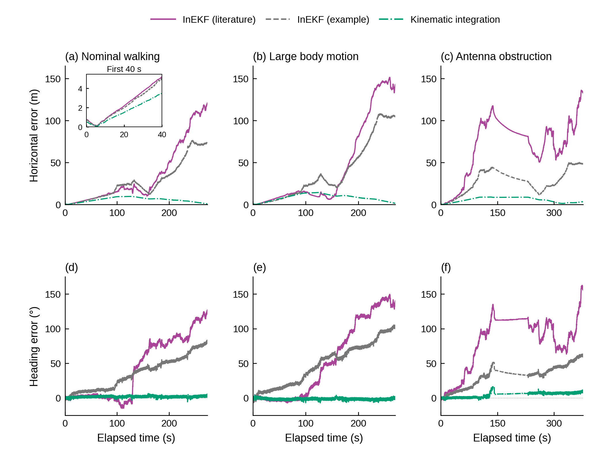

**建议位置：** 补充：自身相对运动。

**子图怎么读：** 上排水平误差，下排航向误差；初始10 s只对齐一次，后续持续评价。

**合理性判断：** 官方接触InEKF两参数配置漂移较大；运动学积分还用了机载姿态，输入不是完全相同。性能差不等于一般理论不可观。

**下一步：** 保留在补充，M1负责结构结论，本图负责实际平台输入表现。

**原图注：** 接触辅助状态估计的相对运动误差。各列分别对应一种工况；在评价窗开始的10 s内进行一次平移与航向对齐后，上、下排分别为水平和航向误差。官方接触辅助InEKF分别采用文献与示例噪声设置；接触运动学积分使用接触足速度和机载姿态。小窗放大常规行走的前40 s。曲线采用已完成评价的原时刻。

来源阶段：当前结果组图；原PDF：`G:/LegSA-GINS-project/V3五问题论文组图_20261011/robot/S01_robot_relative_motion.pdf`。

## 8. M2 · RTKLIB原配置下短基线航向的输出与物理一致性

**建议位置：** 正文方向来源条件。

**子图怎么读：** a新固定输出误差CDF；b完整输出时刻；c固定状态下基线长度；d10–22 s放大。

**合理性判断：** 新输出比例11.2/13.3/5.9%；常规153个固定输出中35个长度残差>0.04 m。CDF仅以有输出样本为分母。

**下一步：** 保留，需与本文实际使用的位置产品基线航向链相接，不能把RTKLIB困难写成所有足式AR方法不适用。

**原图注：** 原始RTKLIB动基线配置下，短基线航向的输出可用性与物理一致性。(a) 三种工况中新固定输出的绝对航向误差累积分布，小窗放大0–20°，保持原累积分布分母。(b) 新固定输出的时刻；百分比以各实验窗内的全部配对历元为分母。(c) 常规行走评价窗内全部153个固定输出的基线长度，其中35个日志长度残差超过4σ。虚线为安装长度0.35 m，灰带为配置长度标准差σ=0.01 m所对应的±4σ范围。(d) 放大(c)中的10–22 s着色区间。所有面板均使用保存的实验窗口；航向由横向基线的水平投影换算，并与参考航向比较。

来源阶段：当前结果组图；原PDF：`G:/LegSA-GINS-project/V3五问题论文组图_20261011/heading/Q2_heading_availability_and_consistency.pdf`。

## 9. S2 · RTKLIB四配置的航向误差与输出连续性

**建议位置：** 补充：RTKLIB四配置。

**子图怎么读：** 上排新解误差，中排保持最近航向后的误差，下排实际新输出时刻。

**合理性判断：** 较低有效点误差可能伴随更稀疏输出。常规fix-and-hold仅60/1370新输出，RMSE4.512°。

**下一步：** 保留完整配置覆盖；上排±180°大范围压缩正常段，可考虑增加小角度分布配表。

**原图注：** 常规行走、大幅机身运动和单侧天线遮挡实验中，RTKLIB动基线航向误差与输出时间。四种配置依次为原始配置、修改星历、扩展星座选择和fix-and-hold处理。上排为新固定解的误差，中排为相邻更新之间保持最近一次航向时的误差，下排标出新解出现的时刻。

来源阶段：当前结果组图；原PDF：`G:/LegSA-GINS-project/V3五问题论文组图_20261011/heading/SQ2_RTKLIB_all_configurations.pdf`。

## 10. S3 · 三种原始双天线处理路线的误差分布与输出

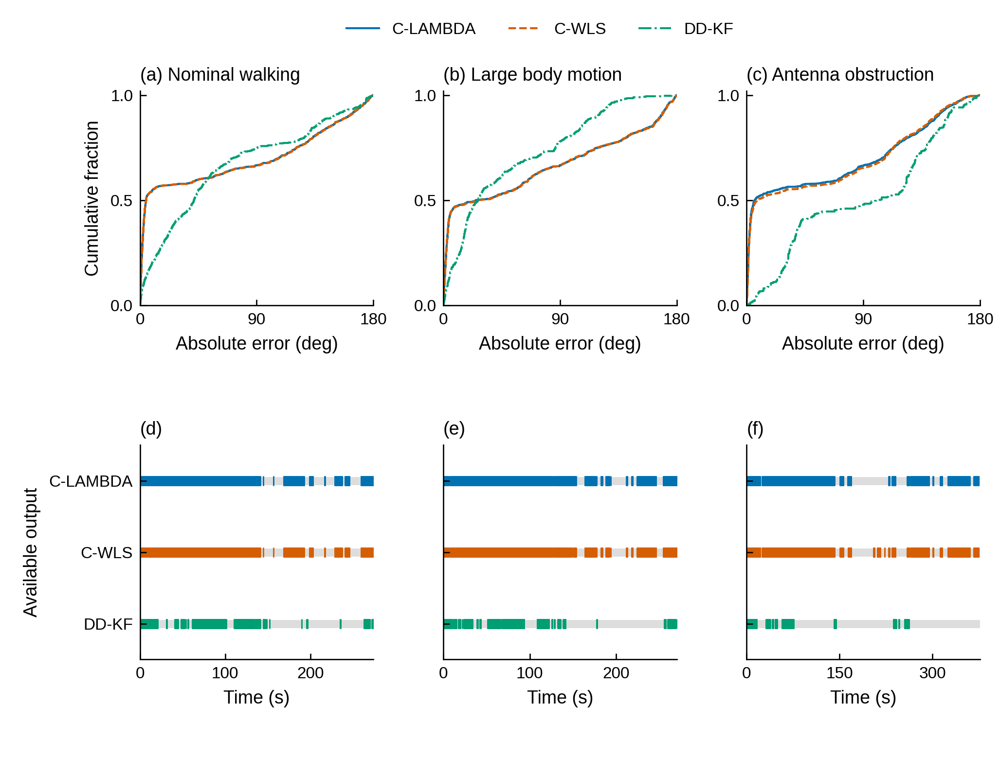

**建议位置：** 补充：原始双天线路线。

**子图怎么读：** 上排三场景绝对方向误差CDF，下排C-LAMBDA/C-WLS/DD-KF的输出时刻。

**合理性判断：** C-LAMBDA与C-WLS相近是已有结果；方向候选未设整数接受检验，有输出不等于正确固定。

**下一步：** 保留路线比较，方法表注明实现身份与接纳规则；不把全部路线混成固定率。

**原图注：** 三种原始双天线观测处理方法在常规行走、大幅机身运动与单侧天线遮挡下的航向误差分布和可用输出。上排为各方法已记录有效输出时刻的绝对方向误差累积分布，下排标出对应输出时间。C-LAMBDA和C-WLS为对应约束目标的独立实现，这些方向候选未设整数接受检验；DD-KF使用保存的双差滤波输出，不插入保持航向。所画方向由横向基线的水平投影换算，并与参考航向比较。

来源阶段：当前结果组图；原PDF：`G:/LegSA-GINS-project/V3五问题论文组图_20261011/heading/SQ2_raw_dual_antenna_methods.pdf`。

## 11. 姿态合图 · 短基线航向与机载倾角观测对姿态估计的影响

**建议位置：** 正文姿态证据。

**子图怎么读：** a–c航向，d–f横滚，g–i俯仰；三列场景相同。上排3配置，下两排只关闭倾角。

**合理性判断：** 航向链带来主要yaw收益；横滚/俯仰收益不同。遮挡pitch仅1.734→1.695°，小收益要保留。

**下一步：** 使用此合图取代正文中的S8/S9；下一步确认事件窗口、标题与结论，不再重复铺两张旧图。

**原图注：** 三列为常规行走、大幅机身运动、单侧天线遮挡；三行分别为航向、横滚、俯仰。上排对照基础配置、加航向与完整方法；下两排对照关闭倾角辅助与完整方法。灰色带为原航向放大范围。

来源阶段：最新正文合图；原PDF：`G:/LegSA-GINS-project/V3五问题论文组图_20261011/attitude_main_20261011/M_attitude_heading_and_tilt.pdf`。

## 12. M5 · 保留航向时的机身速度辅助

**建议位置：** 正文核心：条件平移收益。

**子图怎么读：** a/b一处20 s中断，c/d各时长九布置的全窗RMSE；左全部GNSS损失，右保留方向。

**合理性判断：** 保留方向条件20 s全窗中位数7.961→0.241 m；全部GNSS失效也暂停辅助调度，左列不是只移除方向的独立控制。

**下一步：** 第一优先修改条件标注：移除哪些观测、哪些更新仍发生。把瞬时/末端误差与全窗RMSE清楚区分。

**原图注：** 机身速度辅助在GNSS中断中的条件作用。（a,b）一处20 s中断及恢复过程的水平误差，灰色为中断区间；（b）插图放大中断期间0–2.5 m误差范围。（c,d）同一实测路线中，每种时长九个中断布置的全窗水平RMSE，细线连接相同布置。两列分别为全部GNSS观测中断与保留航向的平移观测中断。所评价实现中，全部GNSS观测中断同时暂停辅助更新。

来源阶段：当前结果组图；原PDF：`G:/LegSA-GINS-project/V3五问题论文组图_20261011/aiding/figures/Q4_body_velocity.pdf`。

## 13. S4 · 保留方向与位置中断中的导航表现

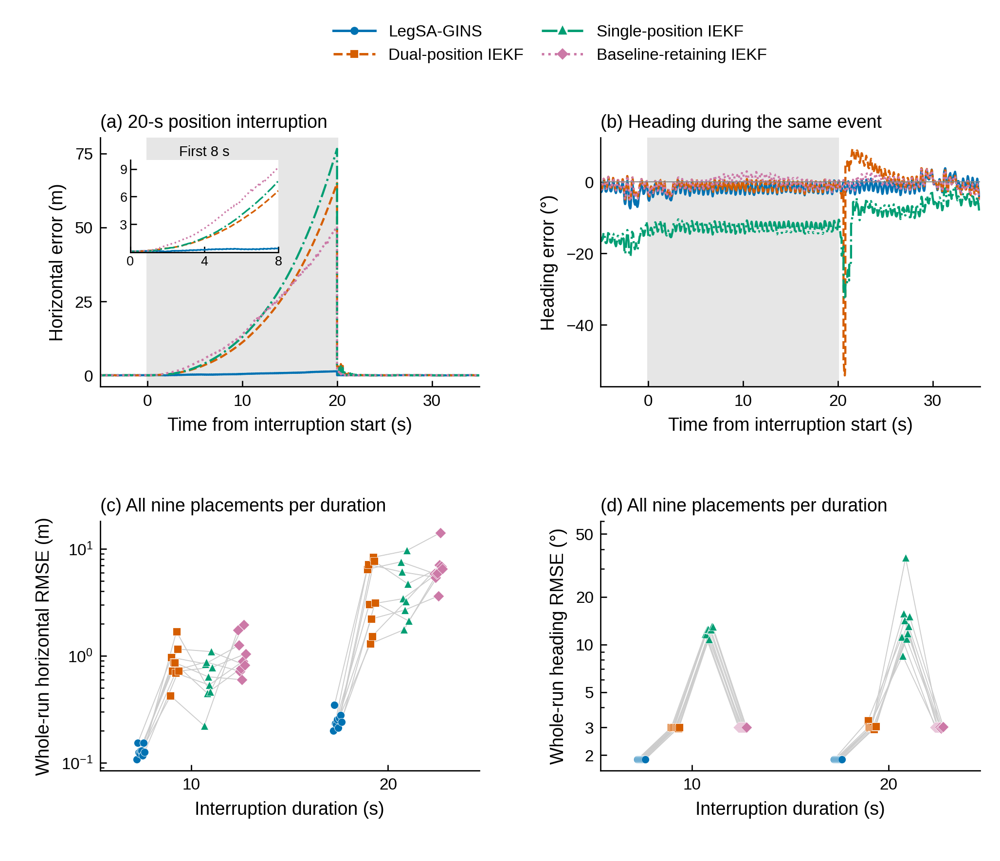

**建议位置：** 正文连接证据或与M5组合。

**子图怎么读：** a/b中断位置和航向，c/d10/20 s各九布置的四方法配对全窗RMSE。

**合理性判断：** 保留基线IEKF保持航向，但18例H中位数2.786 m，大于双位置IEKF1.407 m；V3为0.177 m。方向稳定不自动带来位置稳定。

**下一步：** 与M5分工：M5解释内部速度作用，本图验证外部方向保留反例；可取关键面板进正文，完整分布留补充。

**原图注：** GNSS位置中断时的导航结果。（a,b）首个登记20秒中断的位置和航向误差，灰带表示中断区间，小窗放大中断后的前8秒；双位置和单位置IEKF停止位置更新，保留基线的IEKF继续进行相对基线更新，LegSA-GINS保留可用航向及机身运动辅助。（c,d）全部10秒和20秒中断的整段RMSE，每个时长九个布置；细线连接同一布置的四种方法。保留基线的IEKF维持了航向，但没有自动改善位置结果。对数坐标保留全部有限结果。

来源阶段：当前结果组图；原PDF：`G:/LegSA-GINS-project/V3五问题论文组图_20261011/navigation/Q3_02_heading_retention.pdf`。

## 14. M6 · 来源加权的收益与精度代价

**建议位置：** 正文：质量收益与代价。

**子图怎么读：** a/b代表噪声例H/yaw；c实际R倍率；d发散计数；e513共同完成案例的H配对。

**合理性判断：** 代表例yaw29.799→2.699°，H3.166→3.557 m；发散19→13，配对H差中位+0.981 mm。六例新增完成中两例仍约69°。

**下一步：** 第二优先修改：直接呈现位置代价和完整结果状态；保留配对散点，图注明确R倍率越大信任越低。

**原图注：** 来源加权的收益与位置精度代价。（a,b）已保存的GNSS位置加噪案例中的水平和航向误差，水平标准差3 m、竖直5 m。（c）同次运行三个观测来源的实际协方差放大倍数。（d）541个案例的发散次数；两种配置各另有九例缺少有效初始航向。（e）双方均完成的513例的全窗水平RMSE。等值线下方表示完整方法误差更小，插图放大正常误差量级。案例来自同一实测路线的受控观测扰动。

来源阶段：当前结果组图；原PDF：`G:/LegSA-GINS-project/V3五问题论文组图_20261011/aiding/figures/Q5_source_weighting.pdf`。

## 15. M3 · 自然工况下与双位置IEKF的比较

**建议位置：** 正文：最接近的滤波对照。

**子图怎么读：** 三列场景，上H下yaw，遮挡段局部放大。

**合理性判断：** 自然H接近；常规标定IEKF yaw1.539°优于V3 1.886°。大幅场景几何核查标志需留在比较表。

**下一步：** 保留，密集时序辅以简洁指标；不把参数条件不同的方法写成单一总排名。

**原图注：** 常规行走、大幅机身运动和单侧天线遮挡实验中，LegSA-GINS与双接收机IEKF的水平定位及航向误差。上、下排分别为水平误差和航向误差；两种IEKF配置分别采用文献参数和标定参数。第三组中的灰带表示天线遮挡时段，小窗放大第一个遮挡时段；黑色虚线表示相对于参考值的零误差。

来源阶段：当前结果组图；原PDF：`G:/LegSA-GINS-project/V3五问题论文组图_20261011/navigation/Q3_01_IEKF_natural.pdf`。

## 16. M4 · LegSA-GINS与OiSAM的精度及输出连续性

**建议位置：** 正文：FGO精度与输出覆盖。

**子图怎么读：** a–d同点同时间精度，e全窗三种输出协议，f首次IMU缺口放大。

**合理性判断：** 常规274对，遮挡记录起始54对；后者不是正式遮挡段。单次初始化停止主要由输入IMU缺口引起。

**下一步：** 保留并紧接S5，明确绿线重初始化协议不属于上方严格协议精度曲线。

**原图注：** LegSA-GINS与OiSAM-FGO的精度及输出连续性。（a–d）在同一评价点与匹配时刻比较水平定位和航向误差：常规行走为274个历元，单侧天线遮挡记录起始阶段为54个历元；精度曲线采用仅初始化一次的OiSAM。（e）三条完整记录中，LegSA-GINS、仅初始化一次的OiSAM，以及在实测IMU缺口处分段重新初始化的OiSAM的输出时段。重新初始化的OiSAM行中，空心圆表示仅初始化的状态，线段表示有效动态输出；每个场景内三行按图例顺序排列。（f）放大单侧天线遮挡记录中方框标出的时段，灰带表示首次IMU输入缺口。时间均相对于各评价窗口起点。

来源阶段：当前结果组图；原PDF：`G:/LegSA-GINS-project/V3五问题论文组图_20261011/navigation/Q3_oisam_precision_continuity.pdf`。

## 17. S5 · OiSAM重新初始化后的完整航向比较

**建议位置：** 补充：恢复后的FGO航向。

**子图怎么读：** 左完整共同动态输出，右固定中央窗或首次真实缺口恢复放大。

**合理性判断：** 本次逐文件核对共同点为274/267/367；旧文字369与现用CSV及JSON不符。不是根据误差变坏而任意重启。

**下一步：** 修正旧计数字样；M4正文必须引用本图，避免只展示单次初始化早停。

**原图注：** OiSAM在实测IMU缺口处重新初始化后的航向误差。左列展示三条记录全部匹配动态输出历元，右列分别放大常规行走的固定中间时段，以及另外两条记录评价窗内的首次恢复过程。左图浅色带表示放大区间，右图深灰带表示实测IMU缺口。仅初始化状态不进入曲线，动态输出缺失处断线。两方法使用相同名义评价秒及一致航向定义；本图不混用原评价中不同的位置参考点。

来源阶段：当前结果组图；原PDF：`G:/LegSA-GINS-project/V3五问题论文组图_20261011/navigation/Q3_03_OiSAM_reinitialized_heading.pdf`。

## 18. S6 · 全部外部退化类型的配对比较

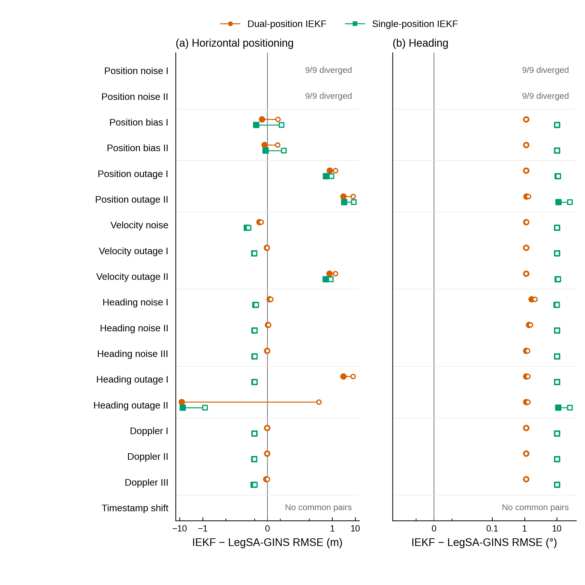

**建议位置：** 补充：全部退化类别。

**子图怎么读：** 左右为H/yaw；横轴IEKF减V3的RMSE差，实心中位数、空心P95。

**合理性判断：** 正值为V3误差较低，负值为IEKF较低；连线不是置信区间。发散和无共同支持另列。部分扰动未进入外部方法。

**下一步：** 补实心/空心图例和故障强度索引。保持分类呈现，不合成异质故障总排名。

**原图注：** 全部18种登记退化类型的配对RMSE差。实心点为共同有限样本中“外部IEKF减LegSA-GINS”的中位数，空心点为95百分位，连线表示二者之间的区间；每种退化登记九个案例。负值表示IEKF误差较低。两种位置噪声下，两种IEKF均各9/9发散；时间戳扰动无有效共同配对。对称对数轴同时保留小差值和大偏离。部分速度、多普勒及航向故障作用于外部滤波器未读取的通道，属于输入等价控制。完整类型定义、396条逻辑结果和744条配对汇总随图交付。

来源阶段：当前结果组图；原PDF：`G:/LegSA-GINS-project/V3五问题论文组图_20261011/navigation/Q3_04_all_degradation_pairs.pdf`。

## 19. S7 · 不同GNSS信息处理路线的定位结果

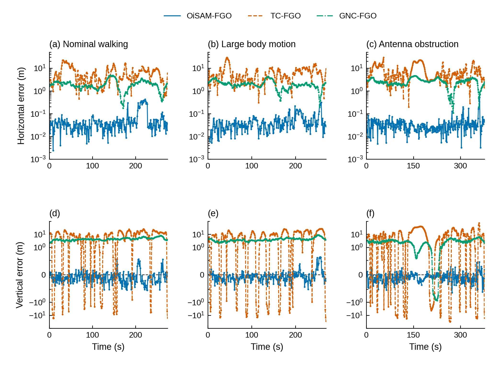

**建议位置：** 补充：不同GNSS处理路线。

**子图怎么读：** 三场景上H对数、下Up对称对数；OiSAM、TC-FGO、GNC-FGO。

**合理性判断：** 均在GNSS1天线点；输入分别RTK/原始码/码+Doppler。与M4的中点、严格协议和共同时间支持不同。此图蓝线为OiSAM。

**下一步：** 保留背景信息，不能直接把此处OiSAM曲线接入M4定位比较；下一版统一跨图方法颜色。

**原图注：** 常规行走、大幅机身运动和单侧天线遮挡实验中，OiSAM-FGO、TC-FGO和GNC-FGO在GNSS1天线位置上的水平与高程误差。缺测和OiSAM-FGO分段边界处断线。水平误差用对数尺度，高程误差用零附近保持线性的对称对数尺度。 OiSAM在实测IMU缺口处重新初始化，仅初始化的状态不计入曲线。OiSAM使用RTK位置与IMU，TC-FGO使用原始码及适配姿态/速度输入，GNC-FGO使用原始码和Doppler；三条路线的输入信息不同。

来源阶段：当前结果组图；原PDF：`G:/LegSA-GINS-project/V3五问题论文组图_20261011/navigation/Q3_05_FGO_position.pdf`。

## 20. S9 · 基础GNSS/INS加入双天线航向的作用

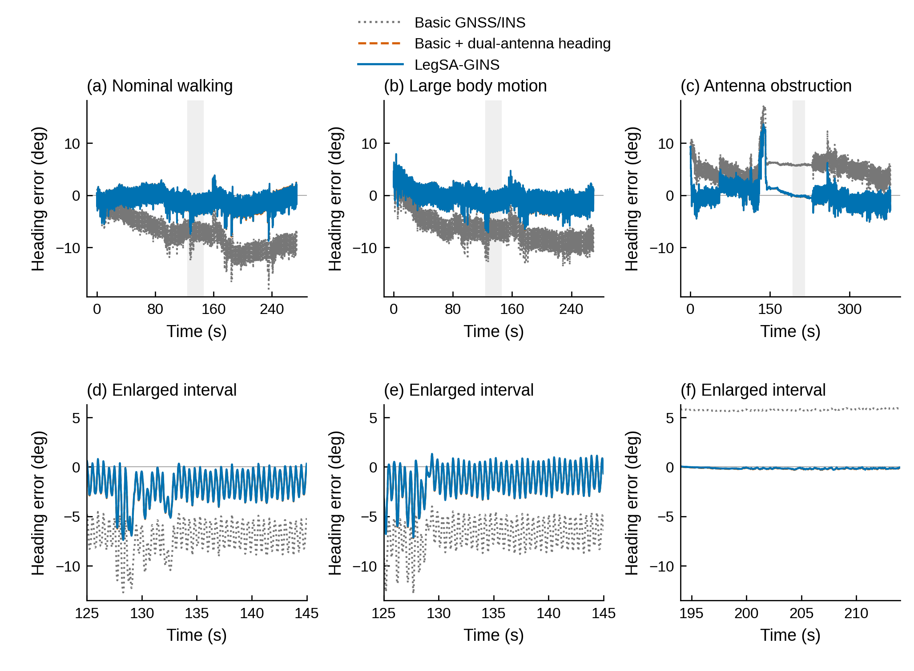

**建议位置：** 姿态合图的展开来源版本。

**子图怎么读：** 上排三场景全窗yaw，原下排为三个较大的局部窗口。

**合理性判断：** 数据已纳入新姿态合图；原放大窗更大，适合检查曲线细节。

**下一步：** 完整保留供核对，正文不与合图重复。

**原图注：** 基础GNSS/INS、基础配置加入双天线航向更新以及完整LegSA-GINS的航向误差。三列依次为常规行走、大幅机身运动与单侧天线遮挡。（a–c）完整误差时序，灰色区间在（d–f）放大。三种配置共享初始方向；前两种配置用于解释加入双天线航向链的作用，完整方法还包含其他辅助。

来源阶段：当前结果组图；原PDF：`G:/LegSA-GINS-project/V3五问题论文组图_20261011/aiding/figures/S_Q4_heading_information.pdf`。

## 21. S8 · 机载倾角辅助与姿态误差

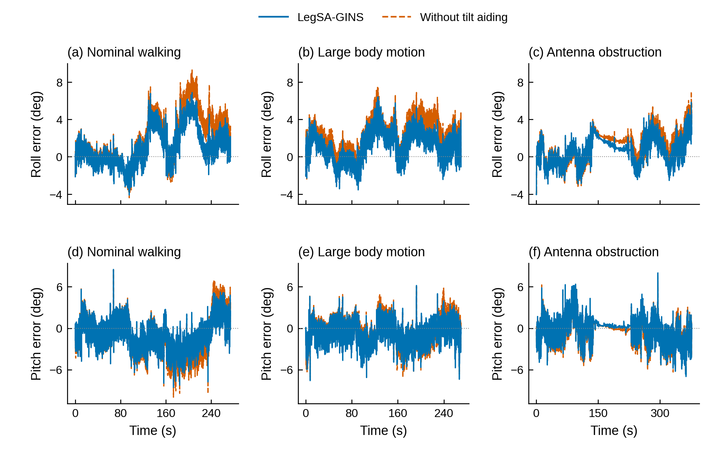

**建议位置：** 姿态合图的展开来源版本。

**子图怎么读：** 三列场景，上roll下pitch；蓝完整、橙关闭倾角。

**合理性判断：** 与新图紫色对照含义相同，只是旧版颜色不同。519个派生共同案例的RP结论来自配表，不是图中三次自然记录的样本数。

**下一步：** 来源保留；不作为又一次独立实验重复计数。

**原图注：** 三条实测序列中机身倾角辅助对横滚、俯仰误差的影响。蓝线为完整方法，橙色虚线为关闭倾角辅助；每列对应一个序列，上下分别为横滚和俯仰。

来源阶段：当前结果组图；原PDF：`G:/LegSA-GINS-project/V3五问题论文组图_20261011/aiding/figures/S_Q4_tilt_aiding.pdf`。

## 22. 旧S13 · NMB长缺测与XB初始化边界

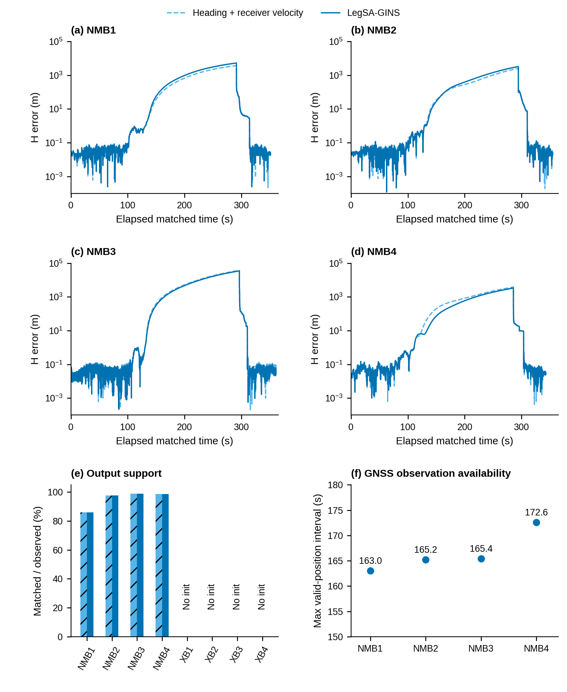

**建议位置：** 另版本的失效边界。

**子图怎么读：** a–d四条NMB长缺测误差，e16个组合输出支持，f有效GNSS位置最长间隔。

**合理性判断：** NMB长间隔约163–173 s后出现公里漂移；XB没有有效初始双固定航向，零指输出支持。使用R5 T03另版本。

**下一步：** 独立补充/讨论，明确与冻结V3版本不同；保留失败证据，不填零误差。

**原图注：** Separate R5 T03 implementation, binary c53784f4…, input-derived body time shift −1.1 s and reference interpolation bracket 0.15 s; this is not the original V3 binary. (a–d) All saved matched H error samples from four NMB recordings, plotted on logarithmic axes; F03 and F04 have the same matched times. Native processes completed but the trajectories drifted by kilometres. (e) Matched/observed-record support for all sixteen method–sequence combinations. XB1–4 have no valid dual-fixed-heading initialization and no error score; the zero denotes output support only. (f) Longest intervals between adjacent valid GNSS position observations, including endpoints, not exact continuous-invalid durations. No gap positions are inferred or shaded.

来源阶段：历史初版；原PDF：`G:/LegSA-GINS-project/V3论文组图_20261008/figures/S13_R5_T03_NMB_XB_failure.pdf`。

## 23. 旧S14 · 另版本失锁域和恢复过程

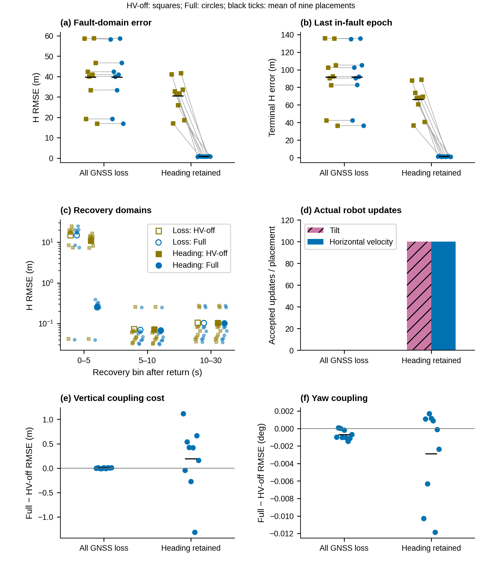

**建议位置：** 另版本的失锁与恢复诊断。

**子图怎么读：** 故障域、末端、恢复域误差，实际辅助更新数，垂向和航向代价。

**合理性判断：** 已有末端/恢复结果；全GNSS loss辅助更新0，保留方向时各辅助100次。来源为explicit-IMU-duration另版本。

**下一步：** 不跨版本拼到M5数值中；作为已有机制诊断入口，先核对版本再用。

**原图注：** Separate explicit-IMU-duration diagnostic IMU_V3_CLAIM_SUBSET_20261004T064538Z, binary 7ca1568e…, not original V3. Both registered 20 s conditions retain all nine placements. (a–b) Paired saved fault-domain RMSE and error at the last observed epoch strictly inside the fault; black ticks are arithmetic means of nine placement values, not epoch-pooled RMSE. Fault intervals are [start,end). (c) Saved domains (end,end+5], (end+5,end+10], (end+10,end+30], with each point and mean. (d) Actual accepted robot updates tied to GNSS event indices; both sources have 0 updates in D61 and 100 per placement in D62. (e–f) Paired fault-domain vertical/yaw differences retain coupled costs. All common observed denominators are unchanged; no interpolation or full-window substitution.

来源阶段：历史初版；原PDF：`G:/LegSA-GINS-project/V3论文组图_20261008/figures/S14_IMU135_fault_terminal_recovery.pdf`。

## 24. 旧S15 · 记录缺口与共同支持敏感性

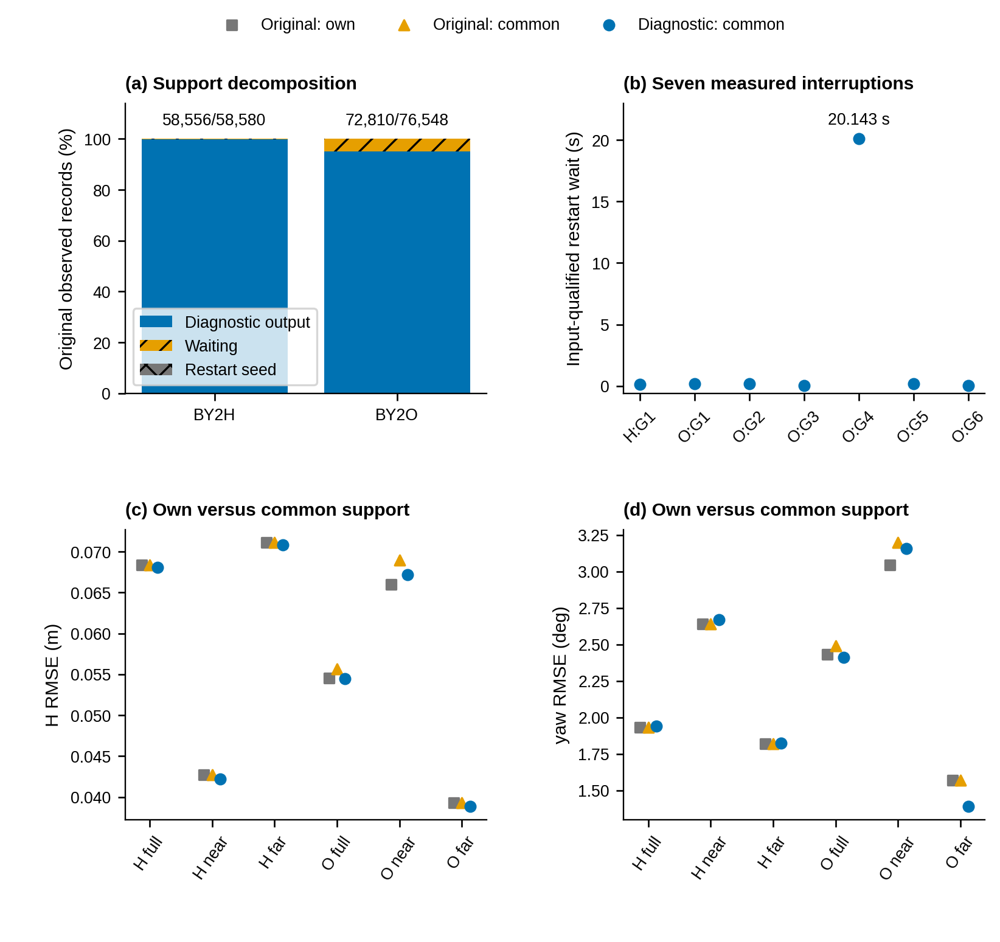

**建议位置：** 另版本的记录缺口与共同支持诊断。

**子图怎么读：** 输出/等待/重启分解、初始化等待、全窗与缺口邻域的H/yaw。

**合理性判断：** 诊断版同时改IMU时长、方向模型/协方差并增加重启；误差差异不能全部归因于重启。

**下一步：** 补充历史诊断，图中旧内部场景名需在投稿版更新。

**原图注：** Original V3 versus the separately identified segmented compound diagnostic. All 22 method–sequence members and seven internal IMU interruptions are retained in source tables; (c–d) display Full for clarity. (a) Each method retains 58,556/58,580 observed epochs in BY2H and 72,810/76,548 in BY2O, with 23/3,732 waiting records and 1/6 restart seeds. (b) Restart wait measured from next recorded segment start to valid position-and-heading initialization, maximum 20.142953 s. (c–d) Full, fixed near-gap union and its complement: original own, original exact-common, diagnostic exact-common support. The diagnostic also changes IMU-duration/heading/Jacobian/covariance processing and adds restart initialization, so differences are compound version and support sensitivity. Physical gaps have no measured records; no artificial epochs, gap interpolation or scores are introduced.

来源阶段：历史初版；原PDF：`G:/LegSA-GINS-project/V3论文组图_20261008/figures/S15_GAP22_common_support_restarts.pdf`。

## 25. 旧M02 · 共同导航状态与辅助依赖

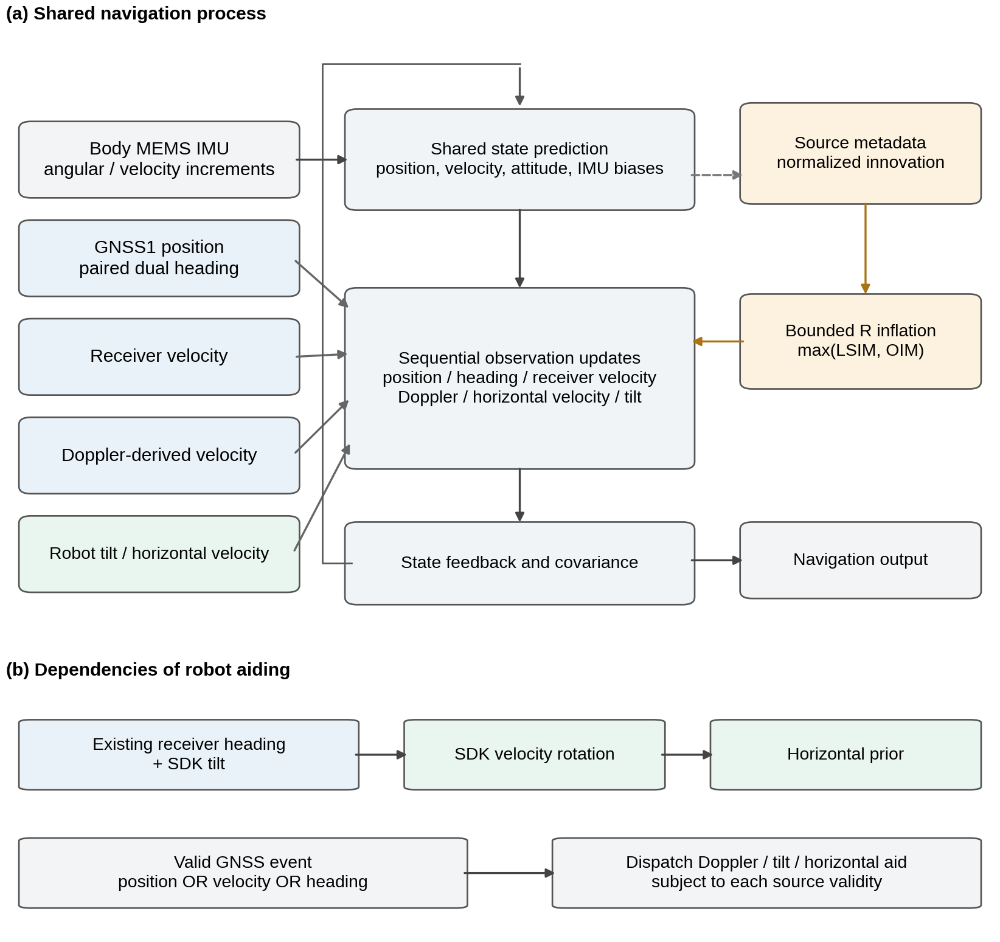

**建议位置：** 历史来源与覆盖核查。

**子图怎么读：** 看航向、机器人倾角与水平速度如何进入同一导航状态。沿箭头读传播、量测更新和反馈，并留意速度旋转与更新时刻的依赖。

**合理性判断：** 这是已完成图件的来源/早期呈现版本。与当前图有重叠时，不作为新的独立实验重复计数；原值和原版本说明保留。

**下一步：** 通过当前结果图与比较去向表决定引用位置；保留这份原图供完整性核查。

**原图注：** (a) Frozen V3 state prediction, sequential observation updates and feedback. The six active observation roles share one error-state covariance; six scale-error slots remain frozen, giving 15 active error states. Source-quality LSIM and normalized-innovation OIM only inflate R within per-source caps. (b) Horizontal-velocity priors use the existing A1 heading and SDK tilt at provider construction; this is not a contact/FK factor or an independent heading-free leg odometer. Doppler, tilt and horizontal-velocity updates are dispatched by a valid GNSS event and retain their own source-validity conditions. Inflation caps do not prove bounded statistical influence or integrity.

来源阶段：历史初版；原PDF：`G:/LegSA-GINS-project/V3论文组图_20261008/figures/M02_shared_state.pdf`。

## 26. 旧M03 · 三个自然序列的位置与姿态表现

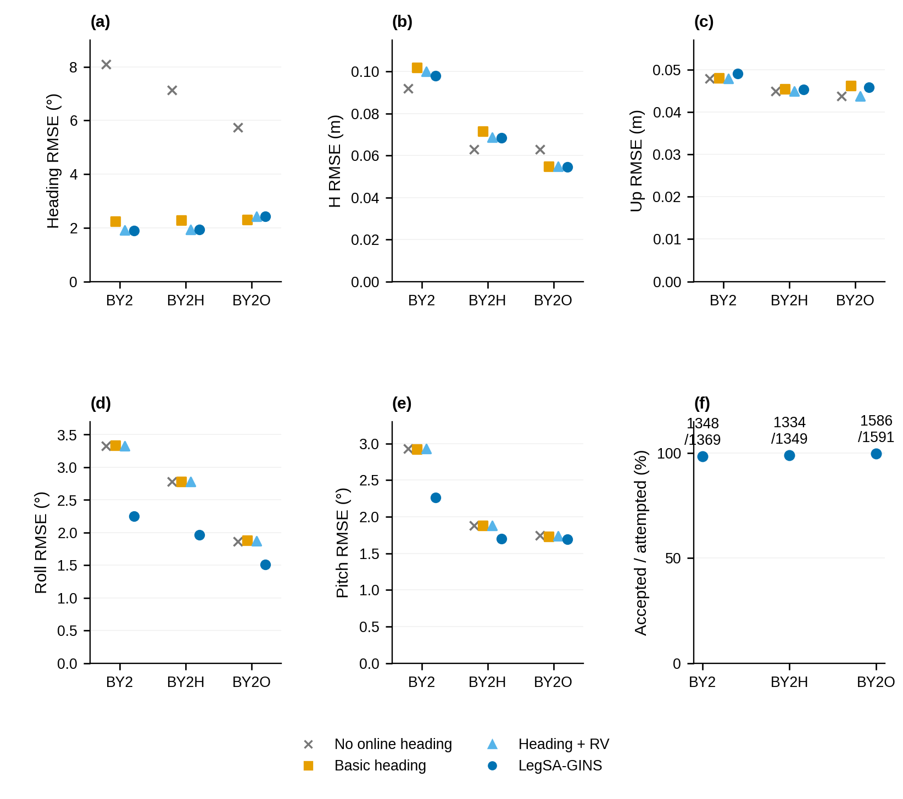

**建议位置：** 历史来源与覆盖核查。

**子图怎么读：** 比较三条记录上的位置与姿态误差，并看航向量测实际被接受的比例。点越低表示对应RMSE越小；不同误差分量分别读，不能只看一个总名次。

**合理性判断：** 这是已完成图件的来源/早期呈现版本。与当前图有重叠时，不作为新的独立实验重复计数；原值和原版本说明保留。

**下一步：** 通过当前结果图与比较去向表决定引用位置；保留这份原图供完整性核查。

**原图注：** Natural fixed-window outcomes on BY2, BY2H and BY2O. Each marker is one method on one recording, not a mean over independent trials. (a-e) Sample-based RMSE relative to the commercial fusion reference at the declared v3 point. All methods share the initial dual-heading seed; F01 disables online heading updates, while F02 disables receiver-velocity updates. Matched/native outputs are 56642/56642, 58580/58580 and 76548/76548. (f) Frozen F04 accepted/attempted scalar-heading counts: 1348/1369, 1334/1349 and 1586/1591. Heading improvement does not imply better horizontal position on every sequence; F02 has lower full-window heading RMSE on BY2O.

来源阶段：历史初版；原PDF：`G:/LegSA-GINS-project/V3论文组图_20261008/figures/M03.pdf`。

## 27. 旧M04 · 机身倾角与水平速度的条件互补

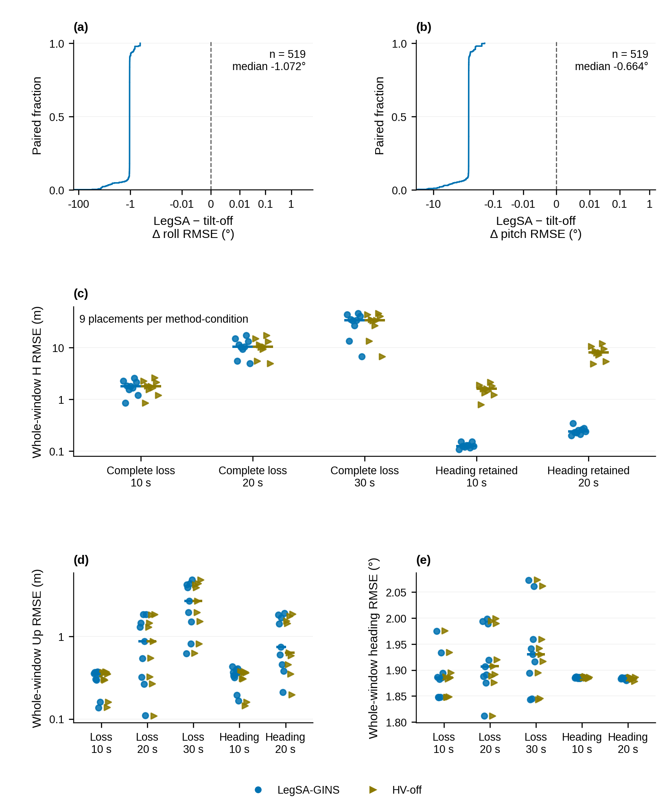

**建议位置：** 补充总体统计，可支持正文姿态图。

**子图怎么读：** 519配对roll/pitch变化及9布置中断统计。

**合理性判断：** 负差为完整方法误差更低；519是扰动案例配对，不是519次独立实地试验。

**下一步：** 保留其姿态总体统计，时序解释由新合图与M5承担。

**原图注：** Conditional robot aiding in original frozen V3. (a,b) Empirical distributions of F04 minus tilt-off roll/pitch RMSE for 519/541 common finite CORE cases; every roll/pitch pair improves. (c-e) Each point is one of nine registered placements on the same BY2 recording; short ticks mark the nine-placement median. In (d,e), Loss means complete GNSS loss and Heading means retained heading. Complete GNSS loss A1 removes position, receiver velocity, raw-Doppler velocity and heading for 10/20/30 s; auxiliary updates are blocked by the original event scheduler. Translation loss A2 removes position and GNSS velocity products for 10/20 s but retains heading and the original SDK horizontal-velocity input. Values are whole-window (66-340 s) case RMSE, not outage-period RMSE. At A2 20 s, median H RMSE is 0.240759 m with F04 and 7.960869 m without HV. The condition is not complete GNSS-denied navigation; vertical/heading costs and all placements remain visible. No independent-trial significance claim is made.

来源阶段：历史初版；原PDF：`G:/LegSA-GINS-project/V3论文组图_20261008/figures/M04.pdf`。

## 28. 旧M05 · 来源加权的完成改善与精度代价

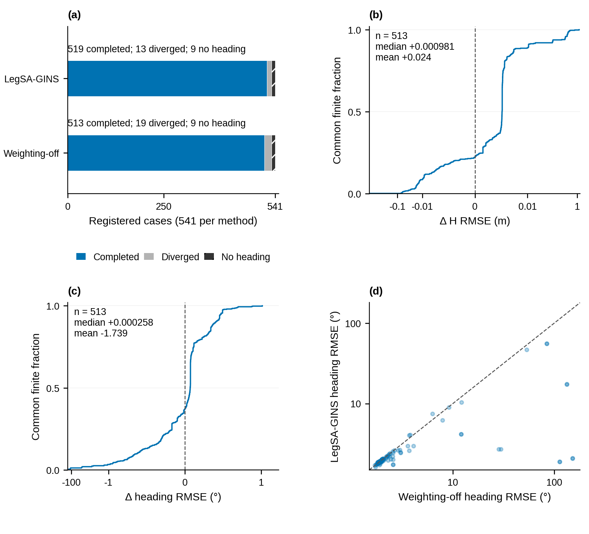

**建议位置：** 历史来源与覆盖核查。

**子图怎么读：** Δ为完整加权方法减去关闭加权后的误差，正值表示加权增加了该项误差。先看完成数量，再看同一批配对案例中普通误差与大误差的变化。

**合理性判断：** 这是已完成图件的来源/早期呈现版本。与当前图有重叠时，不作为新的独立实验重复计数；原值和原版本说明保留。

**下一步：** 通过当前结果图与比较去向表决定引用位置；保留这份原图供完整性核查。

**原图注：** Source-aware weighting trades typical finite-case accuracy for conditional protection. (a) All 541 registered CORE cases per method: weighting-off completes 513, diverges in 19 and has no valid heading in 9; F04 completes 519, diverges in 13 and has no valid heading in 9. Completion is not an accuracy or integrity guarantee: two of the six extra completions have heading RMSE near 69°. (b,c) F04 minus weighting-off on the same 513 finite case keys, with symlog abscissae to show both small typical differences and large tails. H median delta is +0.000981210 m (398/513 cases higher), heading median delta +0.000257994° while mean delta is -1.738980°. (d) The same 513 heading pairs, with the equality line. All exposures reuse one real BY2 recording; failed cases are accounted for in (a), not filled with zero in finite plots.

来源阶段：历史初版；原PDF：`G:/LegSA-GINS-project/V3论文组图_20261008/figures/M05.pdf`。

## 29. 旧M06 · 最接近两位置IEKF的分条件比较

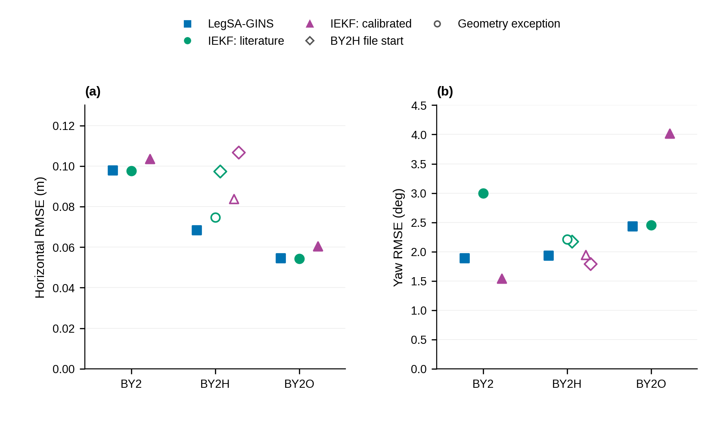

**建议位置：** 历史来源与覆盖核查。

**子图怎么读：** LIT使用文献参数，S使用BY2标定参数；两者都是双位置接收机IEKF。空心点标记基线几何检查异常的运行，再分别读水平位置与航向误差。

**合理性判断：** 这是已完成图件的来源/早期呈现版本。与当前图有重叠时，不作为新的独立实验重复计数；原值和原版本说明保留。

**下一步：** 通过当前结果图与比较去向表决定引用位置；保留这份原图供完整性核查。

**原图注：** Saved full-window horizontal and yaw RMSEs on each method's own support. LegSA-GINS uses frozen V3; the two-position IEKF uses literature (LIT) or project-calibrated (S) parameters. BY2H contract-start estimates are open symbols; two additional file-start diamonds retain all four IEKF geometry-audit exceptions. The exception applies to both panels and is not an accuracy pass. Matched full-rate samples for V3 are 56642/58580/76548 and for each IEKF start 58014/59934/78441 on BY2/BY2H/BY2O. These correlated epochs are not independent trials. The calibrated IEKF has lower BY2 yaw RMSE; the literature IEKF has slightly lower BY2O horizontal RMSE. Inputs, active states and output supports differ. LIT selection occurred after results were seen; S shares BY2 development calibration. The declared v3 midpoint contract and shared-GNSS commercial reference do not establish independently measured point equivalence or independent truth.

来源阶段：历史初版；原PDF：`G:/LegSA-GINS-project/V3论文组图_20261008/figures/M06.pdf`。

## 30. 旧M07 · 动基线方向误差与有效支持

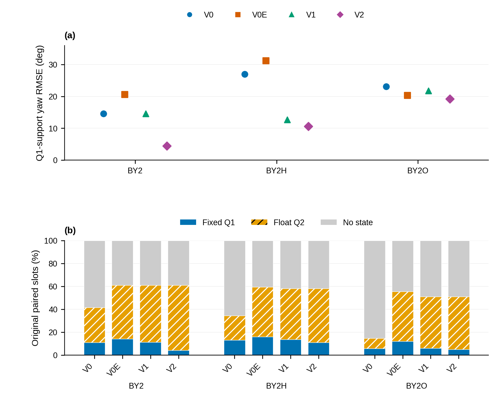

**建议位置：** 历史来源与覆盖核查。

**子图怎么读：** 四组是同一动基线程序的工程配置：原配置、改变星历、扩展星座和fix-and-hold。把航向误差与可输出比例一起读，避免仅由低误差选出覆盖率很低的条件。

**合理性判断：** 这是已完成图件的来源/早期呈现版本。与当前图有重叠时，不作为新的独立实验重复计数；原值和原版本说明保留。

**下一步：** 通过当前结果图与比较去向表决定引用位置；保留这份原图供完整性核查。

**原图注：** All four HX07R conditions of the same official RTKLIB 2.4.3_b34 program. (a) RMSE on each condition's Q1 fixed support. (b) Fixed Q1, float Q2 and no-state fractions retain original 5 Hz paired denominators of 1370/1350/1885 on BY2/BY2H/BY2O; Q5 count is zero in these windows. Native-valid in this saved contract is Q1 and is not a second independent success class. V0 is the original condition; V0E changes ephemeris, V1 expands constellations, and V2 uses fix-and-hold. Their Q1 counts are 153/179/112, 194/217/231, 154/186/117, and 60/149/93, respectively. Q1 does not prove correct integer ambiguities; no held solution is inserted into new fixed support. The plotted quantity is lateral-baseline projected heading versus a fused Euler-yaw reference. These conditions are neither four independent papers nor a same-information comparison against fused V3 navigation.

来源阶段：历史初版；原PDF：`G:/LegSA-GINS-project/V3论文组图_20261008/figures/M07.pdf`。

## 31. 旧S01 · 全部自然配置

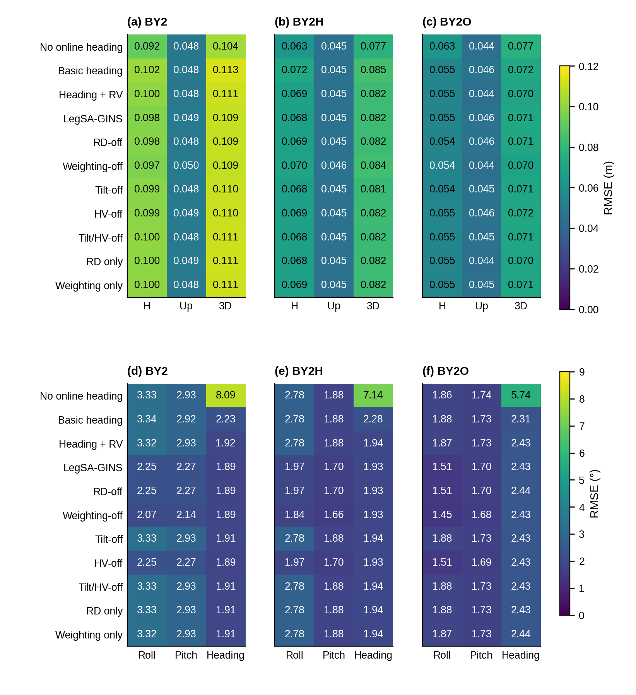

**建议位置：** 补充统计。

**子图怎么读：** 11配置×3场景的位置与姿态RMSE热图。

**合理性判断：** 各物理单位独立色标；自然单场景三指标不能混作同一排名。

**下一步：** 保留完整配置覆盖，正文只选必要控制。

**原图注：** All eleven original V3 natural configurations on all three recordings. Every cell is the fixed-window RMSE of one method-recording output at the declared v3 point; there are no independent replicate error bars. Position quantities share metres; attitude quantities share degrees with separate colour scales. The original exact tokens and matched/native denominators are in the source CSV. F01 shares the initial heading seed, F02 omits receiver velocity, and only the four single-switch ablations isolate RD, weighting, tilt and HV separately. Relative position/attitude trade-offs are retained, including lower BY2O heading error from F02 and lower BY2/BY2H horizontal error from F01.

来源阶段：历史初版；原PDF：`G:/LegSA-GINS-project/V3论文组图_20261008/figures/S01.pdf`。

## 32. 旧S02 · 全部扰动类型的误差和失败

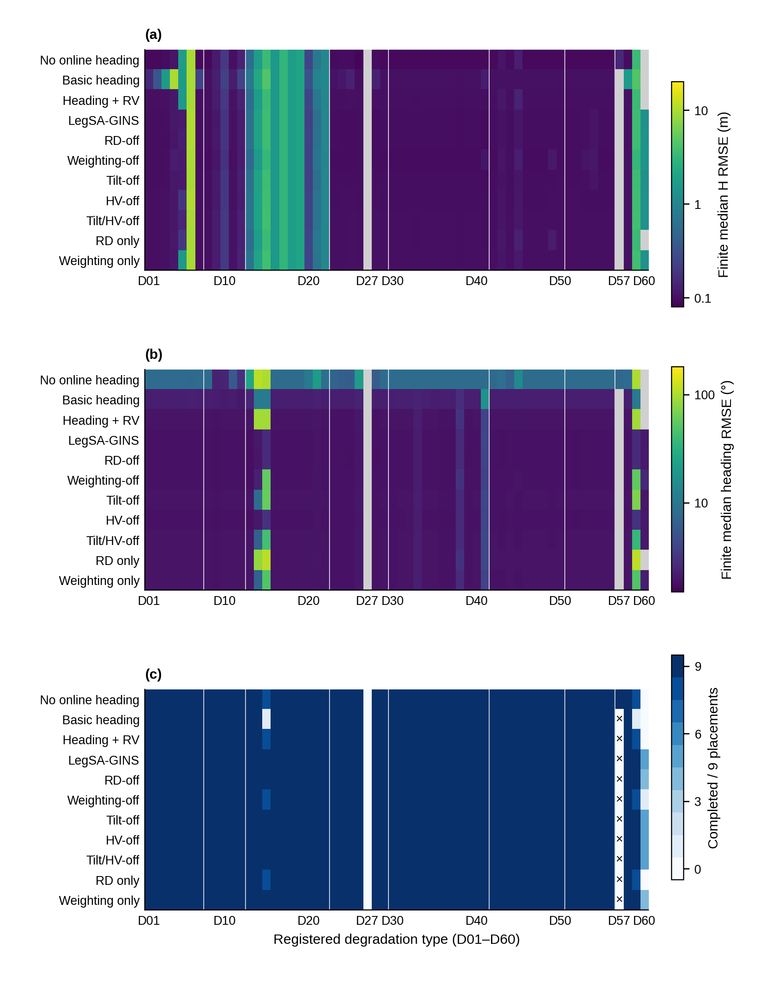

**建议位置：** 补充统计。

**子图怎么读：** 60扰动类别×11配置的有限误差中位数与完成数。

**合理性判断：** 空白/失败和有限成绩一起读；有结果的中位数不能替代完成率。

**下一步：** 保留全矩阵，避免用正文代表例替代全部结果。

**原图注：** All D01-D60 types and all eleven configurations in the original CORE cohort. Each type has nine controlled placements/realisations on the same underlying BY2 recording, not nine independent field trials. (a,b) Median of finite case RMSE values, with separate log colour scales for metres and degrees. Grey denotes no finite output and is not zero error. (c) Native completions out of the nine registered placements; × identifies types with all nine failing for absent valid heading. The clean C00 case is excluded here because its denominator is one. Boundaries follow the registered family order, not result-based reordering. F04 has all-nine divergence in D27, all-nine no-heading outcomes in D57, and four divergences in D60. Exact per-cell denominators and failure classifications remain in CORE5951.csv.

来源阶段：历史初版；原PDF：`G:/LegSA-GINS-project/V3论文组图_20261008/figures/S02.pdf`。

## 33. 旧S03 · 全部单开关模块效果

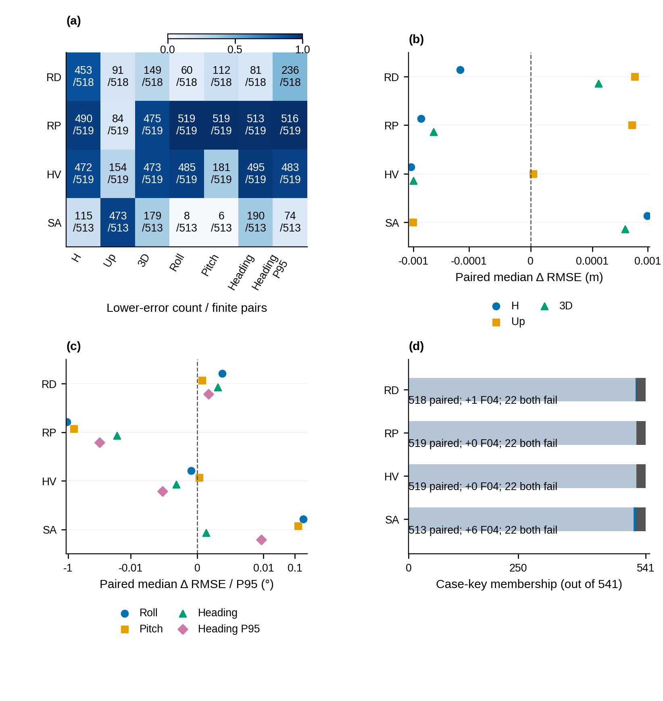

**建议位置：** 补充统计。

**子图怎么读：** Doppler、来源加权、倾角、水平速度的单开关配对作用及状态。

**合理性判断：** 一个观测可改善某分量又增加另一分量误差，配对数各不同。

**下一步：** 保留完整消融覆盖，正文机制图对应引用。

**原图注：** All four single-switch module ablations, with original v3 statistics. (a) Lower-error count divided by the common finite-pair denominator for seven endpoints. (b) Paired median changes for H, Up and 3D in metres. (c) Paired median changes for roll, pitch, heading RMSE and heading absolute-error P95 in degrees; this P95 is an epoch-error statistic, distinct from the across-case RMSE P95. Symlog abscissae retain opposite signs and small changes without clipping tails. (d) Disjoint case-key memberships among 541 registered cases: jointly finite, F04-only completion and both failed; no ablation-only completion occurs in these four comparisons. All descriptors are conditional on the same underlying route and do not establish independent-population significance. Negative changes mean lower error, but each source has costs in other endpoints.

来源阶段：历史初版；原PDF：`G:/LegSA-GINS-project/V3论文组图_20261008/figures/S03.pdf`。

## 34. 旧S04 · 核心案例误差长尾与失败

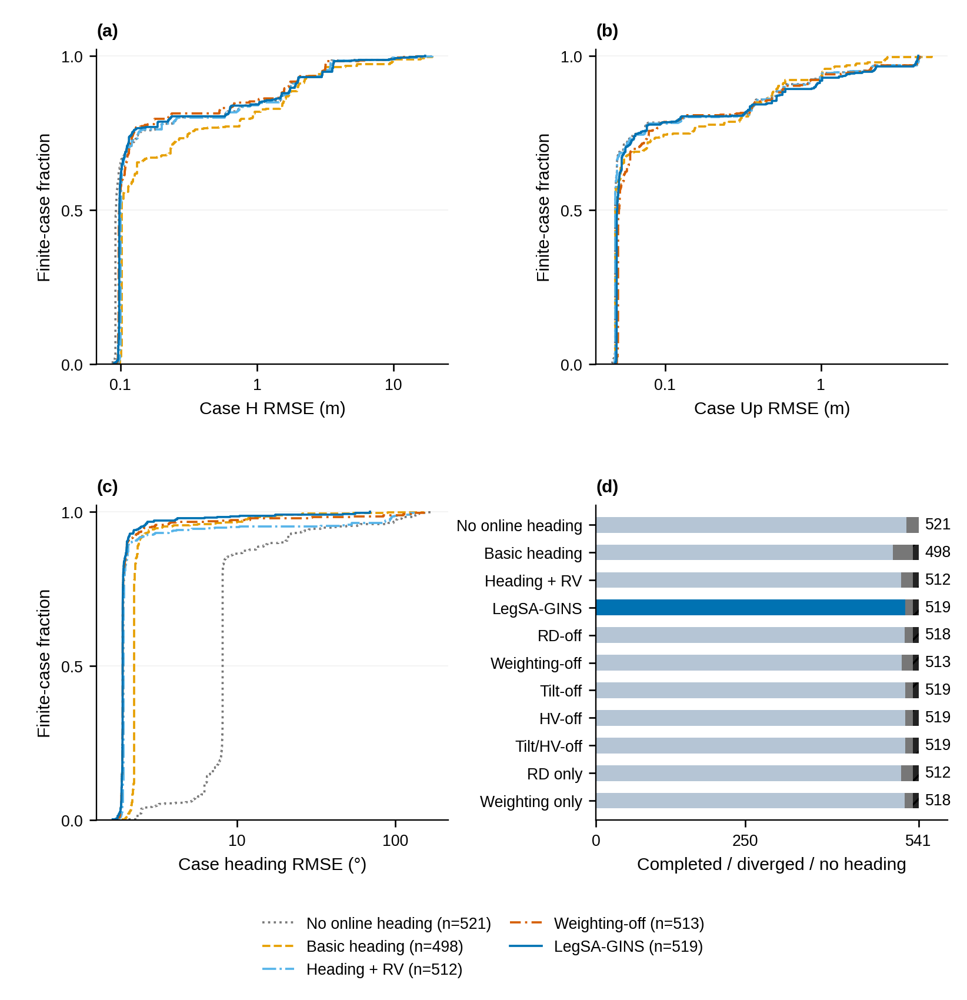

**建议位置：** 补充统计。

**子图怎么读：** 核心案例的误差长尾与未完成状态。

**合理性判断：** CDF是在有限案例上；失败不能视为零误差或从分母无声删除。

**下一步：** 作为代表结果外的完整误差分布支持。

**原图注：** Finite-case error distributions and the complete failure denominator. (a-c) ECDFs of whole-window case RMSE for five primary configurations; log axes retain the observed tails. Curves use each method’s finite cases (F01 521, F02 498, F03 512, weighting-off 513, F04 519), so they are conditional distributions and not a shared-support ranking. F04 H median/P95/max are 0.098228/3.551050/17.035245 m and heading 1.886272/2.446538/69.269924°; its worst 5% means use 26 finite cases and are 6.060571 m and 15.789495°. (d) All eleven methods retain 541 registered cases, with completed, diverged and no-heading sections; printed numbers are completions. Failures are not assigned zero or included as finite-tail observations. These are semisynthetic exposures on one route, not field failure probabilities.

来源阶段：历史初版；原PDF：`G:/LegSA-GINS-project/V3论文组图_20261008/figures/S04.pdf`。

## 35. 旧S05 · 全部追加失锁条件和状态

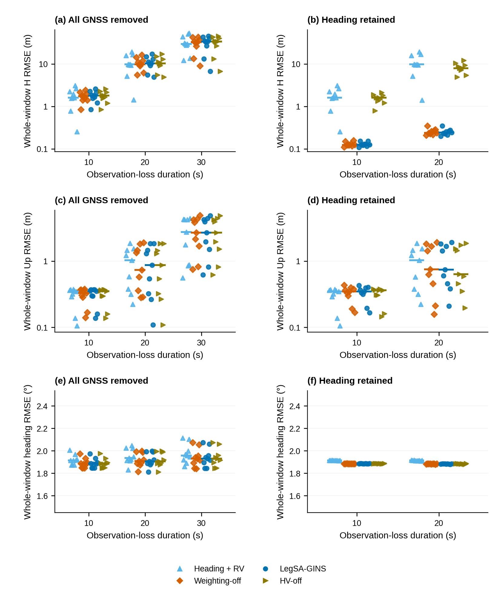

**建议位置：** 补充统计。

**子图怎么读：** 全部追加中断时长、观测条件和配置结果。

**合理性判断：** 全窗RMSE、完成状态、方向是否保留应一起解释。

**下一步：** 保留完整追加条件，M5只承担核心比较。

**原图注：** Original V3 addendum duration and source-availability sensitivity. A1 has three durations and A2 two; every method-duration condition contains all nine registered placements on the same BY2 recording. Points are individual whole-window (66-340 s) case RMSE; short ticks show nine-placement medians, not inferential confidence intervals. Four fixed configurations are displayed: the heading/receiver-velocity backbone (F03), weighting-off (A04), F04 and horizontal-velocity-off (A06). F03 differs by multiple module switches and is not a single-switch causal comparison. H, Up and heading use separate unit axes, with matching limits for the two information-loss families. A1’s large translation drift and A2’s vertical/heading costs remain visible. All 495 registered addendum runs completed, but completion does not imply accurate full-GNSS-loss navigation.

来源阶段：历史初版；原PDF：`G:/LegSA-GINS-project/V3论文组图_20261008/figures/S05.pdf`。

## 36. 旧S06 · 严格与分段OiSAM支持

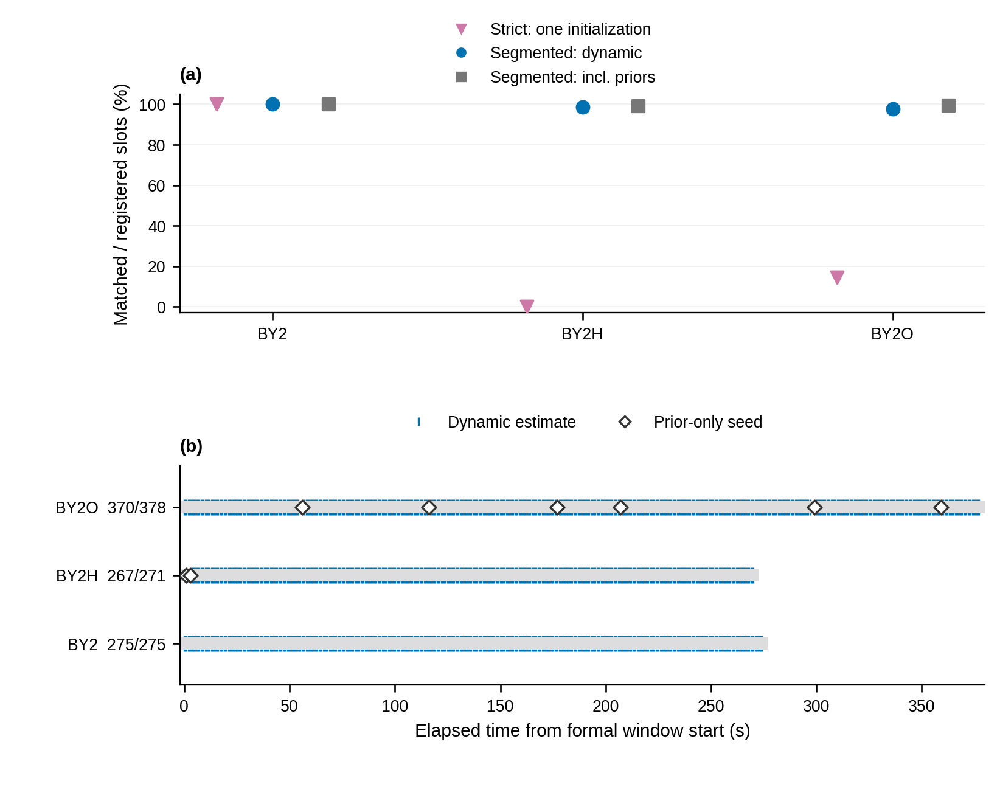

**建议位置：** 历史来源与覆盖核查。

**子图怎么读：** 看同一方法在完整连续处理和分段处理中的输出连续性。时间条将缺输出和段首初始化点分开，帮助解释为什么全窗误差还需要结合实际可用输出读。

**合理性判断：** 这是已完成图件的来源/早期呈现版本。与当前图有重叠时，不作为新的独立实验重复计数；原值和原版本说明保留。

**下一步：** 通过当前结果图与比较去向表决定引用位置；保留这份原图供完整性核查。

**原图注：** OiSAM support under three separate reporting contracts. Strict once-only A1 initialization gives 275/275, 0/271 and 55/378 matched slots. Later source-continuous block execution gives dynamic support 275/275, 267/271 and 370/378; prior-inclusive secondary position support is 275/275, 269/271 and 376/378. The saved primary grids in (b) retain missing slots and prior-only seeds, which are excluded from primary metrics. BY2/BY2H/BY2O use 1/3/7 predeclared input blocks and 11 A1 initializations overall; no result-dependent reset was applied within a block. Three new Oi runs were executed and six original Wen/GNC batch identities were reused. Strict no-output states are not zero errors, and additional initialization changes the information contract.

来源阶段：历史初版；原PDF：`G:/LegSA-GINS-project/V3论文组图_20261008/figures/S06.pdf`。

## 37. 旧S07 · FGO位置与自行估计姿态

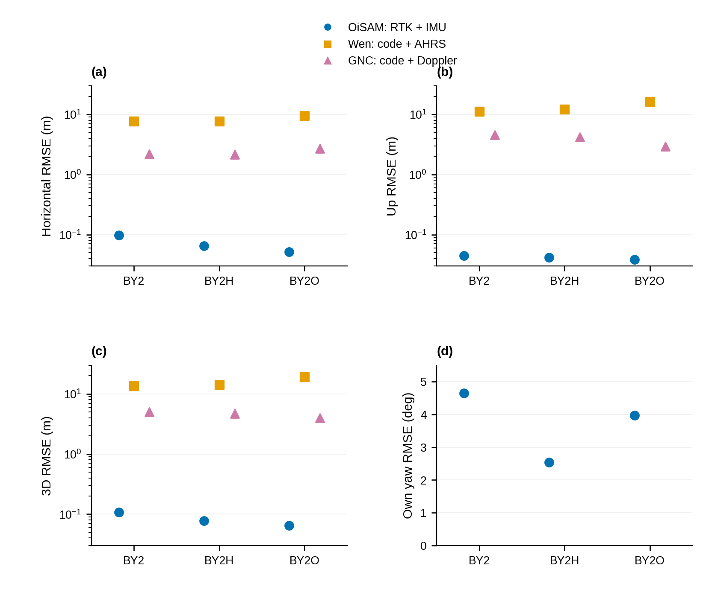

**建议位置：** 历史来源与覆盖核查。

**子图怎么读：** 分别看三个因子图方法的水平、垂向、三维位置误差，以及OiSAM自行估计的航向。方法使用的观测不同，图例中的样本数量说明各条结果实际覆盖的记录。

**合理性判断：** 这是已完成图件的来源/早期呈现版本。与当前图有重叠时，不作为新的独立实验重复计数；原值和原版本说明保留。

**下一步：** 通过当前结果图与比较去向表决定引用位置；保留这份原图供完整性核查。

**原图注：** Saved later primary dynamic own-support metrics at GNSS1. Position panels use logarithmic axes to retain all scales without clipping, and do not include a V3 midpoint result. OiSAM matched 275/275, 267/271 and 370/378 slots; Wen and GNC each matched 274/275, 270/271 and 377/378. Only Oi estimates its own attitude and therefore has a yaw result in (d); no proxy yaw is assigned to Wen or GNC. Oi transports its body-origin position using its own estimated attitude; Wen and GNC have native antenna outputs. Oi uses RTK/IMU and per-block A1 initialization, Wen uses raw code and an AHRS/IMU adapter, and GNC uses code/Doppler and graduated robust estimation. Full-batch information and causal current-node updates differ. Additional Oi block initializations, original six batch-output reuses, prior-only exclusions, and the usable but nonconverged 3286 s event remain part of the saved identities. These application results do not rank same-input solvers or establish independent absolute accuracy.

来源阶段：历史初版；原PDF：`G:/LegSA-GINS-project/V3论文组图_20261008/figures/S07.pdf`。

## 38. 旧S08 · 原始双天线方法误差与输出

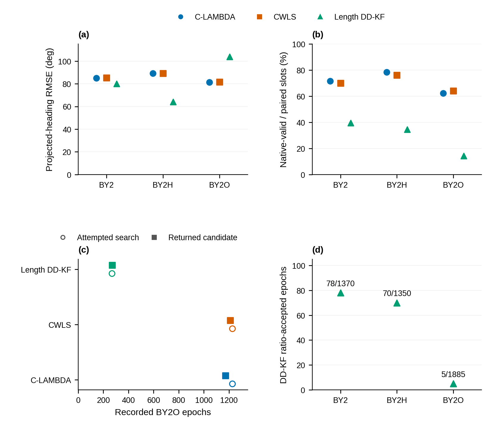

**建议位置：** 历史来源与覆盖核查。

**子图怎么读：** 看原始观测航向方法的误差与输出数量。搜索次数、返回候选与模糊度接受次数各有自己的含义，按对应面板读，不能把它们合成同一种成功率。

**合理性判断：** 这是已完成图件的来源/早期呈现版本。与当前图有重叠时，不作为新的独立实验重复计数；原值和原版本说明保留。

**下一步：** 通过当前结果图与比较去向表决定引用位置；保留这份原图供完整性核查。

**原图注：** All nine saved EXT V2 TECH_RETRY_2 own-valid projected-heading metrics. Original paired denominators are 1370/1350/1885. Native-valid counts are 980/1059/1173 for C-LAMBDA, 961/1029/1210 for CWLS, and 541/467/269 for the length-constrained DD-KF. Panel (c) displays BY2O recorded search-attempt and candidate-return fields only; they are not common fix-success definitions. C-LAMBDA and CWLS declare no ambiguity acceptance test, so their missing ratio-fixed result is not zero. DD-KF ratio-accepted counts in (d) are 78/70/5; true integer correctness is unknown. Inputs, frequencies, state models, search budgets and project acceptance/reset policies differ. The saved native source is guardless; later singular-projection guards were not used to relabel these runs. The lateral-baseline projected heading is compared to a shared-GNSS commercial Euler reference under the stated mounting/tilt approximation, with physical installation still incompletely verified. Large errors describe this declared implementation and input contract, not a general failure of the author methods or a same-input V3 ranking.

来源阶段：历史初版；原PDF：`G:/LegSA-GINS-project/V3论文组图_20261008/figures/S08.pdf`。

## 39. 旧S09 · 接触惯性及SDK相对诊断

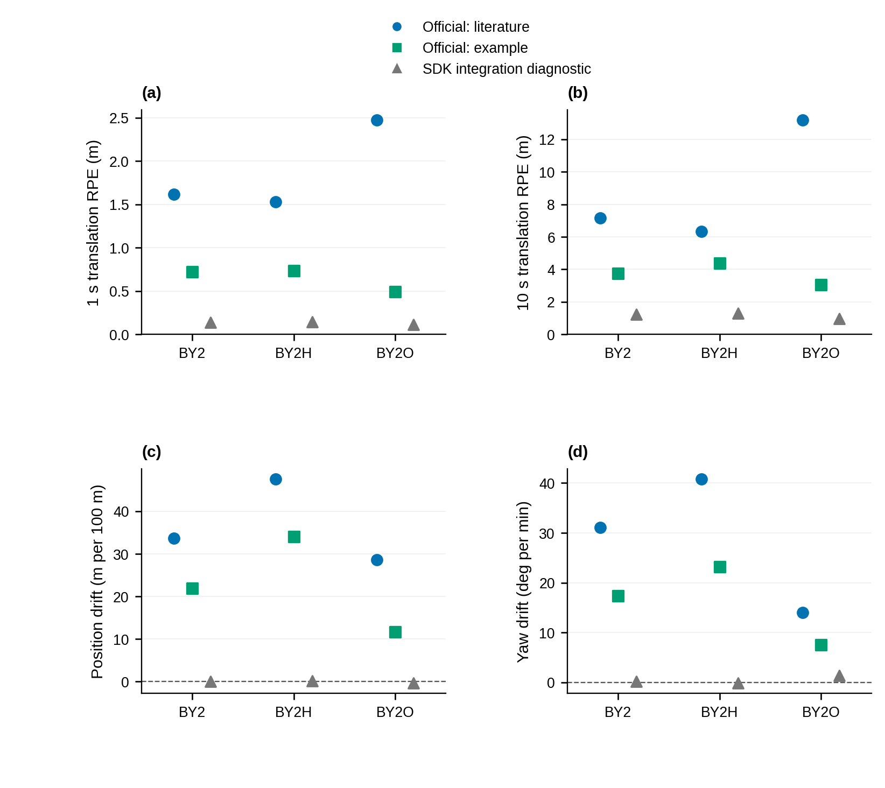

**建议位置：** 历史来源与覆盖核查。

**子图怎么读：** 看1秒和10秒间隔内的相对平移误差，以及位置和航向漂移随行程、时间的变化。各方法先用最初10秒完成同样类型的初始对齐；斜率图中的正负号表示变化方向。

**合理性判断：** 这是已完成图件的来源/早期呈现版本。与当前图有重叠时，不作为新的独立实验重复计数；原值和原版本说明保留。

**下一步：** 通过当前结果图与比较去向表决定引用位置；保留这份原图供完整性核查。

**原图注：** Official contact-aided InEKF at ef16e8a with literature and example parameter conditions, alongside a supplied-SDK-attitude integration diagnostic. (a,b) Translation relative-pose error at 1 and 10 s; (c,d) signed OLS slopes of horizontal-error norm versus reference path and unwrapped yaw error versus minutes. Negative slope is not negative error. Each branch used its own single xyz/yaw alignment on the first 10 s; no scale, roll/pitch or time-offset fitting. Scored 10 Hz epochs are 2741/2700/3771. RPE pairs for 1 s are 2731/2690/3761 and for 10 s 2641/2600/3671. The BY2H first grid point is unsupported and is not extrapolated. Go2 high-level foot-position/force adapters differ from the original author joint/contact measurement chain. SDK integration is an input diagnostic, not an independently reproduced estimator or proof that InEKF mathematics is wrong. These aligned relative metrics are not absolute GNSS navigation accuracy and do not rank against V3. Old transplanted-code initialization failures remain separate historical identities.

来源阶段：历史初版；原PDF：`G:/LegSA-GINS-project/V3论文组图_20261008/figures/S09.pdf`。

## 40. 旧S10 · 原V3留存BY2轨迹与姿态

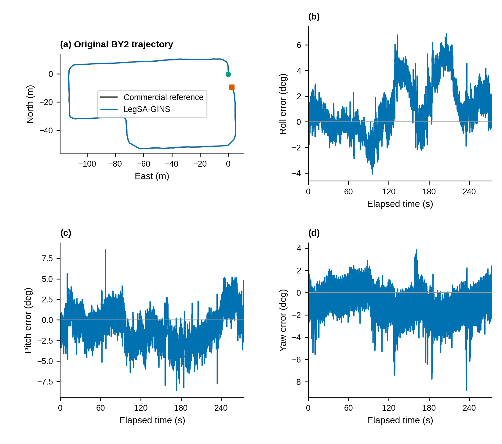

**建议位置：** 历史来源与覆盖核查。

**子图怎么读：** 先看BY2的整体路线，再看沿记录时间变化的横滚、俯仰与航向误差。圆点和方点标记起终点；姿态误差的正负表示相对于参考的偏差方向。

**合理性判断：** 这是已完成图件的来源/早期呈现版本。与当前图有重叠时，不作为新的独立实验重复计数；原值和原版本说明保留。

**下一步：** 通过当前结果图与比较去向表决定引用位置；保留这份原图供完整性核查。

**原图注：** Original V3 BY2, 66–340 s, 56,642 matched epochs / 56,642 actual output epochs. (a) Stored matched LLH is transformed through WGS84 ECEF into a fixed East/North frame anchored to the first stored reference point; no fitted translation or rotation. Circle/square mark start/end. (b–d) Signed roll, pitch and wrap-safe yaw errors from the saved evaluator. Lines break at adjacent saved times greater than 0.1 s. The evaluation position is the frozen nominal antenna midpoint. Only BY2 matched trajectory is retained; no H/O trajectory is reconstructed.

来源阶段：历史初版；原PDF：`G:/LegSA-GINS-project/V3论文组图_20261008/figures/S10_original_BY2_trajectory_attitude.pdf`。

## 41. 旧S11 · 三序列完整误差时间过程

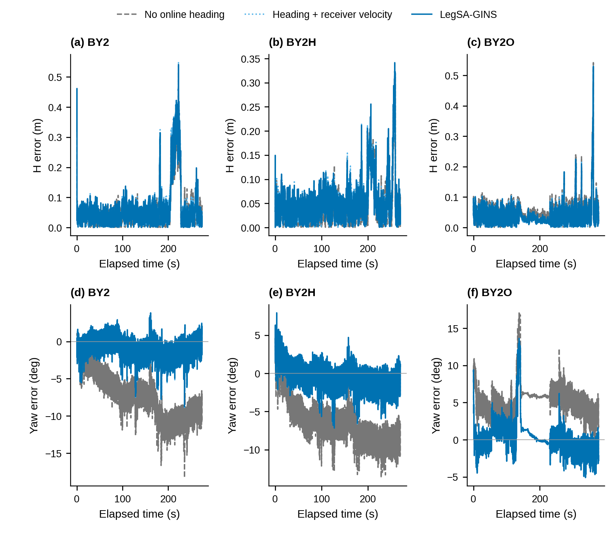

**建议位置：** 历史来源与覆盖核查。

**子图怎么读：** 看三条记录的完整水平位置误差与航向误差变化。灰线关闭在线双天线航向，浅蓝线保留航向与接收机速度，深蓝线是完整方法，局部重合表示差异确实很小。

**合理性判断：** 这是已完成图件的来源/早期呈现版本。与当前图有重叠时，不作为新的独立实验重复计数；原值和原版本说明保留。

**下一步：** 通过当前结果图与比较去向表决定引用位置；保留这份原图供完整性核查。

**原图注：** Original V3, three natural windows: BY2 66–340 s, BY2H 413–683 s, BY2O 3186–3563 s. Upper/lower rows show horizontal error norm and signed wrap-safe yaw error. Each method has 56,642 / 58,580 / 76,548 matched and output epochs in BY2/H/O. F01 has no online dual-heading update but uses shared dual-heading initialization; F03 also includes receiver velocity. Thus these are configuration contrasts, not a pure single-module ladder. All saved samples remain; lines break when adjacent times exceed 0.1 s.

来源阶段：历史初版；原PDF：`G:/LegSA-GINS-project/V3论文组图_20261008/figures/S11_original_three_sequence_fullwindow.pdf`。

## 42. 旧S12 · BY2O关键段和段外对照

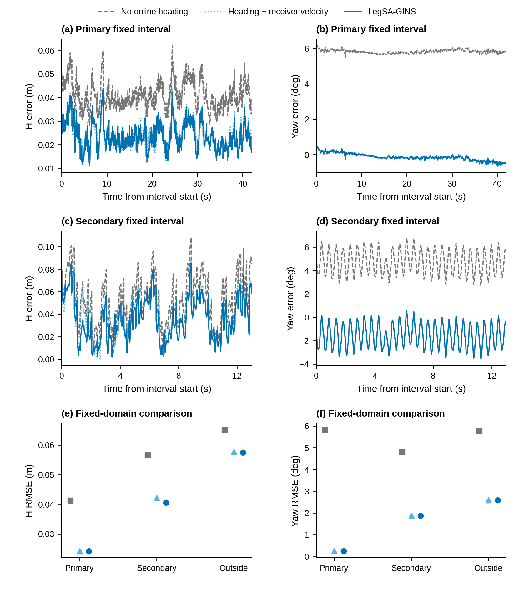

**建议位置：** 历史来源与覆盖核查。

**子图怎么读：** 上两排放大两处关键时间段，最后一排把两段与其余记录比较。放大图说明局部变化，段外结果帮助判断这些变化是否代表整条记录。

**合理性判断：** 这是已完成图件的来源/早期呈现版本。与当前图有重叠时，不作为新的独立实验重复计数；原值和原版本说明保留。

**下一步：** 通过当前结果图与比较去向表决定引用位置；保留这份原图供完整性核查。

**原图注：** Original V3 BY2O. Primary 3369.94–3411.95 s and secondary 3495.94–3508.94 s are the previously frozen closed intervals. (a–d) Stored H and yaw errors within these windows. (e–f) Previously saved domain RMSE for each interval and its outside complement, using each original matched denominator. No window is selected by displayed error; no threshold or epoch changes are applied. Lines break at gaps over 0.1 s. Per-epoch receiver-quality and heading-action data are not bound here, so the panels do not infer acceptance actions from final errors.

来源阶段：历史初版；原PDF：`G:/LegSA-GINS-project/V3论文组图_20261008/figures/S12_original_BY2O_fixed_intervals.pdf`。

## 43. C01 · LegSA-GINS与双接收机IEKF的定位及航向误差

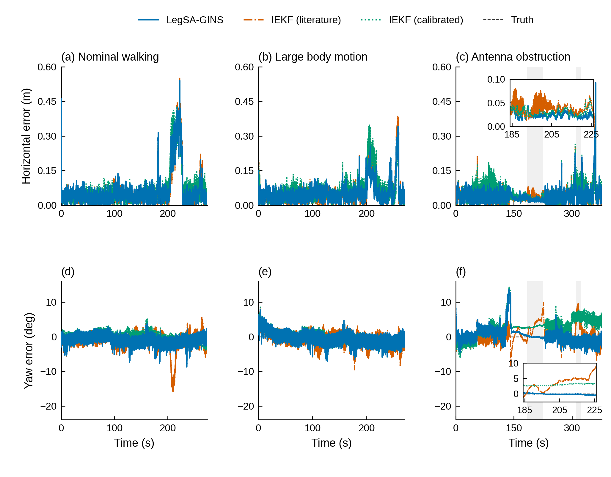

**建议位置：** 历史来源与覆盖核查。

**子图怎么读：** 这张图把整体误差大小还原为随机器人运动变化的过程，同时让遮挡期间的细微差别可见。

**合理性判断：** 这是已完成图件的来源/早期呈现版本。与当前图有重叠时，不作为新的独立实验重复计数；原值和原版本说明保留。

**下一步：** 通过当前结果图与比较去向表决定引用位置；保留这份原图供完整性核查。

**原图注：** 常规行走、大幅机身运动和单侧天线遮挡实验中，LegSA-GINS与双接收机IEKF的水平定位及航向误差。上、下排分别为水平误差和航向误差；两种IEKF配置分别采用文献参数和标定参数。第三组中的灰带表示天线遮挡时段，小窗放大第一个遮挡时段；黑色虚线表示相对于参考值的零误差。

来源阶段：过程图重设计；原PDF：`G:/LegSA-GINS-project/V3论文组图_20261008/redesign_20261009/figures/C01.pdf`。

## 44. C02 · FGO方法的位置误差对比

**建议位置：** 历史来源与覆盖核查。

**子图怎么读：** 把三种GNSS信息处理路线的误差变化放到同一场景时钟中，呈现持续误差和局部异常，而不是只给一个整段RMSE。

**合理性判断：** 这是已完成图件的来源/早期呈现版本。与当前图有重叠时，不作为新的独立实验重复计数；原值和原版本说明保留。

**下一步：** 通过当前结果图与比较去向表决定引用位置；保留这份原图供完整性核查。

**原图注：** 常规行走、大幅机身运动和单侧天线遮挡实验中，OiSAM-FGO、TC-FGO和GNC-FGO在GNSS1天线位置上的水平与高程误差。缺测和OiSAM-FGO分段边界处断线。水平误差用对数尺度，高程误差用零附近保持线性的对称对数尺度。

来源阶段：过程图重设计；原PDF：`G:/LegSA-GINS-project/V3论文组图_20261008/redesign_20261009/figures/C02.pdf`。

## 45. C03 · RTKLIB航向误差与输出时间

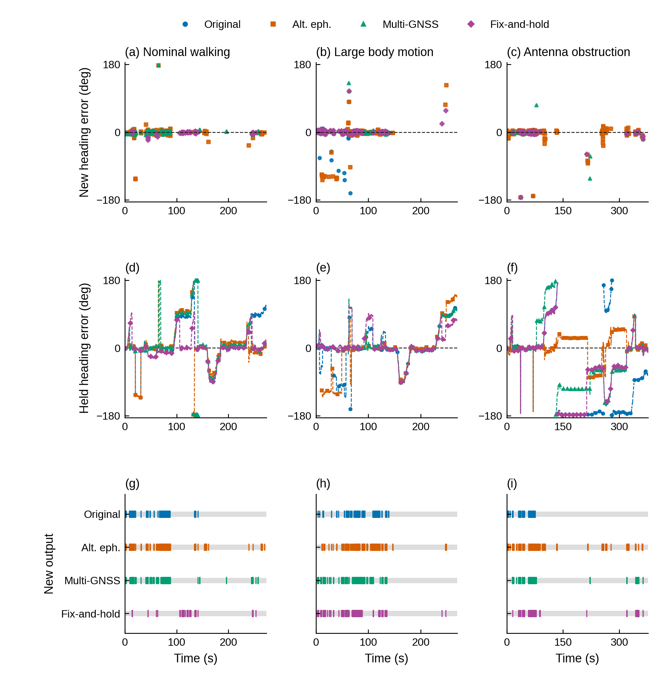

**建议位置：** 历史来源与覆盖核查。

**子图怎么读：** 将“有一个航向值”与“此刻有新的有效航向解”分开，让长时间保持旧值的误差和稀疏新解都能直接看见。

**合理性判断：** 这是已完成图件的来源/早期呈现版本。与当前图有重叠时，不作为新的独立实验重复计数；原值和原版本说明保留。

**下一步：** 通过当前结果图与比较去向表决定引用位置；保留这份原图供完整性核查。

**原图注：** 常规行走、大幅机身运动和单侧天线遮挡实验中，RTKLIB动基线航向误差与输出时间。四种配置依次为原始配置、修改星历、扩展星座选择和fix-and-hold处理。上排为新固定解的误差，中排为相邻更新之间保持最近一次航向时的误差，下排标出新解出现的时刻。

来源阶段：过程图重设计；原PDF：`G:/LegSA-GINS-project/V3论文组图_20261008/redesign_20261009/figures/C03.pdf`。

## 46. C04 · 双天线航向方法的误差与输出时间

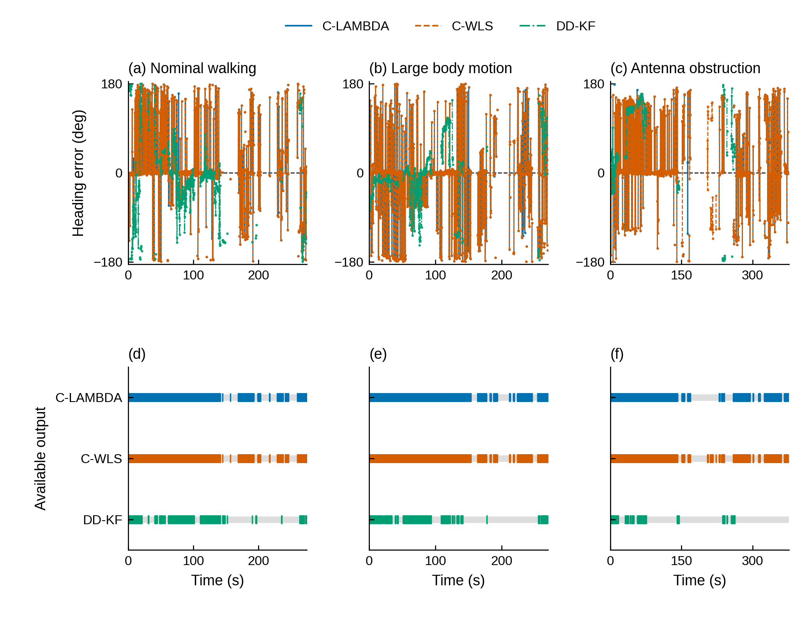

**建议位置：** 历史来源与覆盖核查。

**子图怎么读：** 直接呈现原始观测路线中方向误差持续性与输出间断的位置，不把各自最好的一小段当作全程表现。

**合理性判断：** 这是已完成图件的来源/早期呈现版本。与当前图有重叠时，不作为新的独立实验重复计数；原值和原版本说明保留。

**下一步：** 通过当前结果图与比较去向表决定引用位置；保留这份原图供完整性核查。

**原图注：** 三种原始双天线观测处理方法的航向误差和可用输出时刻。上排画有效航向误差，下排标出有效输出时间；缺测和角度跳变处断线，不用保持值填补。

来源阶段：过程图重设计；原PDF：`G:/LegSA-GINS-project/V3论文组图_20261008/redesign_20261009/figures/C04.pdf`。

## 47. A01 · GNSS中断期间的机身速度辅助效果

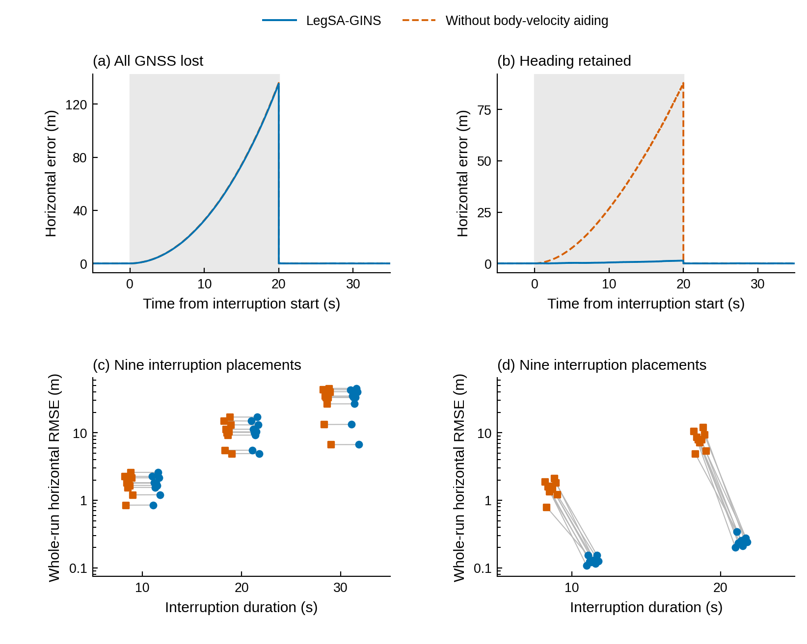

**建议位置：** 历史来源与覆盖核查。

**子图怎么读：** 先看上排两条误差曲线何时分开，再看下排这种变化是否在九个布置中都出现。

**合理性判断：** 这是已完成图件的来源/早期呈现版本。与当前图有重叠时，不作为新的独立实验重复计数；原值和原版本说明保留。

**下一步：** 通过当前结果图与比较去向表决定引用位置；保留这份原图供完整性核查。

**原图注：** 机身速度辅助在两类GNSS中断中的作用。上排放大同一处20秒中断及恢复过程，灰色表示中断时段；下排展示每种时长的九个布置，灰线连接同一布置。保留航向时，机身速度明显抑制水平漂移。

来源阶段：过程图重设计；原PDF：`G:/LegSA-GINS-project/V3论文组图_20261008/redesign_20261009/figures/A01_velocity_aiding.pdf`。

## 48. A02 · 机身倾角辅助对姿态估计的影响

**建议位置：** 历史来源与覆盖核查。

**子图怎么读：** 蓝线相对零线更近的区段，就是倾角辅助直接改善机身姿态的时段。

**合理性判断：** 这是已完成图件的来源/早期呈现版本。与当前图有重叠时，不作为新的独立实验重复计数；原值和原版本说明保留。

**下一步：** 通过当前结果图与比较去向表决定引用位置；保留这份原图供完整性核查。

**原图注：** 三条实测序列中机身倾角辅助对横滚、俯仰误差的影响。蓝线为完整方法，橙色虚线为关闭倾角辅助；每列对应一个序列，上下分别为横滚和俯仰。

来源阶段：过程图重设计；原PDF：`G:/LegSA-GINS-project/V3论文组图_20261008/redesign_20261009/figures/A02_tilt_aiding.pdf`。

## 49. A03 · 来源加权对导航误差与发散的影响

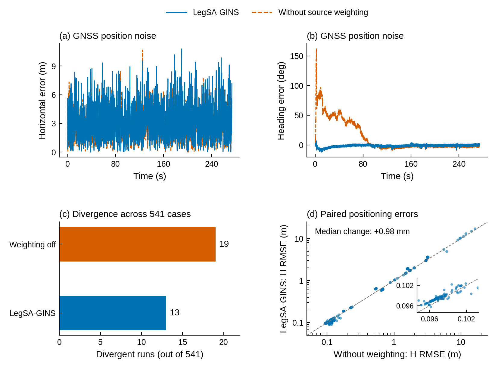

**建议位置：** 历史来源与覆盖核查。

**子图怎么读：** 这张图直接展示加权如何抑制大的航向偏离，以及它同时带来的位置精度取舍。

**合理性判断：** 这是已完成图件的来源/早期呈现版本。与当前图有重叠时，不作为新的独立实验重复计数；原值和原版本说明保留。

**下一步：** 通过当前结果图与比较去向表决定引用位置；保留这份原图供完整性核查。

**原图注：** 来源加权对导航误差和发散次数的影响。上排是加入GNSS位置噪声后的水平误差与航向误差；左下显示541例中的发散次数；右下比较513个双方均完成案例的水平RMSE，虚线下方表示完整方法更好，放大窗展示正常误差量级附近的细小变化。

来源阶段：过程图重设计；原PDF：`G:/LegSA-GINS-project/V3论文组图_20261008/redesign_20261009/figures/A03_source_weighting.pdf`。

## 50. R01 · M1的原始集中展示版

**建议位置：** 历史来源与覆盖核查。

**子图怎么读：** 读图顺序：左图说明同样自身观测可以对应多个全局方向；右上说明初始方向差异在时间中保留，而局部航向变化相同；右下给出这一现象的结构来源。它支持论文对外部绝对方向约束的需求。

**合理性判断：** 这是已完成图件的来源/早期呈现版本。与当前图有重叠时，不作为新的独立实验重复计数；原值和原版本说明保留。

**下一步：** 通过当前结果图与比较去向表决定引用位置；保留这份原图供完整性核查。

**原图注：** 机器人自身观测下的绝对航向自由度。（a）同一组 IMU 与足端接触数据的七次已保存运行，初始航向覆盖 −150° 至 +150°，在任意局部坐标系中形成相互旋转的轨迹。彩色突出 0° 与 ±100°，圆点表示共同起点与各轨迹终点。（b）展开后的航向演化保留初始方向差异；插图为预先根据输入选定的 0.216 s 双接触窗口内航向增量，七条曲线重合。（c）含偏置模型在五个预选接触窗口的已保存可观测性奇异值，分别除以各自最大奇异值，并按从小到大排序。两段四接触与三段双接触窗口分别对应 27 维和 21 维状态；前四个方向均低于相对秩阈值（虚线，10⁻⁹），对应三维全局平移与一维全局航向自由度。不同标记表示不同窗口。仅消除各运行初始旋转后，最大位置差为 1.90 × 10⁻⁷ m。该组实验验证同一自身观测下全局方向的等价性。

来源阶段：复用来源版本；原PDF：`G:/LegSA-GINS-project/V3论文组图_20261008/focused_20261011/robot/R01_proprioception_absolute_heading.pdf`。

## 51. F02 · M4的原始集中展示版

**建议位置：** 历史来源与覆盖核查。

**子图怎么读：** 上部比较相同时刻的精度，下部交代这些时刻覆盖了多少实际运行时间；右下放大首次输入缺口后的输出变化。

**合理性判断：** 这是已完成图件的来源/早期呈现版本。与当前图有重叠时，不作为新的独立实验重复计数；原值和原版本说明保留。

**下一步：** 通过当前结果图与比较去向表决定引用位置；保留这份原图供完整性核查。

**原图注：** LegSA-GINS与OiSAM-FGO的精度及输出连续性。（a–d）在同一评价点与匹配时刻比较水平定位和航向误差：常规行走为274个历元，单侧天线遮挡记录起始阶段为54个历元；精度曲线采用仅初始化一次的OiSAM。（e）三条完整记录中，LegSA-GINS、仅初始化一次的OiSAM，以及在实测IMU缺口处分段重新初始化的OiSAM的输出时段。重新初始化的OiSAM行中，空心圆表示仅初始化的状态，线段表示有效动态输出；每个场景内三行按图例顺序排列。（f）放大单侧天线遮挡记录中方框标出的时段，灰带表示首次IMU输入缺口。时间均相对于各评价窗口起点。

来源阶段：复用来源版本；原PDF：`G:/LegSA-GINS-project/V3论文组图_20261008/focused_20261011/comparison/F02_precision_and_continuity.pdf`。

## 52. 早期R01 · 参考路线与由留存误差重建的路线

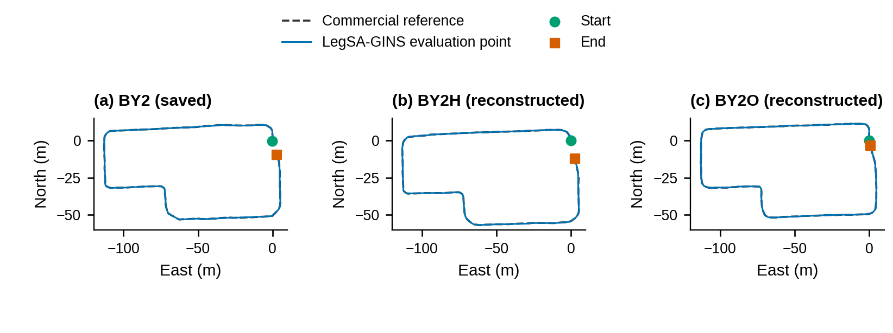

**建议位置：** 历史来源与覆盖核查。

**子图怎么读：** 早期轨迹核对版本，用于确认参考与轨迹关系；当前论文场景读法优先用P01/P03。

**合理性判断：** 这是已完成图件的来源/早期呈现版本。与当前图有重叠时，不作为新的独立实验重复计数；原值和原版本说明保留。

**下一步：** 通过当前结果图与比较去向表决定引用位置；保留这份原图供完整性核查。

**原图注：** Original V3 evaluation-point routes at the exact original matched times: BY2 56,642, BY2H 58,580 and BY2O 76,548 epochs. BY2 uses saved original matched reference/estimate LLH. BY2H/O use the original hash-matched reference files and sealed signed East/North/Up errors, with base times 1772784000 and 1772780400 respectively. Reference LLH components are interpolated by the unchanged archived evaluator rule and displayed in the fixed WGS84 ENU frame at each recording first matched reference point; estimate coordinates are reconstructed by adding sealed signed errors. The BY2 inverse reconstruction was checked against its stored estimate at every sample, maximum 3D difference 4.39e-09 m. H/O curves are display reconstructions of the already evaluated nominal point, not recovered native NAV, new estimates or new scores. No fitted alignment, new time offset, output interpolation or epoch addition is used; line segments break for saved adjacent times above 0.1 s. Start/end markers use actual first/last matched samples. At route scale the reference and estimate may overlap; the figure does not imply independently verified centimetre accuracy.

来源阶段：早期来源核对；原PDF：`G:/LegSA-GINS-project/V3论文组图_20261008/revision_20261009/R01_reference_and_reconstructed_routes.pdf`。

## 下一步的组图安排

先完成当前图的科学分工，再统一版式，不以新增实验数量作为推进标准。

1. **首先修改M5的条件说明，并与S4安排分工。** M5回答内部速度辅助的作用，S4说明外部“保留方向”不自动带来平移稳定。应将方向、位置和实际辅助更新的可用性放在读者能直接看到的位置。
2. **把P01/P03和P02的绝对航向部分组成场景过程图。** 轨迹、机身朝向、转弯/动作/遮挡时段用同一组已确认事件对应，避免0.5 s局部框与其他图的20 s窗口各说各话。已有图与数据都保留。
3. **保留新的正文姿态合图，讨论图名、事件窗口和结论。** 原S8/S9作为展开来源，不再在正文重复占位。原M04与S03提供519配对和完整单开关统计。
4. **调整M6的收益与代价表达。** 代表例同时给出航向改善和位置代价，并把完成、发散、无初始化与大误差区分清楚。
5. **整理外部比较的共同条件。** M3对应最接近IEKF；M4与S5共同说明OiSAM精度和恢复后表现；S6与S7保留全部类别和不同信息层级。修正S6实心/空心图例，统一跨图方法颜色。
6. **最后冻结正文/补充清单、图号与图注。** 平台、方法、场景分别有现成内容。结果核心为M1、M2、新姿态图、M5+S4、M6、M3/M4；可再根据篇幅合并，不能现在把所有独立图都塞入正文。

若上述整理暴露需要新证据的问题，先检查现有来源与版本，再决定是否追加实验。S13–S15已有另版本长缺测、末端/恢复和记录缺口结果，不能把它们说成未做，也不能跨版本拼入冻结V3主结果。
