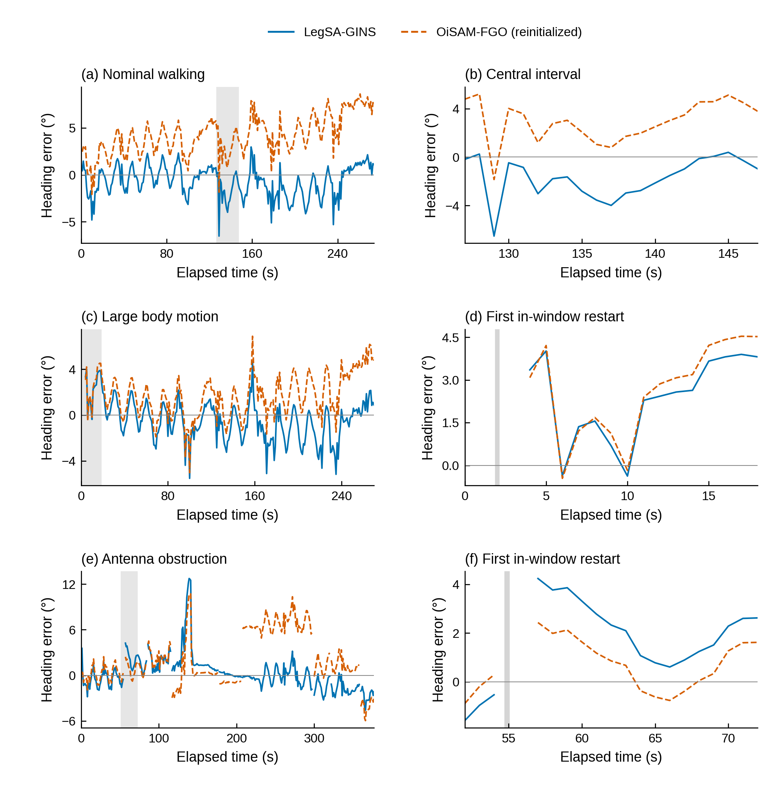

# 五个问题的主文与补充图

先读主文6组图，再按需要展开补充。完整结果与方法去向见COMPARISON_USE_MAP.csv。

## Q1 机器人自身观测缺少什么约束？

### M1 机器人自身观测与绝对航向（正文）

读图顺序：左图说明同样自身观测可以对应多个全局方向；右上说明初始方向差异在时间中保留，而局部航向变化相同；右下给出这一现象的结构来源。它支持论文对外部绝对方向约束的需求。

机器人自身观测下的绝对航向自由度。（a）同一组 IMU 与足端接触数据的七次已保存运行，初始航向覆盖 −150° 至 +150°，在任意局部坐标系中形成相互旋转的轨迹。彩色突出 0° 与 ±100°，圆点表示共同起点与各轨迹终点。（b）展开后的航向演化保留初始方向差异；插图为预先根据输入选定的 0.216 s 双接触窗口内航向增量，七条曲线重合。（c）含偏置模型在五个预选接触窗口的已保存可观测性奇异值，分别除以各自最大奇异值，并按从小到大排序。两段四接触与三段双接触窗口分别对应 27 维和 21 维状态；前四个方向均低于相对秩阈值（虚线，10⁻⁹），对应三维全局平移与一维全局航向自由度。不同标记表示不同窗口。仅消除各运行初始旋转后，最大位置差为 1.90 × 10⁻⁷ m。该组实验验证同一自身观测下全局方向的等价性。

[PDF](robot/Q1_proprioception_absolute_heading.pdf) · SVG（本地来源：`G:/LegSA-GINS-project/V3五问题论文组图_20261011/robot/Q1_proprioception_absolute_heading.svg`）

### S1 接触辅助估计与机载姿态参与积分的相对运动表现（补充）

结构图解释绝对方向自由度；这张补充图展示同一平台输入下相对状态估计的实际误差演化，以及机载姿态参与的运动学积分参照。

接触辅助状态估计的相对运动误差。各列分别对应一种工况；在评价窗开始的10 s内进行一次平移与航向对齐后，上、下排分别为水平和航向误差。官方接触辅助InEKF分别采用文献与示例噪声设置；接触运动学积分使用接触足速度和机载姿态。小窗放大常规行走的前40 s。曲线采用已完成评价的原时刻。

[PDF](robot/S01_robot_relative_motion.pdf) · SVG（本地来源：`G:/LegSA-GINS-project/V3五问题论文组图_20261011/robot/S01_robot_relative_motion.svg`）

## Q2 短基线GNSS方向何时可靠？

### M2 RTKLIB原配置下短基线航向的输出与物理一致性（正文）

新固定输出的覆盖率与输出后的物理一致性是两个问题：本组数据中固定解稀疏，且固定状态仍可能伴随显著长度残差。

原始RTKLIB动基线配置下，短基线航向的输出可用性与物理一致性。(a) 三种工况中新固定输出的绝对航向误差累积分布，小窗放大0–20°，保持原累积分布分母。(b) 新固定输出的时刻；百分比以各实验窗内的全部配对历元为分母。(c) 常规行走评价窗内全部153个固定输出的基线长度，其中35个日志长度残差超过4σ。虚线为安装长度0.35 m，灰带为配置长度标准差σ=0.01 m所对应的±4σ范围。(d) 放大(c)中的10–22 s着色区间。所有面板均使用保存的实验窗口；航向由横向基线的水平投影换算，并与参考航向比较。

[PDF](heading/Q2_heading_availability_and_consistency.pdf) · SVG（本地来源：`G:/LegSA-GINS-project/V3五问题论文组图_20261011/heading/Q2_heading_availability_and_consistency.svg`）

### S2 RTKLIB四配置的航向误差与输出连续性（补充）

将“有一个航向值”与“此刻有新的有效航向解”分开，让长时间保持旧值的误差和稀疏新解都能直接看见。

常规行走、大幅机身运动和单侧天线遮挡实验中，RTKLIB动基线航向误差与输出时间。四种配置依次为原始配置、修改星历、扩展星座选择和fix-and-hold处理。上排为新固定解的误差，中排为相邻更新之间保持最近一次航向时的误差，下排标出新解出现的时刻。

[PDF](heading/SQ2_RTKLIB_all_configurations.pdf) · SVG（本地来源：`G:/LegSA-GINS-project/V3五问题论文组图_20261011/heading/SQ2_RTKLIB_all_configurations.svg`）

### S3 三种原始双天线处理路线的误差分布与输出（补充）

完整使用九组保存结果，把方向误差分布与输出覆盖分开呈现，避免密集正负180度跳转线遮住三种方法的差别。

三种原始双天线观测处理方法在常规行走、大幅机身运动与单侧天线遮挡下的航向误差分布和可用输出。上排为各方法已记录有效输出时刻的绝对方向误差累积分布，下排标出对应输出时间。C-LAMBDA和C-WLS为对应约束目标的独立实现，这些方向候选未设整数接受检验；DD-KF使用保存的双差滤波输出，不插入保持航向。所画方向由横向基线的水平投影换算，并与参考航向比较。

[PDF](heading/SQ2_raw_dual_antenna_methods.pdf) · SVG（本地来源：`G:/LegSA-GINS-project/V3五问题论文组图_20261011/heading/SQ2_raw_dual_antenna_methods.svg`）

## Q3 融合精度与输出连续性如何？

### M3 自然工况下与双位置IEKF的比较（正文）

这张图把整体误差大小还原为随机器人运动变化的过程，同时让遮挡期间的细微差别可见。

常规行走、大幅机身运动和单侧天线遮挡实验中，LegSA-GINS与双接收机IEKF的水平定位及航向误差。上、下排分别为水平误差和航向误差；两种IEKF配置分别采用文献参数和标定参数。第三组中的灰带表示天线遮挡时段，小窗放大第一个遮挡时段；黑色虚线表示相对于参考值的零误差。

[PDF](navigation/Q3_01_IEKF_natural.pdf) · SVG（本地来源：`G:/LegSA-GINS-project/V3五问题论文组图_20261011/navigation/Q3_01_IEKF_natural.svg`）

### M4 LegSA-GINS与OiSAM的精度及输出连续性（正文）

上部比较相同时刻的精度，下部交代这些时刻覆盖了多少实际运行时间；右下放大首次输入缺口后的输出变化。

LegSA-GINS与OiSAM-FGO的精度及输出连续性。（a–d）在同一评价点与匹配时刻比较水平定位和航向误差：常规行走为274个历元，单侧天线遮挡记录起始阶段为54个历元；精度曲线采用仅初始化一次的OiSAM。（e）三条完整记录中，LegSA-GINS、仅初始化一次的OiSAM，以及在实测IMU缺口处分段重新初始化的OiSAM的输出时段。重新初始化的OiSAM行中，空心圆表示仅初始化的状态，线段表示有效动态输出；每个场景内三行按图例顺序排列。（f）放大单侧天线遮挡记录中方框标出的时段，灰带表示首次IMU输入缺口。时间均相对于各评价窗口起点。

[PDF](navigation/Q3_oisam_precision_continuity.pdf) · SVG（本地来源：`G:/LegSA-GINS-project/V3五问题论文组图_20261011/navigation/Q3_oisam_precision_continuity.svg`）

### S4 保留方向与位置中断中的导航表现（补充）

上排显示位置中断中误差如何增长，下排说明这一现象在全部18个登记条件中的分布。

GNSS位置中断时的导航结果。（a,b）首个登记20秒中断的位置和航向误差，灰带表示中断区间，小窗放大中断后的前8秒；双位置和单位置IEKF停止位置更新，保留基线的IEKF继续进行相对基线更新，LegSA-GINS保留可用航向及机身运动辅助。（c,d）全部10秒和20秒中断的整段RMSE，每个时长九个布置；细线连接同一布置的四种方法。保留基线的IEKF维持了航向，但没有自动改善位置结果。对数坐标保留全部有限结果。

[PDF](navigation/Q3_02_heading_retention.pdf) · SVG（本地来源：`G:/LegSA-GINS-project/V3五问题论文组图_20261011/navigation/Q3_02_heading_retention.svg`）

### S5 OiSAM重新初始化后的完整航向比较（补充）

在允许按真实输入缺口重新初始化后，比较两方法整段航向，而非只用OiSAM一次初始化后的早停描述它。

OiSAM在实测IMU缺口处重新初始化后的航向误差。左列展示三条记录全部匹配动态输出历元，右列分别放大常规行走的固定中间时段，以及另外两条记录评价窗内的首次恢复过程。左图浅色带表示放大区间，右图深灰带表示实测IMU缺口。仅初始化状态不进入曲线，动态输出缺失处断线。两方法使用相同名义评价秒及一致航向定义；本图不混用原评价中不同的位置参考点。

[PDF](navigation/Q3_03_OiSAM_reinitialized_heading.pdf) · SVG（本地来源：`G:/LegSA-GINS-project/V3五问题论文组图_20261011/navigation/Q3_03_OiSAM_reinitialized_heading.svg`）

### S6 全部外部退化类型的配对比较（补充）

这张补充图保留所有故障类别和反例；它逐类比较，不把异质故障混成一个总排名。

全部18种登记退化类型的配对RMSE差。实心点为共同有限样本中“外部IEKF减LegSA-GINS”的中位数，空心点为95百分位，连线表示二者之间的区间；每种退化登记九个案例。负值表示IEKF误差较低。两种位置噪声下，两种IEKF均各9/9发散；时间戳扰动无有效共同配对。对称对数轴同时保留小差值和大偏离。部分速度、多普勒及航向故障作用于外部滤波器未读取的通道，属于输入等价控制。完整类型定义、396条逻辑结果和744条配对汇总随图交付。

[PDF](navigation/Q3_04_all_degradation_pairs.pdf) · SVG（本地来源：`G:/LegSA-GINS-project/V3五问题论文组图_20261011/navigation/Q3_04_all_degradation_pairs.svg`）

### S7 不同GNSS信息处理路线的定位结果（补充）

把三种GNSS信息处理路线的误差变化放到同一场景时钟中，呈现持续误差和局部异常，而不是只给一个整段RMSE。

常规行走、大幅机身运动和单侧天线遮挡实验中，OiSAM-FGO、TC-FGO和GNC-FGO在GNSS1天线位置上的水平与高程误差。缺测和OiSAM-FGO分段边界处断线。水平误差用对数尺度，高程误差用零附近保持线性的对称对数尺度。 OiSAM在实测IMU缺口处重新初始化，仅初始化的状态不计入曲线。OiSAM使用RTK位置与IMU，TC-FGO使用原始码及适配姿态/速度输入，GNC-FGO使用原始码和Doppler；三条路线的输入信息不同。

[PDF](navigation/Q3_05_FGO_position.pdf) · SVG（本地来源：`G:/LegSA-GINS-project/V3五问题论文组图_20261011/navigation/Q3_05_FGO_position.svg`）

## Q4 机身运动信息起了什么作用？

### M5 保留航向时的机身速度辅助（正文）

先看上排两条误差曲线何时分开，再看下排这种变化是否在九个布置中都出现。

机身速度辅助在GNSS中断中的条件作用。（a,b）一处20 s中断及恢复过程的水平误差，灰色为中断区间；（b）插图放大中断期间0–2.5 m误差范围。（c,d）同一实测路线中，每种时长九个中断布置的全窗水平RMSE，细线连接相同布置。两列分别为全部GNSS观测中断与保留航向的平移观测中断。所评价实现中，全部GNSS观测中断同时暂停辅助更新。

[PDF](aiding/figures/Q4_body_velocity.pdf) · SVG（本地来源：`G:/LegSA-GINS-project/V3五问题论文组图_20261011/aiding/figures/Q4_body_velocity.svg`）

### S8 机载倾角辅助与姿态误差（补充）

蓝线相对零线更近的区段，就是倾角辅助直接改善机身姿态的时段。

三条实测序列中机身倾角辅助对横滚、俯仰误差的影响。蓝线为完整方法，橙色虚线为关闭倾角辅助；每列对应一个序列，上下分别为横滚和俯仰。

[PDF](aiding/figures/S_Q4_tilt_aiding.pdf) · SVG（本地来源：`G:/LegSA-GINS-project/V3五问题论文组图_20261011/aiding/figures/S_Q4_tilt_aiding.svg`）

### S9 基础GNSS/INS加入双天线航向的作用（补充）

基础配置加入航向链后持续航向误差明显降低，完整方法与该配置的航向曲线接近；二者微小差值不是本文全部收益。

基础GNSS/INS、基础配置加入双天线航向更新以及完整LegSA-GINS的航向误差。三列依次为常规行走、大幅机身运动与单侧天线遮挡。（a–c）完整误差时序，灰色区间在（d–f）放大。三种配置共享初始方向；前两种配置用于解释加入双天线航向链的作用，完整方法还包含其他辅助。

[PDF](aiding/figures/S_Q4_heading_information.pdf) · SVG（本地来源：`G:/LegSA-GINS-project/V3五问题论文组图_20261011/aiding/figures/S_Q4_heading_information.svg`）

## Q5 来源加权的收益与代价是什么？

### M6 来源加权的收益与精度代价（正文）

权重轨迹说明各来源受到不同程度的降权；误差轨迹与完整案例集合共同显示，发散和大航向偏离减少，同时保留位置精度代价。

来源加权的收益与位置精度代价。（a,b）已保存的GNSS位置加噪案例中的水平和航向误差，水平标准差3 m、竖直5 m。（c）同次运行三个观测来源的实际协方差放大倍数。（d）541个案例的发散次数；两种配置各另有九例缺少有效初始航向。（e）双方均完成的513例的全窗水平RMSE。等值线下方表示完整方法误差更小，插图放大正常误差量级。案例来自同一实测路线的受控观测扰动。

[PDF](aiding/figures/Q5_source_weighting.pdf) · SVG（本地来源：`G:/LegSA-GINS-project/V3五问题论文组图_20261011/aiding/figures/Q5_source_weighting.svg`）
