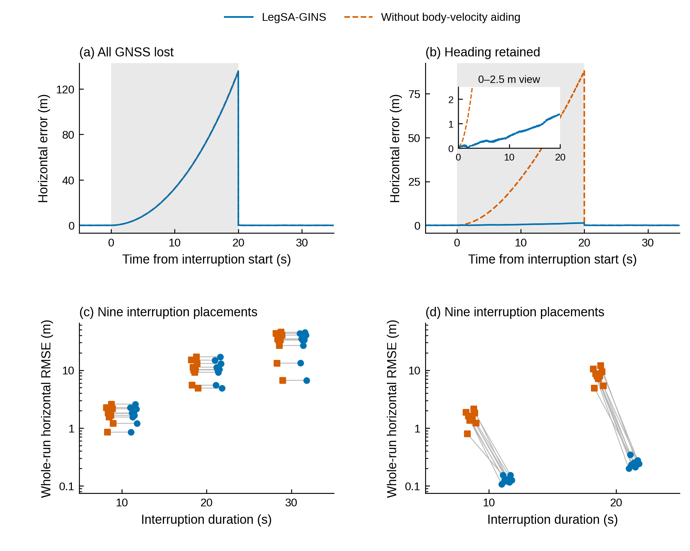
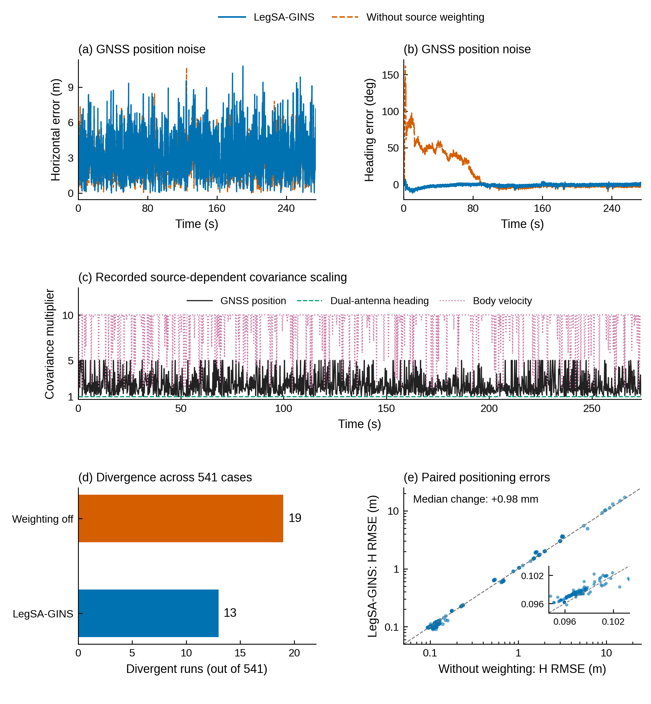

> 组图更新：S9/S8 已合成 [正文姿态图讨论稿](../revisions/attitude_main_20261011/README.md)。下文保留旧图编号和原解释，便于追溯。

# 逐图讲解：从坐标轴读到科学结论

全文中心问题采用作者原句：

> 在紧凑四足机器人的 GNSS/INS 中，短基线方向信息与机身运动观测如何共同改善姿态和平移估计，这种互补在什么观测可用性与质量条件下成立，又在何时失效？

图号沿用当前目录，便于边看边读。建议顺序：M1→M2→S9→S8→M5→M6→M3/M4。先看谁提供了什么信息、内部实验显示什么作用，再看外部比较。

## 先统一三个概念

姿态包括横滚roll（左右侧倾）、俯仰pitch（前后倾斜）和航向yaw（朝向）。这里的平移效果主要用水平位置误差衡量；当前没有独立速度误差评价合同，所以不能把位置改善直接写成已测得的速度RMSE改善。

短基线方向主要约束航向；机载倾角观测直接约束横滚、俯仰；机身速度信息提供相对运动量。机身前向速度要表达成导航系速度，需要方向关系，物理上可写为 $\mathbf v^n=\mathbf R_b^n\mathbf v^b$，其中 $\mathbf R_b^n$ 表示从机身系到导航系的旋转。当前V3在预处理阶段用已有方向和倾角完成HV旋转，再把水平速度观测送入共同滤波器。这是理解图中互补关系时需要知道的实际处理。

## M1：机器人自身观测为什么还需要绝对方向？

左图a的横纵轴是任意局部世界坐标中的x、y，单位m。七条轨迹来自同一段输入数据、七种初始朝向，不同颜色/线型表示初始角度。应看“改变全局朝向后，仍然得到相互旋转的相容估计”。它承担结构说明，而不是把轨迹离参考多远作为评分。

右上b的横轴是时间，纵轴是连续展开的航向角。展开意味着超过一圈后继续记360°、720°，不在±180°处折回。七条曲线保留初始偏移。插图每条都减去自己的局部窗口起点航向，表示同一0.216 s运动中的转角；曲线重合说明相对变化一致。

右下c的横轴是从小到大排列的奇异值序号，纵轴是除以各自最大值后的奇异值，对数刻度。可理解为“当前观测对不同状态组合的辨识能力”：前四个数接近零，低于虚线阈值；结合已保存零空间方向，它们对应三平移与一航向。图上第1至4个序号不分别标成某个轴，因为奇异向量可以是这些自由度的组合。

**读出结论：自身观测能够约束相对运动，但留下全局方向自由度，因而需要外部绝对方向信息。**

## M2：为什么有固定解还要判断方向质量？

a是累积分布。横轴是绝对航向误差，纵轴表示在“已经有新固定输出”的样本里，误差不超过该横轴值的比例。例如纵轴0.9对应90%的这些输出。曲线越靠左上，通常意味着有效输出误差越小；它没有把无输出时段算成零误差。小窗仅放大0–20°，分母保持不变。

b补足a的分母含义。横轴是完整实验时间，每条小竖线表示一次新的固定输出。11.2%、13.3%、5.9%以各记录全窗的全部配对历元为分母。a回答“有输出时准不准”，b回答“多久才有一次可用的新输出”。

c的横轴是常规行走时间，纵轴是解出的天线间基线长度。实际名义安装长度为0.35 m，黑虚线表示它；灰带为配置σ=0.01 m对应的±4σ范围，即约0.31–0.39 m。蓝圆与橙叉区分日志记录的长度残差条件。注意这个灰带是所配置噪声模型的范围，不是证明过的实际机械安装误差范围。

d放大c中10–22 s，显示一些已标为固定的输出仍有很大长度残差。35/153描述常规评价窗的固定输出；其分母与a/b的全窗历元不同。

**读出结论：方向进入融合前，应同时考虑是否持续有输出以及这些输出的物理一致性。该图使用原始RTKLIB动基线配置，不把所有方向生成方法一概等同。**

## S9：短基线方向具体改善了哪个姿态量？

横轴时间，纵轴航向误差，越靠近零越好。三列分别是常规行走、大幅机身运动、单侧天线遮挡。灰色为基础GNSS/INS；橙色为在基础配置上加入双天线航向；蓝色为完整方法。上排展示全窗，下排放大灰色时段。

先比较灰色和橙色，它们对应加入航向链的作用。再看橙色和蓝色：很多地方几乎重合，所以橙线被蓝线遮住是结果接近，并不是漏画。完整方法的其他观测不必在每段自然记录中继续显著降低yaw；它们还承担倾角、平移和质量变化下的作用。

三配置共享初始方向。灰线与其他线后来分离，体现运行过程中持续方向更新的作用，不能解释为只有蓝线一开始知道朝向。

**读出结论：自然记录中的主要航向收益来自持续的双天线方向约束。**

## S8：机载倾角又改善了什么？

上排纵轴是横滚误差，下排是俯仰误差；横轴时间，三列对应三种工况。蓝色完整方法，橙色仅关闭倾角辅助。应比较曲线到零线的距离，不是简单比较哪条数值更低：−5°比−1°更差。

蓝线在多段正负偏差上的幅度减小。图中展示自然时序，519个共同完成案例中roll/pitch RMSE均下降、中位分别降低1.072°/0.664°，来自完整配套统计。该统计不等于每个瞬时采样点都更好。

**读出结论：短基线方向约束yaw，机载倾角帮助roll/pitch；这两幅图应相邻成为姿态改善的核心结果。**

## M5：有了方向，机身速度怎样改善平移？

整张图只有两种算法配置：蓝色完整方法，橙色只关闭机身速度辅助。两列是两种观测条件，上排是一个代表过程，下排是全部布置的统计。

**a，全部GNSS观测中断。** 横轴0是中断开始，灰区为0–20 s；纵轴为当时的水平位置误差。蓝橙重合且误差上升。当前V3的辅助更新由有效GNSS事件触发，全部事件失效也暂停辅助更新，因此这里没有持续的机身速度校正。它展示当前实现的更新边界，不能由此推广为机身运动信息在完全断星时物理上必然无用。

**b，平移观测中断但保留方向。** 两种配置均保留航向，区别是有没有机身速度辅助。橙线迅速漂移，蓝线保持较小误差；小窗用0–2.5 m纵轴范围展示主图中贴近横轴的蓝线。它是互补产生平移收益的直接对照。

**20 s附近误差骤降。** 恢复定位观测后，滤波器的位置估计得到校正，误差迅速下降。这段下降描述恢复行为；中断期间表现看灰区。

**c/d，下排的点和灰线。** 横轴是中断时长；每种时长有同一路线上九个中断位置。每个方块/圆点对应一个布置的一条完整运行，灰线连接同一布置的两种配置。点在刻度两侧错开仅为显示。c基本水平，d普遍向下，分别对应左列没有明显收益、右列有明显收益。

下排纵轴为整段评价窗口的RMSE，且为对数刻度：0.1→1和1→10都是十倍。0.241 m是d中20 s九个布置的全窗RMSE中位数；b小窗显示某一布置的瞬时误差，因此中断末端约米级与全窗0.241 m并不矛盾。

**读出结论：在方向仍可用、机身速度观测有效且实际更新持续的条件下，机身速度明显抑制平移漂移。左列同时给出该实现失去收益的可用性边界。**

## M6：质量变坏以后，加权究竟在做什么？

蓝色完整方法，橙色关闭来源加权，其他配置相同。上排是一个案例，中排是这次运行真实采用的协方差放大，下排看全矩阵结果。

**a/b，代表加噪案例。** GNSS位置加入水平标准差3 m、竖直5 m的噪声。a画瞬时水平误差，曲线密集，不能凭蓝色覆盖较多就判断更好；原指标表显示水平RMSE从3.166变为3.557 m，略差。b画航向误差，橙线初段偏差明显较大，蓝线较快接近零；航向RMSE29.799→2.699°。

**c，协方差放大倍数。** 纵轴不是直接的权重，而是对量测协方差R采用的倍数。1表示没有额外放大；5表示这份协方差乘5，通常降低该观测对更新的影响。黑线对应位置，绿线对应双天线航向，粉线对应机身速度。因此粉线约10表示更强降权，不能解释成速度获得最大信任。滤波增益还取决于状态协方差和观测模型，倍数并非完整增益的倒数。

**d，发散次数。** 横轴是案例数，同一541案例集合里关闭加权19例发散、完整方法13例发散；双方各另有九例未获得有效初始航向。它说明减少发散的作用，与每例最终精度分别评价。

**e，513个成对案例的代价。** 每点代表双方均完成的同一案例。横轴是关闭加权时的水平RMSE，纵轴是完整方法；灰虚线是y=x。点在线下表示完整方法更好，线上方更差。小窗放大约0.1 m的密集区，让毫米差异可见；中位变化+0.981 mm意味着典型水平精度有小幅代价。

新增完成的六例不在这513对散点中，其中两例仍约69°航向RMSE。因此该图分别支持“减少发散”和“部分异常条件下更好的航向”，并保留质量处理仍会失败或付出代价的事实。

**读出结论：互补还取决于观测质量；来源加权改变各类观测进入共同更新时的影响，并呈现条件收益与代价。**

## M3：为什么还要看IEKF？

上排水平误差，下排航向误差，三列对应三种工况。蓝色本文，另外两条为同一双位置IEKF的文献参数与标定参数。位置误差是非负量，越小越好；航向是有符号误差，到零的距离越小越好。第三列灰区为已记录的天线遮挡，小窗放大第一段。

这张图检验完整系统在邻近融合路线中的表现。常规场景的标定IEKF航向1.539°低于本文1.886°；位置总体接近。这帮助区分“本文实现的条件互补已经有效”与“本文在所有条件全面优于其他估计器”。具体输入和起点条件在方法表中统一说明。

## M4：为什么OiSAM只在两种工况画精度？

a/c为常规行走274个共同评价点，b/d为遮挡记录起始54个共同评价点。上排水平误差，下排航向误差，双方使用同一物理点与共同时间。大幅运动在严格一次初始化协议下没有共同输出，所以它的事实放到e的完整时间线中，而不是画一个零误差点。

e每场景三行按图例依次为本文、一次初始化OiSAM、输入缺口后重新初始化OiSAM。f放大遮挡记录52–60 s：本文约0.27 s真实输出缺口仍可见；严格OiSAM最后输出54 s，重初始化方法56 s给先验、57 s恢复动态输出。空心圈是初始化状态，线段才是动态输出。

常规共同支持上本文航向更低，遮挡初段OiSAM更低；完整时间线上又有不同可用性。精度与覆盖需要一起读。这里首次停止的记录原因是IMU输入缺口，与该记录后来发生的天线遮挡时段分开。

## 其余补图各负责什么

| 图 | 如何看 | 对全文的作用 |
|---|---|---|
| S1 | 两排为一次对齐后的水平/航向误差，三列为三工况，比较两参数InEKF和使用机载姿态的接触积分 | 自身相对运动的实际表现 |
| S2 | 上排新固定误差、中排保持旧航向后的误差、下排新输出时刻；四配置三工况完整保留 | 显示低误差新解与低覆盖、旧值保持之间的关系 |
| S3 | 上排各方法有效方向的绝对误差CDF，下排有效输出时刻 | 保留三种原始双天线处理路线的完整比较 |
| S4 | 上排相同20 s平移中断的定位/航向过程，下排两时长九布置的配对RMSE | 连接“保留方向”与“平移收益”：仅保留基线并不自动更好 |
| S5 | 左列三工况分段OiSAM与本文共同历元航向，右列固定局部时段/首次重启放大 | 展示OiSAM恢复之后的表现 |
| S6 | 每行一种退化；实心点为配对差中位、空心点为95百分位；负值表示IEKF更好 | 完整退化与反例；95百分位不是置信区间 |
| S7 | 三种FGO的水平/高程误差；对数/对称对数保留各量级 | 其他原始码层路线的系统结果 |

阅读顺序的关键是先看姿态与平移的内部作用，再看外部系统比较。完整实验库存保留在图表目录，主文按作者选定的问题逐步回答。
