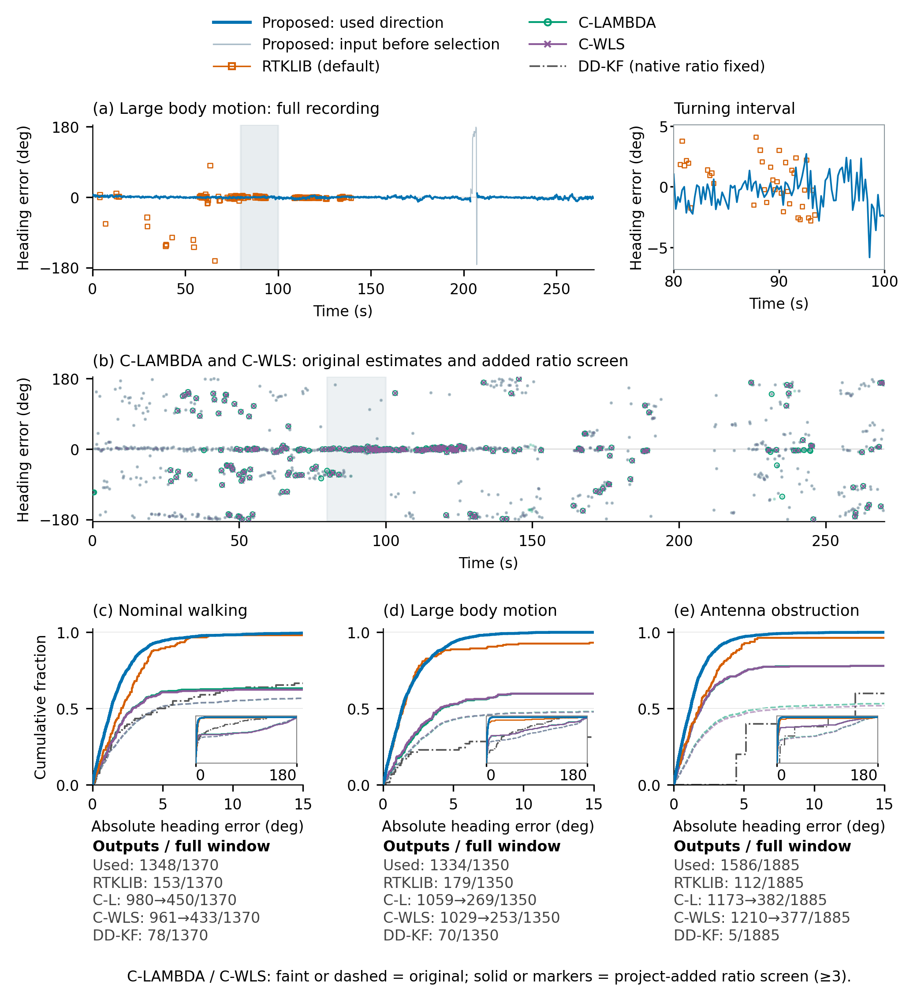

# 正文十图：以航向精度为主线的完整读法

日期：2026-10-12。本册只解释本轮最新正文图，不混入旧版本。

贯穿全文的问题仍是：**在紧凑四足机器人的 GNSS/INS 中，短基线方向信息与机身运动观测如何共同改善姿态和平移估计，这种互补在什么观测可用性与质量条件下成立，又在何时失效？**

本轮将**航向精度**放在结果中心：先说明需要哪种方向约束、该方向在真实平台上是否可靠，再展示融合航向的改善；倾角和平移用于解释不同观测的作用，受控扰动用于检验条件变化。正文仅重点讨论两个严重精度边界，其余全部结果和失败仍保留配表。

阅读时记住三个区别：方向输入的误差不等于融合后航向误差；局部过程不等于全窗RMSE；方法有输出不等于输出准确。

## 图1　紧凑四足平台与短基线安装

**(a)真实照片，(b)平台插图，(c)几何定义。** (a)完整显示真实采集照片；(b)依实物照片调用image绘制，帮助看清机身与上方装配；(c)用矢量标明p1、p2、b=p2−p1、名义0.35m基线及机体坐标轴。三部分分别交代实物、结构与方向观测来源。

**正文主张：** 紧凑平台上的短基线提供方向信息。照片保留实物证据，插图用于说明，几何图连接方法定义。

**下一步：** 按论文方法统一器件称呼、基线方位到机身航向的安装角约定。抽象坐标原点不表示已测量的IMU位置；不能从照片推断相位中心或杆臂。图1为174×82mm，文字最小8pt，矢量几何与实际照片分开保存。

## 图2　方向与机身观测怎样作用于共同状态

**沿箭头从左到右读。** MEMS IMU传播共同状态；GNSS位置对在实际支路构造方向并做有效性/新息选择；roll/pitch直接走倾角支路，body velocity经过坐标旋转。观测进入更新前的菱形标明冻结V3的有效GNSS事件调度。更新下方的质量/新息控制协方差，再返回真正使用它的更新步骤。

历史heading+tilt只以虚线连接预处理坐标旋转，没有画成当前估计状态的实时反馈。已纠正一个接线问题：roll/pitch不再进入Frame rotation，而是沿独立倾角箭头直接进入更新门。

**正文主张：** 不同观测校正同一个姿态、位置、速度与零偏状态；方向选择、坐标转换、更新调度各自位于实际作用路径。

**下一步：** 本轮image信息关系与设计已完成。原生1816×866像素的图2已保存PNG及原像素嵌入PDF；174mm下约265ppi，出版排版仍需矢量化文字和线条，不能把PDF封装当作矢量成图。完整箭头解释和英文图注见schematics/README.md。

## 图3　沿真实事件看路线、朝向与导航误差

**先看左列路线，再沿同一行看右列误差。** 三行分别为常规行走、大幅机身运动记录和单侧天线遮挡记录。

- **(a,d,g)**：米尺度的事件路线。灰黑参考与蓝色本文轨迹高度重合时，说明位置差相对运动距离较小；等长箭头表示机身朝向，白圆为事件首点。右下小窗用完整路线定位事件。
- **(b,e,h)**：同一事件中本文与双位置IEKF两种参数的航向误差。接近零越好；不需要从轨迹细线之间猜测角度差。
- **(c,f,i)**：同一时间轴的水平位置误差，单位厘米，使姿态表现与位置表现能够对应。

前两行是评价窗80–100s的首个参考确认转弯，净方向变化约87°和83°，位移约23.2m和21.0m。选择只看参考运动，不看哪种方法误差更小。第三行显示173.94–235.95s；其中灰带183.94–225.95s是原登记遮挡，前后各保留10s上下文。

**正文主张：** 航向精度的差别可以放回具体转弯和遮挡过程观察。常规转弯中各方案都有相近波动；这段遮挡中本文较好地保持方向，双位置IEKF出现持续偏移。

**适用范围：** 大幅运动是整条记录的场景名，80–100s只被参考确认是转弯，不能说它有人工确认的特定动作标签。局部路线使用已有参考/本文物理点；外部位置误差沿用原评价定义，不在图上拼造外部空间轨迹。

**下一步：** 重点判断当前转弯、遮挡两类事件是否已足以交代平台特征。图6使用相同窗口，后续应统一在正文中引用这些事件。

## 图4　不同绝对朝向，为什么可以对应相同相对运动

**它是一张方向自由度图，不是定位精度图。** 局部xy坐标也不是地理东、北坐标。

- **(a)**：完全相同的IMU和足端接触输入，仅改变已知初始航向，得到七条整体朝向不同的轨迹。0°、±100°突出，其余四条淡灰。起点三根箭头使用真实已知的初始Euler yaw，颜色对应图例。
- **(b)**：只消除每条运行已知的初始旋转，七条路径重合。没有再拟合角度、尺度、平移或时间。
- **(c)**：在相同原生时刻比较旋转校正后的三维位置。最大差为约**1.89×10⁻⁷m**，因此(b)看上去只有一条蓝线。这个数是运行之间的等价性残差，不能解释成亚微米定位精度。

**正文主张：** 自身观测能够限定相对运动，却允许多个等价的全局方向；外部方向约束用于确定全局朝向。

**适用范围：** 这是已有可观测性结构在当前数据与实现中的检验，不把它包装成新发现的不可观测性定理。完整秩谱、不同接触窗口和阈值结果仍在配套材料中。

**下一步：** 作者主要确认“a中的不同方向—b中的相同运动—c中的实际重合程度”是否已经直观。若继续减版面，应保留a/b，不再添加重复的维数点图。

## 图5　短基线方向路线的误差，以及新增筛选实际做了什么

**本图现在先展示误差过程，再用完整记录的误差分布比较。** 蓝线是融合器采用的方向观测，图6才是融合后的机身航向。

- **(a)**：大幅机身运动整条记录中，灰蓝细线是选择前的方向输入，蓝线是原生更新实际采用的方向，橙色方点是预先指定的RTKLIB默认动基线固定输出。完整图保留约205s的大输入异常；右侧单独放大80–100s转弯，与图3、6对应。
- **(b)**：C-LAMBDA、C-WLS原始估计用淡点保留，绿色圆和紫色叉标出本轮新增成本比筛选留下的历元。筛选没有重新改写航向，只决定是否保留该次输出。
- **(c–e)**：三条完整记录的绝对航向误差累积分布。横坐标误差越小越好；同一个误差阈值下，曲线越高，表示更多有效输出达到了该精度。主轴展开0–15°，小窗保留完整0–180°尾部。下方的数量说明该曲线背后有多少输出，防止只看精度而忽略稀疏输出。

**先纠正“没做整数接受检验”的含义。** 既有实现已经完成两篇文献的单基线核心求解。原文没有规定本轮增加的`ratio≥3`在线接受步骤，因此这不是补回漏做的文献步骤。找出本次搜索最好的整数/方向答案，与判断该答案是否足够可信，是两个不同环节。

用户要求进一步做完质量判断后，本轮已完成一套**项目新增成本比筛选**：比较最佳与第二个不同整数答案的成本，阈值先固定为3，再跨三条记录生成全部接受状态，之后才连接已有参考误差。C-WLS先合并重复的整数答案，避免把同一个答案的两个拷贝当作第一、第二名。原有搜索失败继续保持失败。不同方法成本定义不完全相同，所以这个工程阈值也不是相同错误固定概率的标定值。

筛选后的C-LAMBDA/C-WLS在大幅运动记录中的RMSE约从89°降到74.5°/75.0°，遮挡记录从约81°降到54.7°/54.9°；相应保留输出比例降至约19%–20%。常规记录改善很小。这说明它筛掉了一部分历元，但仍接受了部分大误差答案。完整状态为10446个历史历元中2484接受、4988因成本比拒绝、2974原生无效；评价窗统计单独使用1370/1350/1885的固定分母。

**正文主张：** 在本平台的这些记录中，位置产品形成的方向结合原生质量选择提供了更集中于小误差、也更连续的方向观测。原始双天线路线加上明确筛选后仍存在误差和支持上的不足，因此本图为本文采用的方向观测路线提供依据，而非仅仅“证明别人的算法无效”。

**适用范围：** 这些路线来自同批记录，但处理输入、输出接受条件与有效时刻不同。原始基线的水平投影方向和商业融合Euler yaw在较大roll/pitch下也不完全相同；同时间配对结果已经另表保存。不能将本图写成完全相同输入的整数求解器统一竞赛。

**下一步：** 讨论正文最需要保留哪几条方向路线。RTKLIB其余三种配置和全部原始/筛选指标已保存，正文当前使用事先确定的默认配置，没有按结果挑最佳配置。

## 图6　持续方向更新带来的航向收益

**这张是自然场景下的核心航向结果。** 蓝色是完整方法，橙色是基础配置加入持续方向，灰色是基础GNSS/INS。

- **(a–c)**：三条记录的全部航向误差。灰、橙共享初始方向，因此它们的区别展示运行期间持续方向更新的作用。
- **(d–f)**：图3同一事件的放大。前两列80–100s转弯，第三列首段遮挡及恢复。可以直接看出基础配置的偏移，以及加入方向后曲线如何接近零。
- **(g–i)**：倾角辅助的独立消融。每个roll/pitch分量，紫点为关闭倾角，蓝点为完整方法；横坐标是全窗RMSE，越靠左越好。这一排用于说明其他姿态分量，不再用六幅密集时序与航向争夺版面。

基础→加入方向的航向RMSE分别为**8.090°→1.916°、7.137°→1.941°、5.739°→2.432°**。完整方法与仅加方向的自然航向接近，正说明持续方向更新贡献了主要航向收益。倾角的作用随分量和场景变化，遮挡记录俯仰只改善约0.039°。

**正文主张：** 短基线方向更新显著减小自然记录中的航向偏离；机载倾角观测对roll/pitch另有分量相关的作用。

**适用范围：** 灰—蓝之间还改变了其他辅助，不能全部归因于一个航向开关；真正的方向对照是灰—橙，倾角对照是最后一排的紫—蓝。曲线重叠是已保存结果接近，不是漏画。

**下一步：** 以这张确定航向主结论的表述，并与图5衔接：“观测方向更好”是否真正转化为“融合航向更好”。

## 图7　航向保持时，机身速度怎样帮助位置

**先看顶部状态条，再看曲线。** 三条状态线依次为位置观测、方向观测、机身辅助更新。深色表示持续，浅色表示中断；状态条描述完整方法。

- **左列**：全部GNSS中断，方向不可用，辅助更新也暂停。
- **右列**：平移观测中断，方向与相关辅助更新持续。
- **(a,b)**：两种条件中的航向误差。
- **(c,d)**：同一20s过程中的位置误差。灰色为中断，20s恢复GNSS。误差上升和下降表示漂移积累与观测恢复后的校正，不是机器人实际走了一段“凸起路线”。右侧小窗展开完整方法的米级误差。
- **(e,f)**：各时长全部九个布置的全窗水平RMSE，细线连接同一个布置。纵轴为对数，不能用高度差当作线性差值。

右列代表例在恢复前，关闭速度辅助的位置误差约88.0m，完整方法约1.38m；该例全窗RMSE则约10.50m与0.20m。20s全部九个布置的全窗中位数约7.961m与0.241m。它们分别是瞬时末端、单例全窗和多例中位数，含义不同。

**正文主张：** 在方向和有效辅助更新持续的条件下，机身速度显著限制平移漂移；这是航向与机身运动互补作用的空间结果。

**适用范围：** 左右列同时改变方向可用性与辅助调度；当前机身速度构造还继承历史方向旋转关系。因此本图展示现有实现的运行条件，不单独分离纯方向开关的因果效应。

**下一步：** 看作者是否能只凭状态条和恢复线读懂两种条件。正文将重点解释右列，并用左列说明该互补不能随意外推到全部GNSS丢失。

## 图8　位置观测受扰时怎样保持航向

**先看(a)的航向，再沿同一时间看(b)的来源调整。** 本图保留一个具体过程和一项完整集合统计。

- **(a)**：整条位置输入加入水平σ=3m、垂直σ=5m噪声的既有代表例。关闭来源加权与完整方法的航向RMSE为**29.80°与2.70°**。
- **(b)**：同次运行实际保存的位置、方向、机身速度协方差倍率。倍率越大，表示相对降低该来源信任。它与(a)共时间轴，便于查看何时采用怎样的处理。
- **(c)**：同一案例的位置代价：水平RMSE约**3.17m→3.56m**。航向改善明显，但位置并未同时变好。
- **(d)**：全部513个双方均完成案例的航向RMSE降低量分布。横轴为“关闭加权−完整”，正值有利于完整方法；零附近±0.02°线性，其余采用有符号对数尺度。

**正文主张：** 来源质量处理可以在位置观测受扰时保护航向，但收益不会对所有状态和所有案例同时发生。

**适用范围：** 实际倍率与误差同轴便于解释，不能仅凭两条曲线形状断言唯一因果机制。513对不包含新增完成的六例；完整分母仍为541，关闭加权513完成/19发散/9无初始方向，完整方法519/13/9。

**下一步：** 重点确认(a,b)是否已经清楚说明来源质量变化与航向表现，正文只用一两句话保留位置代价与总体配对结果。

## 图9　滤波类与因子图类方法的航向比较

**同一场景左边看航向随时间怎样变化，右边看整段误差分布。** 颜色始终对应同一方法，文献/标定参数用不同线型。

- **(a,c,e)**：三条自然记录中，本文、双位置IEKF文献/标定、单位置IEKF文献/标定、重新初始化OiSAM的航向误差。灰带为已登记遮挡，动态输出缺失处断线。
- **(b,d,f)**：同一批共同历元的绝对航向误差分布。越靠左上表示小误差时刻占比越高。大幅运动面板附0–10°细节，完整尾部仍在主轴中。
- **(g)**：首个登记20s位置中断的航向过程。金色点划线为保留基线IEKF，20s恢复位置。
- **(h)**：全部18个中断条件的全窗航向RMSE；每点是一例，黑短线是中位数。它与上三行自然条件分开解释。

自然场景所有方法使用相同名义动态时刻，共**274/267/367**点；既有误差按距名义秒≤5ms匹配，不插值。这是同图所需的1Hz共同支持统计，原全频率评价继续保留。

| 方法 | 常规行走 | 大幅机身运动 | 天线遮挡 |
|---|---:|---:|---:|
| 本文 | 1.778° | 1.797° | 2.323° |
| 双位置IEKF，文献 | 2.905° | 2.027° | 2.421° |
| 双位置IEKF，标定 | **1.469°** | **1.789°** | 3.902° |
| 单位置IEKF，文献 | 11.912° | 20.027° | 5.748° |
| 单位置IEKF，标定 | 10.161° | 7.545° | 8.175° |
| OiSAM，按记录缺口恢复 | 4.659° | 2.535° | 3.984° |

**正文主张：** 本文相对单位置方法及当前OiSAM设置有明显航向优势，遮挡时相对双位置标定方案也更稳；**常规场景标定双位置IEKF更好，大幅运动中两者近似**。论文不能写成所有场景全面优胜。

**适用范围：** 大幅运动的双位置方法几何审查例外和不同初始化结果仍在完整表。GINav只有2个有效支持点的场景不足以形成可靠全窗航向曲线；其余速度门限失败也留表。原始码TC/GNC-FGO没有适合当前共同航向比较的自估计姿态输出，因此回到定位补充。全部已执行解级方法都有去向，正文不再混合不同物理点的位置排名。

**下一步：** 将系统比较结论写成按场景成立的航向收益，并在方法比较表中用简短列说明每个方法的方向、位置和辅助输入。

## 图10　航向质量条件与两个剩余精度边界

**上排看方向可用性和质量变化，下排看跨来源冲突。** 这些来自实测记录上的既有受控观测扰动，不是九次独立重新采集的实地实验。

- **(a)**：方向中断0、5、20s时的全窗航向RMSE。每个非零条件保留全部九个登记布置。
- **(b)**：方向噪声参数σ=0、1、5°。点是单次实现，线连接该强度的中位数。
- **(c)**：±10°方向尖峰概率0、5%、10%。零条件只有一条真实干净运行，没有复制成九次。
- **(d)**：位置/速度来源冲突的第一条保留航向时序。该族仅此变体按历史协议保留双方时序，因此用它展示过程，再由(e)展示全部变体。
- **(e)**：全部九个冲突变体的原始航向RMSE。蓝点完整，空紫点关闭来源加权，细线配对相同变体。第三、第五例完整方法仍有**55.8°、69.3°**误差，这两个是正文重点展示的精度边界。第五例关闭加权真实发散，因此没有伪造一个数值点。

上排中基础GNSS/INS约8°且近乎不变，是因为它不采用持续方向观测；其输入没有暴露于这些方向扰动。橙、蓝约2°且接近，说明在已测强度范围内，持续方向约束的主要收益仍在；5°噪声使误差和分散程度有所增加。不能由这些点外推无限大的噪声或任意长中断。

**正文主张：** 持续方向更新的航向收益在已执行的可用性和质量变化范围内保持；跨来源冲突仍可能导致严重航向错误。

**适用范围：** 方向扰动沿用原始1s单元的实现，并非新增独立5Hz噪声。中位线不是置信区间。下排完整9/9完成、关闭加权8/9完成，所有九例都在，**只突出两例边界，没有从统计分母中删除其他失败或大误差**。

完整受控证据继续保留：5951行核心结果、2164条四项单开关配对、全部未完成及61类×11配置的状态与航向表。实际改变RP、HV的条件分别整理；输入没有变化的对照单列，避免把它们当成抗扰证据。正文不再把全部异质条件压成一张难读的热图。

**下一步：** 讨论这两个精度边界是否足以说明当前方法失效的性质。后续结论使用“在所测强度范围内保持收益、在部分跨源冲突中仍失效”，不从两例推导新的精确失效阈值。

## 这十图怎样组成结果

| 读者的问题 | 主要图件 | 结论位置 |
|---|---|---|
| 机器人上装了什么，方向与机身观测怎样进入算法？ | 图1、2 | 平台与方法 |
| 结果发生在怎样的真实运动和遮挡中？ | 图3 | 场景和代表过程 |
| 自身观测为什么还需要绝对方向？ | 图4 | 研究动机 |
| 本文采用的方向观测是否有精度和可用性依据？ | 图5 | 方向路线比较 |
| 方向观测是否转化为融合航向改善？ | 图6 | 核心航向结果 |
| 较好的方向怎样支持机身运动的平移作用？ | 图7 | 条件互补 |
| 质量变化时怎样保持航向，付出什么代价？ | 图8 | 质量作用机制与总体配对 |
| 与已执行滤波、因子图路线相比怎样？ | 图9 | 系统航向比较 |
| 受控强度变化和跨来源冲突下是否仍成立？ | 图10 | 条件范围与失效边界 |

作者下一轮最值得决定的是：**图5的方向处理比较是否已经直观；图6、9是否把“航向精度”放到了足够清楚的位置；图7是否能通过状态条读懂互补条件。** 完整失败与未展示配置已经有记录，不需要在正文再次铺满状态报表。

## 来源入口

- 图3、9：[navigation/README.md](navigation/README.md)。
- 图4：[observability/README.md](observability/README.md)。
- 图5：[heading_acceptance/CAPTIONS_ZH_EN.md](heading_acceptance/CAPTIONS_ZH_EN.md)与[接受层原文核对](heading_acceptance/AUDIT_REPORT_ZH.md)。
- 图6、7、8、10：[aiding/README_航向主线图6_7_8_10.md](aiding/README_航向主线图6_7_8_10.md)。
- 全图定位：[MAIN_FIGURE_CATALOG.csv](MAIN_FIGURE_CATALOG.csv)。

图1、2待总审将最终面板和文件状态补全，其余八图已经有本轮成图、双语图注、数据入口及视觉检查。本轮新增计算包括图5的工程接受筛选和若干共同支持的配图统计；原始导航求解器及冻结V3结果没有改变。
