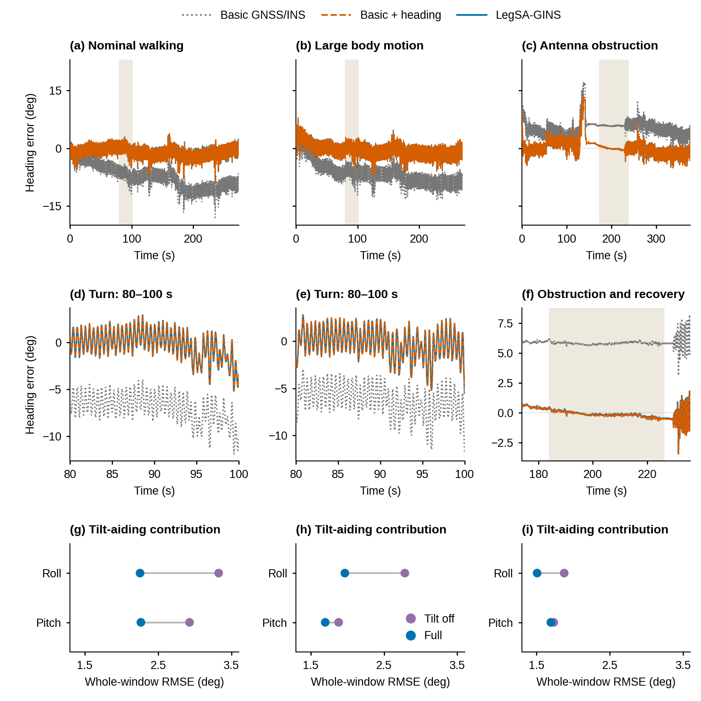
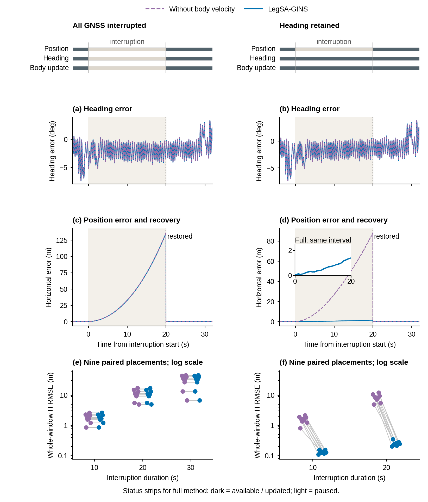
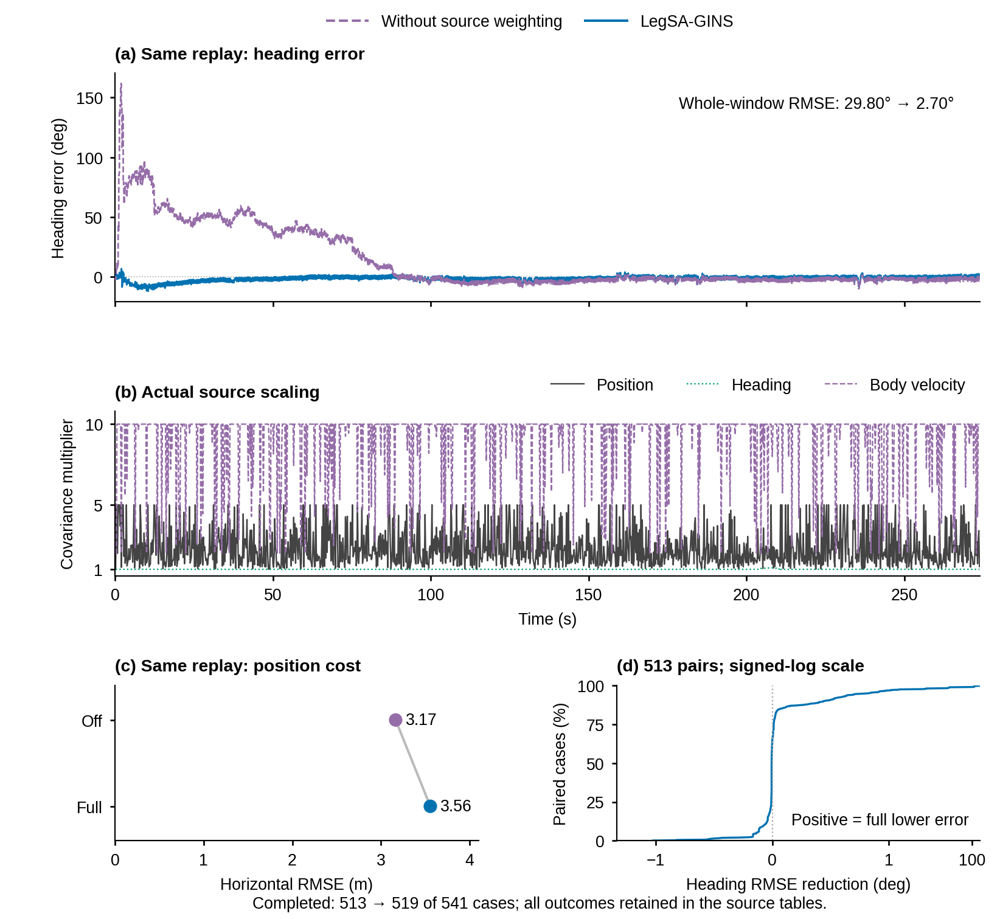
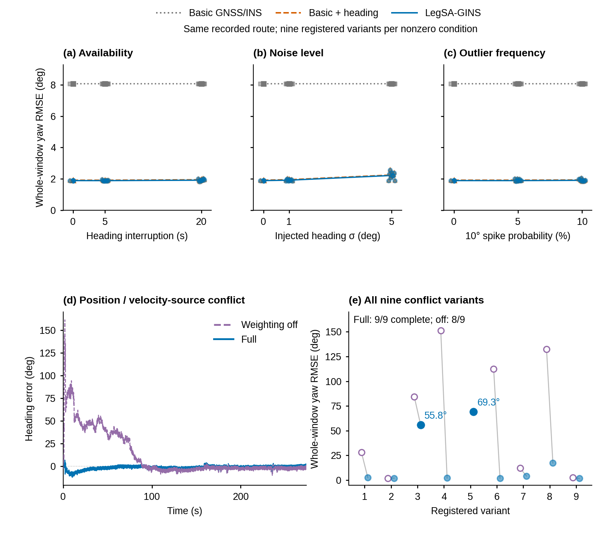

# 航向主线：正文图 6、7、8、10

本目录是 2026-10-12 的最新修订，全部来自冻结 V3 已保存的输出、评价时序与运行日志。没有运行求解器、provider 或 evaluator。图形宽度 174 mm，最小字 8 pt，正文输出位于 `figures/`，提供 PDF、SVG、PNG（600 dpi）、LZW TIFF（600 dpi）；`preview/` 为快速预览和灰度检查。

科学问题沿用作者选定原句：在紧凑四足机器人的 GNSS/INS 中，短基线方向信息与机身运动观测如何共同改善姿态和平移估计，这种互补在什么观测可用性与质量条件下成立，又在何时失效？本轮将航向精度作为主要结果，姿态其他分量和平移作为作用路径与适用条件。

## 图 6：持续方向更新的航向收益，以及倾角的独立作用

第一排 (a–c) 为三条自然记录的完整航向误差。灰色基础 GNSS/INS 与橙色“基础+航向”共享初始方向，两者的对照用于解释持续航向更新。蓝色完整方法还包含其他辅助；不能把灰—蓝差异全部归给一个单开关。灰色背景带标出第二排窗口。

第二排 (d–f) 保留同一窗口的全部原始样本，没有平滑。常规与大幅机身运动记录采用与图 3 共用的 80–100 s 参考转弯窗口；这是参考运动识别的转弯段，不能称作人工标注的特殊动作区间。遮挡记录共用 173.94–235.95 s 的上下文窗口，其中浅色区标明已登记的 183.94–225.95 s 遮挡。橙、蓝接近反映真实的航向收益接近，而非删除某条曲线。

第三排 (g–i) 将原 roll/pitch 六条时序压缩为独立倾角消融的整窗 RMSE：紫点关闭倾角，蓝点完整方法。两点用灰线连接同一个分量。小收益仍按原值显示，遮挡记录的俯仰只有约 0.039° 改善。

**暂定图注（英文）**：Effect of sustained short-baseline heading updates in three recorded scenarios. (a–c) Full-window heading errors for basic GNSS/INS, the basic configuration with heading updates, and LegSA-GINS; all share the initial direction. (d–f) Original samples within the highlighted intervals, using reference-defined turning windows for the first two records and the registered obstruction interval for the third. (g–i) Whole-window roll and pitch RMSE for the full configuration and its tilt-aiding ablation. The lower comparisons are separate controlled ablations and do not imply that the basic-to-full contrast changes heading alone. No time-series smoothing is applied.

## 图 7：方向保留与辅助调度条件下的平移作用

每列上方的三条状态线分别是位置观测、方向观测、机身辅助更新：深色表示持续，浅色表示中断。左列所有 GNSS 中断时辅助更新也暂停；右列平移观测中断而方向和辅助更新持续。状态条描述完整方法的更新条件，关闭机身速度的对照当然不执行 HV 更新。

(a–b) 是同一 20 s 中断的航向误差；(c–d) 是同一时间轴下的水平误差。灰色区间为中断，20 s 为恢复。中断中的上升是导航位置误差增长；恢复后的下降是绝对观测校正。它不是实际运动轨迹的“凸起”。右侧小窗展开蓝线在相同中断区间内的米级误差。

(e–f) 保留各时长全部九个布置的整窗水平 RMSE，每条细线连接同一布置的两个配置。纵轴是对数尺度。这个统计包括整个评价窗口，与 (c–d) 中断末端的瞬时误差不是一个指标。原始末端样本和整窗 RMSE 已分列写入 `tables/F07_REPRESENTATIVE_ENDPOINTS.csv`。

**支持范围**：当前实现下，当方向与辅助更新保持时，机身速度明显抑制平移漂移。左右两列同时改变了方向可用性和辅助调度，不能宣称为独立的 heading×HV 因子试验。HV 还继承冻结的历史方向旋转关系。

**暂定图注（英文）**：Conditional translation benefit of body-velocity aiding during controlled interruptions. Availability strips describe position observations, heading observations and auxiliary updates in the full configuration. Dark segments denote continued availability and light segments denote interruption. (a,b) Heading errors and (c,d) horizontal errors for the same 20-s event; absolute observations resume at 20 s. The inset expands the full-method error over the identical interval. (e,f) Whole-window horizontal RMSE for all nine registered placements per duration; lines join the same placement and the ordinate is logarithmic. In the evaluated implementation, complete GNSS loss also suspends auxiliary updates, so the columns represent operating conditions rather than an independent heading-by-velocity factorial experiment.

## 图 8：质量变化时保护航向，保留位置代价

(a) 使用原来的 D15_seed_00：位置加噪 H σ=3 m、V σ=5 m，整条输入序列施加，并非人为画出的局部故障窗。关闭来源加权与完整方法的航向 RMSE 为 29.80° 与 2.70°。

(b) 直接从同次运行保存的日志画出实际位置、方向、HV 的协方差倍率，并与 (a) 共用时间轴。倍率增大意味着相对降低信任。全部六来源在压缩源表中保留。对齐有助于查阅运行过程，不以图形相关替代机制验证。

(c) 用小面板保留同次运行的位置代价：3.17 m→3.56 m。它不再与航向曲线平分主图，但仍然明确可见。

(d) 使用全部 513 个双方均完成案例，以“关闭加权 RMSE−完整 RMSE”为横轴。正值表示完整方法航向误差更低；与配对改善统一同号。横轴为有符号对数，零附近 ±0.02° 保持线性。新增完成的六例不混进 513 对。完整结果为关闭加权 513 完成、19 发散、9 无初始方向；完整方法 519、13、9。全部原始结果和每个失败保留在配表。

**暂定图注（英文）**：Heading preservation under degraded position observations. (a) Heading errors for a retained replay with added horizontal/vertical position-noise standard deviations of 3/5 m. (b) Actual covariance multipliers for position, heading and body-velocity sources on the same time axis; a larger multiplier reduces relative trust. (c) Whole-window horizontal RMSE for the same replay, retaining the positioning cost. (d) Distribution of heading-RMSE reductions, defined as weighting-off minus full, in all 513 jointly completed cases. Positive values favour the full configuration. The signed-log abscissa is linear within ±0.02°. All 541 outcomes and additional completions are retained separately in source tables.

## 图 10：航向可用性、质量强度与跨源冲突

上排围绕航向精度绘制三个真正已执行的物理变化：

- (a) 方向中断 0、5、20 s；非零条件包含全部九个登记布置。
- (b) 方向噪声参数 σ=0、1、5°，保留全部九个登记实现。
- (c) ±10° 方向尖峰，登记概率为 0、5%、10%。

各点是运行级全窗 RMSE，线连接物理递增强度的中位数。没有把类别任意连线，也没有将 clean 结果复制为九次试验。零条件只有一条实际 clean 运行。微小水平散开只为显示重合点，不改变物理强度。噪声和尖峰的已实现圆周扰动从原始 1 s 单元延拓到 V3 的方向输入，**不是新独立的 5 Hz 随机注入**；F01 不使用持续方向观测，其相同结果是输入无暴露的真实对照。

(d) 为 D59_seed_00 的原始航向时序：位置受扰、方向保持原条件，且 Doppler 与接收机速度存在约 1 m/s 冲突。这是 D59 中唯一按历史保留协议保留双方误差时序的 variant。其余 variant 的时序已释放，准确原始运行指标仍在，没有重造或重跑它们。

(e) 用全部九个 D59 variant 的原始航向 RMSE 补足代表时序的局限：蓝点完整、空紫点关闭加权，细线配对相同 variant。第 3 和第 5 例完整方法仍有 **55.8°、69.3°** 误差，正文明确突出这两个精度边界；第 5 例关闭加权发生真实发散，没有伪造 RMSE 坐标。其余结果保持浅显展示，不将整篇变成失败报表。完成分母为完整 9/9、关闭加权 8/9。

**暂定图注（英文）**：Heading accuracy under controlled observation degradation and a remaining cross-source conflict. (a–c) Whole-window heading RMSE versus interruption duration, nominal injected angular-noise standard deviation and the registered probability of ±10° spikes. All nine registered variants are shown at each nonzero level; the clean reference is one actual run. Lines join medians, not confidence limits. Existing disturbances are extended over their original one-second cells and are not independent 5-Hz realizations. (d) The retained time history for the first registered position/velocity-conflict replay. (e) Original paired RMSE for all nine variants of that condition; filled blue markers denote full and open purple markers denote weighting off. Two large full-method errors are annotated to show that completion does not ensure accurate heading. The weighting-off run missing at variant 5 diverged and is not assigned a numerical error.

## 完整半合成证据怎样保留

`tables/ALL5951_RESULTS_WITH_INPUT_GROUPS.csv` 保留 5951 行全部核心配置结果；`ALL2164_ORIGINAL_ABLATION_PAIRS.csv` 保留全部四项单开关对照；`ALL_CORE_NONCOMPLETIONS.csv` 保留每个未完成；`ALL61x11_STATUS_AND_HEADING.csv` 对每类每配置同时给出分母、状态与条件性航向中位数。没有删除未展示的失败。

`ALL61_PHYSICAL_INPUT_MAP.csv` 修正了旧热图分类：

- D51、D52 真正改变 RP，D53、D54 真正改变 HV。D52 是二维偏置向量模长 2°，不是每轴 +2°。D54 保留不同 seed 的尺度、掉测、两者组合分支。
- D29、D40、D55、D56 是没有进入正式估计器活动通路的输入不变／审计对照，独立列出，不能作为抵抗真实物理扰动的证据。
- D25 和 D28 的实现参数相同（位置 std×4），保留原登记身份与分母，但不称为两种独立机制。
- RP/HV 的实际质量变化另有 `S_actual_body_observation_quality`，作为本轮补充来源保留，不挤入正文航向主线。左图分别画 roll、pitch 的单开关 RMSE 降低量；右图将 D54 按实际尺度、掉测、两者组合分支分开，连同 D53 的速度噪声，避免把不同物理影响混为一个分组。

定义依据为仓库 `docs/paper_rebuild/audit_xbpg_20261001/v3_interpretation/core/{dual_yaw,go2_prior_metadata,position_std_status}/README.md` 及其逐案例注入表、`PROTOCOL_V3_PREREG.md`。前三组原解释与 INJECTION_CASES / INJECTION_COMPONENTS 已复制到 `provenance/`。这里只读取这些冻结语义记录；物理映射中的 `registered_active_measurement_path` 表示已登记的活动量测路径，不声称重新核验了每个 provider 载荷。

## 生成与检查

在 Ubuntu-22.04 WSL 中运行 `python3 /mnt/g/LegSA-GINS-project/V3航向主线重绘_20261012/aiding/build_heading_first.py`。也可在安装 numpy/pandas/matplotlib/Pillow 的环境内从本目录运行 `python build_heading_first.py`：旧路径不存在时读取本目录复制的表格和压缩时序。压缩时序保留绘图所用 time/yaw/H 三列，全部原始样本；未使用的原始列仍在来源路径中。完整图形元数据、源时序指针和机器检查在 `FIGURE_READERS.json`、`SOURCE_SERIES.json`、`qa/`。线图未平滑、未抽样；时间间隔超过 0.1 s 的线段断开。各正文图的预览已目视检查。
