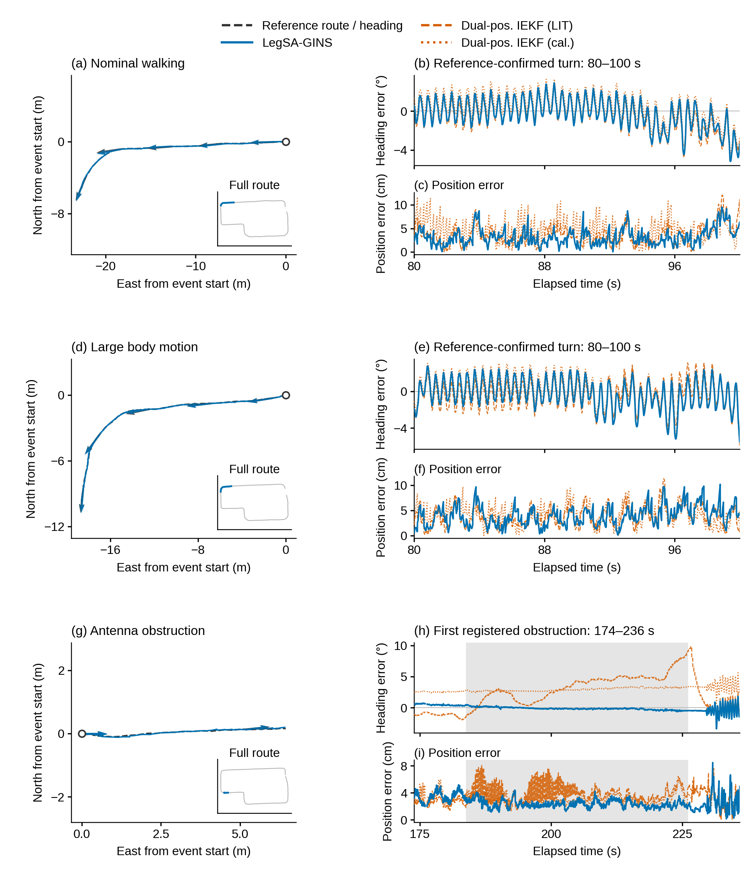
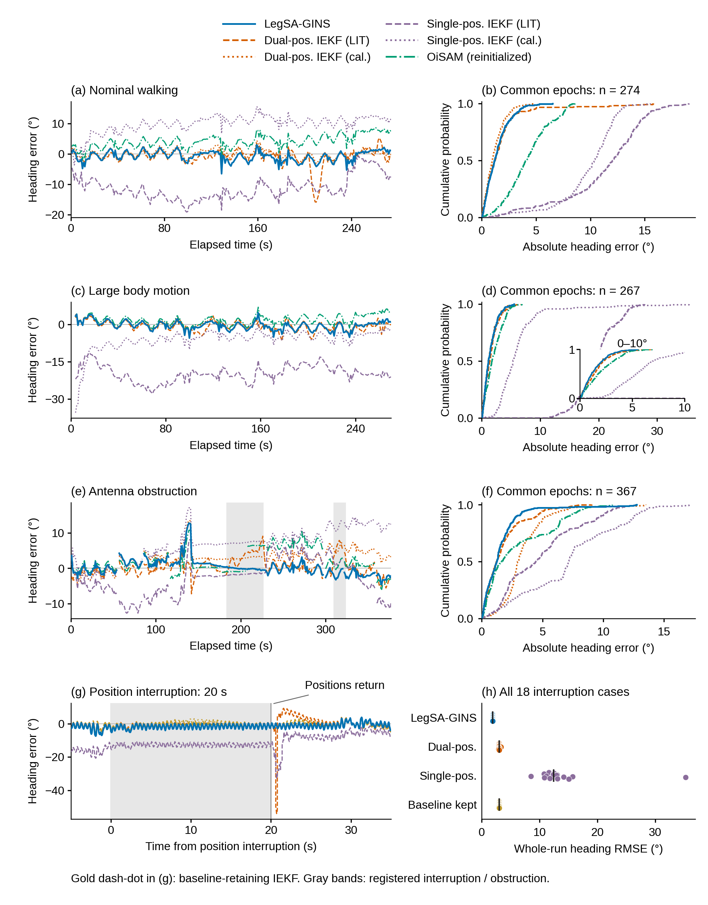

# 航向主线：图3与图9（2026-10-12）

本目录只整理既有结果，未调用导航求解器、provider 或评价器。冻结 V3：`7d43b9af26120ed5dde21f53e515386361072ba6`。原版本保留。图层共同支持统计另存，不替换历史全频率指标。

## 图3：事件中的轨迹、朝向与误差



- **(a,d,g)**：事件期间的米尺度路线。灰黑虚线为参考，蓝线为本文。等长箭头表示机身朝向，不表示速度。白圆为事件首点。右下小窗显示该事件在完整路线中的位置。
- **(b,e,h)**：同一个事件中的航向误差。蓝线为本文，橙虚线为双位置IEKF文献参数，橙点线为标定参数。
- **(c,f,i)**：同一时间段的水平位置误差，单位为厘米；这是对姿态结果的空间上下文，不以厘米路线的极短抖动代替真正的运动事件。

前两行均采用评价窗80–100秒的首个参考确认转弯。选择规则在读入估计误差前执行：从评价窗10秒后按5秒网格扫描，取首个20秒净参考航向变化≥60°、首末位移≥2m的窗口。常规记录约87°/23.2m，大幅运动记录约83°/21.0m。它们是由参考确定的转弯，不冒充有人工时间标注的特殊机身动作。

第三行使用原登记第一段遮挡183.94–225.95秒，增加前后各10秒（显示173.94–235.95秒）。遮挡实际发生的时间画成灰带。该窗口包含低速/近静止过程和后续运动，因此没有按误差胜负寻找另一段。

**读图结论**：正常转弯期间，三种估计器的航向误差都存在相近的运动相关波动；第一段遮挡中本文的航向偏离较小，而双位置IEKF存在持续偏移。小尺度位置误差与航向误差同时呈现，但不由一段局部曲线推导全窗优胜。

局部参考与本文轨迹来自已有POI显示重建；外部IEKF误差保留各自冻结评价契约，没有凭空重建外部天线/中点空间路线。参考为既有Fixposition派生参考，独立真值性质沿用论文Methods说明。

## 图9：以航向误差直接比较全部可用的解级方法



- **(a,c,e)**：三场景全部共同动态时刻的有符号航向误差，观察偏移怎样形成、恢复。
- **(b,d,f)**：完全相同样本的绝对航向误差累计分布。越靠左上表示更多时刻误差较小。大幅运动面板同时给0–10°小窗，完整尾部仍保留。
- **(g)**：首个登记20秒位置中断航向过程。灰带为位置中断；20秒恢复位置；金色点划线为保留基线IEKF。
- **(h)**：全部18个登记位置中断条件的全窗航向RMSE，每点一个案例；黑短线为中位数。没有删除高误差点。

自然场景包括本文、双位置IEKF文献/标定参数、单位置IEKF文献/标定参数，以及按原登记IMU数据块重新初始化的OiSAM。方法颜色和线型在图中不改变含义。自然与中断分成不同条件，不能把各自不同输入当成同一协议。

### 共同支持

从已有V3/OiSAM共同动态名义时刻开始，给四个IEKF提取距同一名义秒不超过5ms的已保存误差，所有方法取交集；不插值、不跨缺口连线、不按误差删点。最终三场景仍为274/267/367点。名义采样统一为1Hz用于同图比较，历史全频率统计及原始错误序列继续保留。初始化-only OiSAM状态不进入曲线。

共同支持航向RMSE（度）：

| 方法 | 常规行走 | 大幅机身运动 | 单侧天线遮挡 |
|---|---:|---:|---:|
| 本文 | 1.778 | 1.797 | 2.323 |
| 双位置IEKF（文献） | 2.905 | 2.027 | 2.421 |
| 双位置IEKF（标定） | 1.469 | 1.789 | 3.902 |
| 单位置IEKF（文献） | 11.912 | 20.027 | 5.748 |
| 单位置IEKF（标定） | 10.161 | 7.545 | 8.175 |
| OiSAM（分段重新初始化） | 4.659 | 2.535 | 3.984 |

这些是图层配对支持统计，不替换原200Hz等全频率指标。常规场景标定双位置IEKF航向优于本文，大幅机身运动中两者近似，不能写本文在所有自然场景全面优胜。遮挡条件和相对单位置方法/OiSAM的结果更能体现本文的作用。

### 全部身份的去向

`data/METHOD_DESTINATIONS.csv`列出每条自然方法/起点结果的去向：12条主起点身份进入图，4条大幅运动文件起点敏感性结果保留完整表，包含失败；大幅运动双位置几何审查例外同样保留。保留基线IEKF只使用实际执行的18例中断协议，不虚构自然场景结果。

GINav在有效场景仅有2个支持点、其余速度门限失败，因此保留`GINAV_ACTUAL_RESULTS.csv`而不画误导性全窗航向曲线。原始码TC/GNC-FGO没有适合这一共同航向比较的自估计姿态输出，留在完整GNSS1位置配表。OiSAM单次初始化结果与可用性另表保留；本图显示允许按既定记录缺口分段初始化的完整动态航向。

## 文件与再生成

- 主图：PNG（600dpi）、PDF/SVG（矢量）、TIFF（600dpi，LZW压缩）。物理宽174mm，图3高205mm、图9高222mm，文字至少8pt。
- `preview/`：300dpi彩色与灰度。
- `data/F03_EVENT_WINDOWS.csv`：窗口及选择依据。
- `data/*_COMMON_HEADING.csv.gz`：实际图9共同支持数据。
- `data/*_ALL_MATCH_ATTEMPTS.csv`：完整匹配尝试与时间差。
- `data/F09_COMMON_HEADING_STATISTICS.csv`：上述共同支持统计。
- `data/LC_ALL16_NATIVE_RECORDS.csv`：全部16条历史自然配置/起点结果。
- `data/F09_ALL18_INTERRUPTION_CASES.csv`：全部18中断结果。
- `data/DEGRADATION_EXTERNAL_TABLE_R2.csv`、`DEGRADATION_PAIRED_R2.csv`：全部外部退化结果及配对表，不删除失败。
- `SOURCE_PATHS.json`：原数据路径；生成代码依赖本地已有记录，不向Git复制原始数据。

```bash
python3 build_navigation.py
```

Windows对应路径：`G:/LegSA-GINS-project/V3航向主线重绘_20261012/navigation`。脚本当前使用已登记WSL源路径。

两张图均已实际查看彩色预览，修复事件路线缩放、局部图遮挡和标签交叉问题；PDF字号检查与文字碰撞检查通过。完整审查结果见`qa/`。
