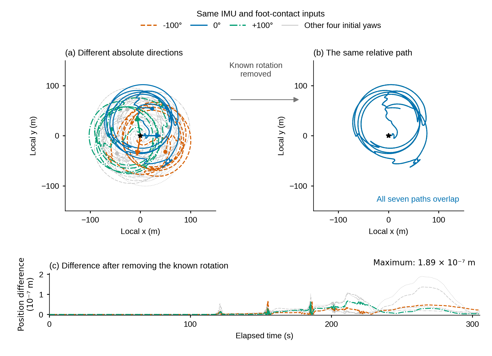

# 图4：不同绝对朝向，相同相对运动



本图保留用户要求的两个主面板，新增薄残差带来解释“右图看上去只有一条线”的原因。

- **(a) 不同绝对朝向。** 七次运行输入完全相同，只改变已知初始yaw，初值分别为0°、±50°、±100°、±150°。0°和±100°用三种颜色强调，其余四条完整轨迹用淡灰色保留。星号为共同起点，圆点为末点。起点的三根箭头由各运行真实的初始Euler yaw构造，箭头颜色与图例对应；它们不是用轨迹切线代替机身方向。
- **(b) 相同相对运动。** 对每次运行仅施加已知初始旋转的逆旋转，即`p_aligned = Rz(-initial_yaw) p`。没有轨迹拟合、平移、尺度修正或时间对齐。七条轨迹在相同局部坐标范围内重合，所以蓝色0°基准曲线覆盖其余曲线。
- **(c) 重合程度。** 各运行在同一原生时刻的旋转校正后三维位置，与0°运行做差。纵轴单位是`10^-7 m`，最大为`1.8924919178716387e-7 m`。这一残差说明(b)确实重合，而不是漏画六条线。0°自身差恒为0，其余六条残差全历元保留。

图中xy是任意局部坐标，不是East/North。这是自身观测的全局方向等价性检验，不是与地理参考的定位精度比较。核心含义：相同自身观测允许多个全局方向，而相对运动保持一致，因此需要外部绝对方向约束来选择全局朝向。

原来的“五个窗口都等于4”棍图移出正文。完整结构谱、不同阈值的秩结果、预选接触窗口和原规范自由度检验摘要都保留在`source_data/`，没有删除该理论证据。轨迹实验是既有可观测性结构的实证说明，不作为新发现的可观测性定理。

## 数据与验证

- 七条原生路径各63277行，共442939行，所有原生历元都进入图。
- 时间戳逐条完全一致；没有插值。
- 显示初始Euler yaw由每条源文件第一行核验，结果见`source_data/ALIGNMENT_SUMMARY.csv`。
- 位置最大差约`1.89e-7 m`，相对航向增量最大差约`1.27e-7 degree`。
- 所有残差数据：`source_data/ALL_NATIVE_ALIGNMENT_RESIDUALS.csv.gz`。
- 源路径、图注、计算关系与审查结果：`F04_absolute_direction_relative_motion.json`。
- 174×126mm，文字至少8pt，600dpi PNG/TIFF及矢量PDF/SVG。矢量保留全部曲线点，因此PDF约10MB、SVG约31MB。
- 已实际查看彩色和灰度预览；线型保留冗余编码，标签不覆盖曲线。PDF字号与文字碰撞审查均PASS。

本次没有运行任何新导航求解器、provider或评价器，也没有改写已有实验结果或旧图。

```bash
python3 build_observability.py
```

生成脚本复用源目录`V3论文组图_20261008/focused_20261011/robot/source_data/`下七条轨迹及结构分析表。
