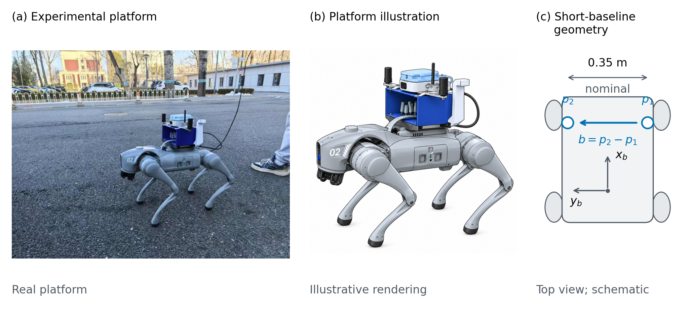
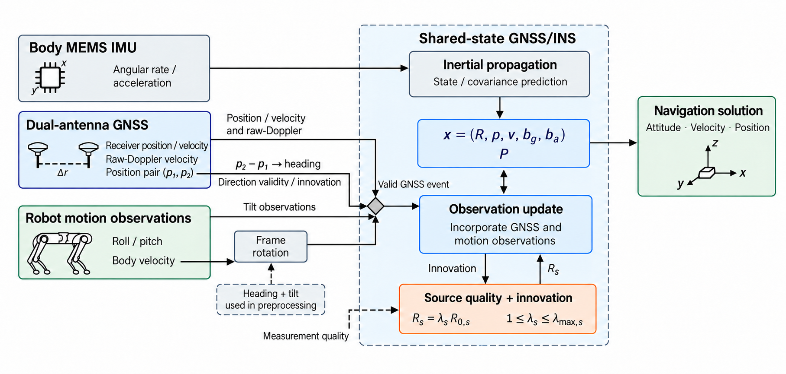

# 图1–2：平台与信息路径

## 图1｜紧凑平台、真实装配与短基线几何

(a) 原始实机照片，完整显示原帧，未重绘、修补或合成实物证据。(b) 依照该照片通过内置 image 工具生成的解释性插图；用于看清紧凑机身与上方装配关系，不能替代实物测量。(c) 原生矢量几何说明：两个接收机位置构成 b=p2−p1，标出名义0.35 m短基线与机体坐标方向。它是抽象顶视图，不是经过测量的杆臂或传感器外参图。

这张图回答“研究发生在什么平台、方向信息从何而来”。真实照片和插图各负其责，第三面板将读者带到短基线方向构造。基线方位到机身航向仍需正文中的坐标约定及安装角；图中没有用照片估计该安装角。

English caption: Compact quadruped platform and short-baseline sensing geometry. (a) Original photograph of the experimental platform. (b) Illustrative rendering of the platform and sensor assembly, generated with AI assistance from the photograph. (c) Schematic top view of the position-pair baseline and body axes. The 0.35-m label denotes the nominal baseline; the drawing does not specify surveyed lever arms or sensor extrinsics. Body heading is obtained using the coordinate and installation-angle convention described in the Methods.

## 图2｜方向选择与机身观测怎样进入同一导航状态

从左到右读：机身MEMS IMU传播同一个姿态、位置、速度和零偏状态；GNSS提供位置/速度及原始多普勒速度，两天线位置对构造方向。方向有效性和新息选择写在实际方向支路上，进入更新前的“Valid GNSS event”菱形明确当前实现的事件调度。Roll/pitch走独立的倾角观测箭头；body velocity经坐标旋转后进入更新。冻结预处理使用的历史heading+tilt以虚线单列在旋转箭头下，不画成一个不存在的实时状态反馈。

更新下方的来源质量与新息决定有界协方差倍率，箭头返回实际使用该协方差的更新步骤。右侧输出共同状态中的姿态、速度与位置。本图没有引入新的估计器或改动V3计算。

English caption: Information paths in the shared-state GNSS/INS estimator. Inertial propagation maintains the common attitude, position, velocity and bias state. GNSS positions, velocities and raw-Doppler velocity enter the observation update. The position-pair branch constructs heading and applies direction-validity and innovation selection along its measurement path. Tilt observations and pre-rotated body velocity join the update at the valid-GNSS-event gate used by the evaluated implementation. Source quality and innovation determine bounded covariance inflation. The dashed preprocessing input denotes the historical heading and tilt used for frame rotation, not a feedback from the current estimated state.

## 导出与制作

- 图1：174×82 mm；原照片1706×1279，以70 mm宽展示（原生约619 ppi）；AI插图1254×1254，以52 mm宽展示（约613 ppi）；文字/几何为矢量，最小8pt。PDF、SVG、600dpi PNG/TIFF在figures中，preview用于讨论。几何由Matplotlib构成，不生成或修改任何数据曲线。
- 图2：内置image生成的本轮成图，原生1816×866像素。PDF只作同尺寸嵌入封装，不是矢量化。174 mm栏宽时约265 ppi，因此本轮完成信息关系与视觉设计，后续出版排版仍需将文字和线条矢量化；不会将放大像素称作新增真实分辨率。
- 本轮选择的图1机器人插图与图2均调用内置image工具；不用API/CLI回退。
- 原始照片从前轮references/platform_original.jpg复制，文件内容不变。图片资产已存入本目录，不依赖临时生成目录。

Prompt与输入身份见PROMPTS_AND_PROVENANCE.md；图1组合脚本为build_platform.py。
