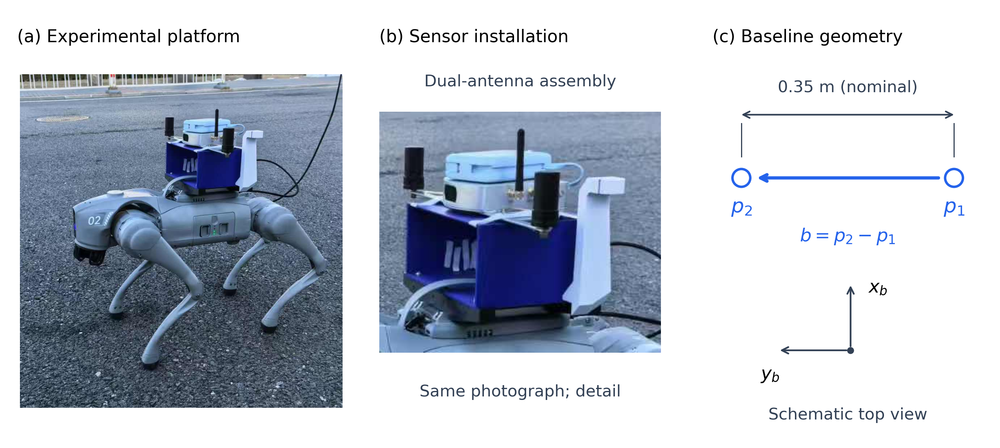
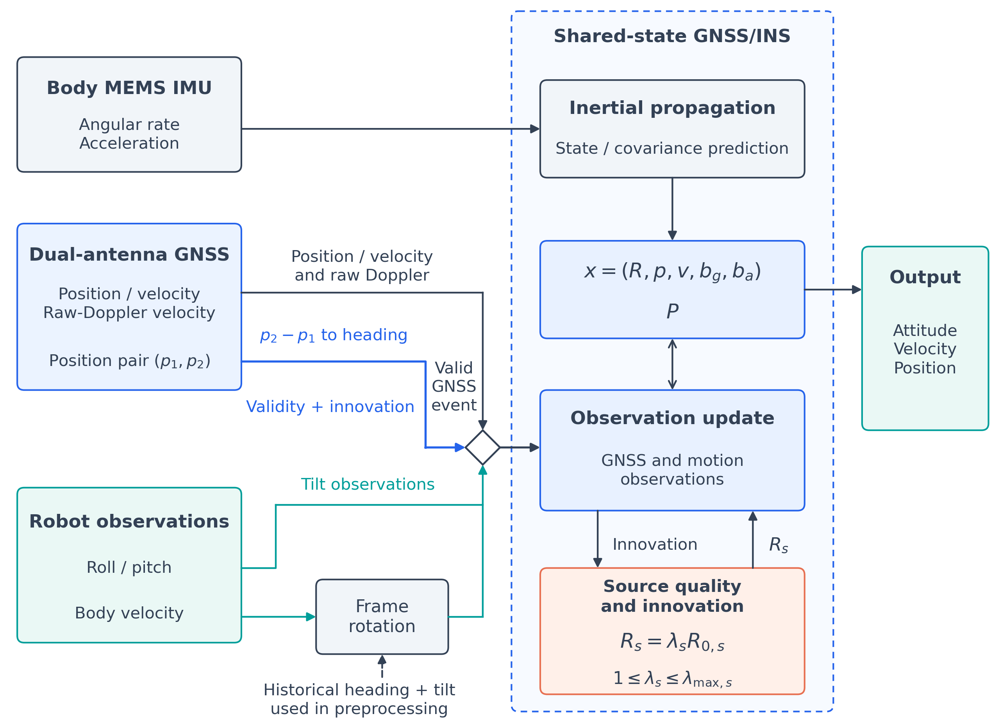
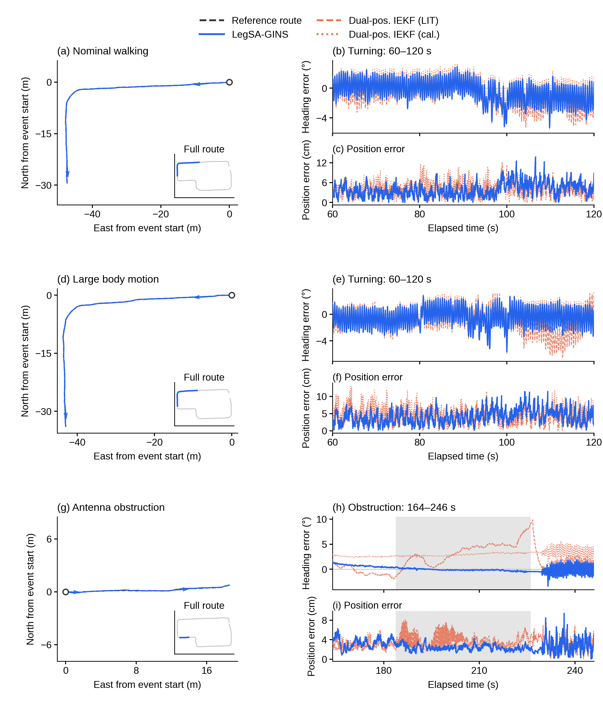
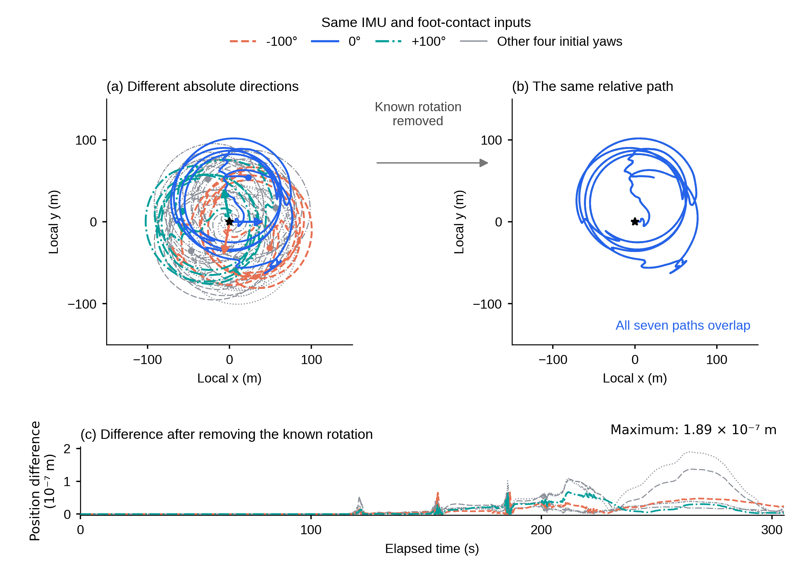
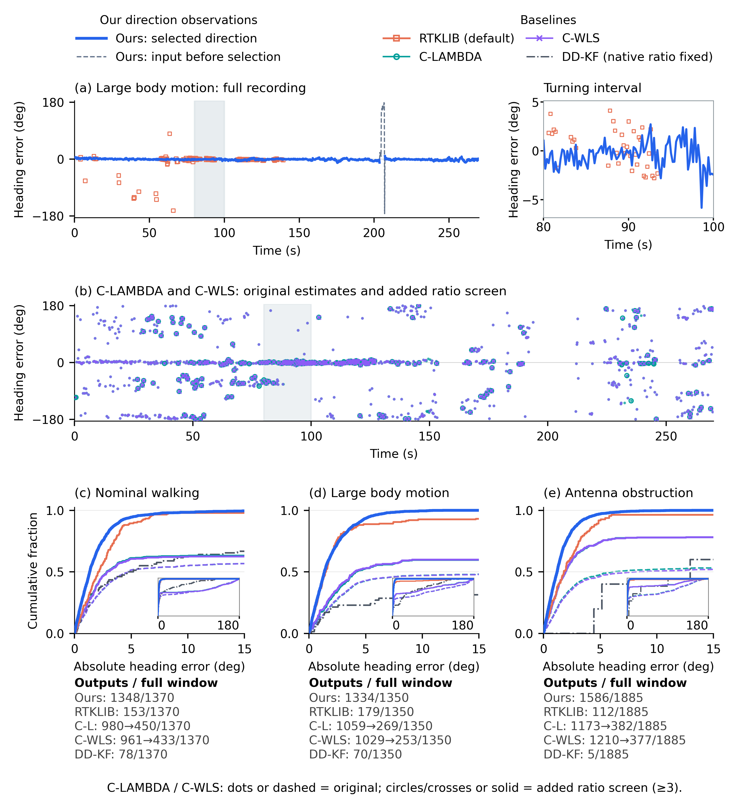
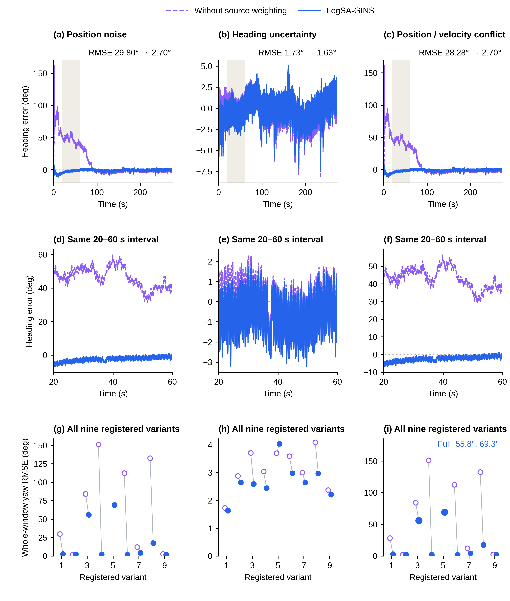
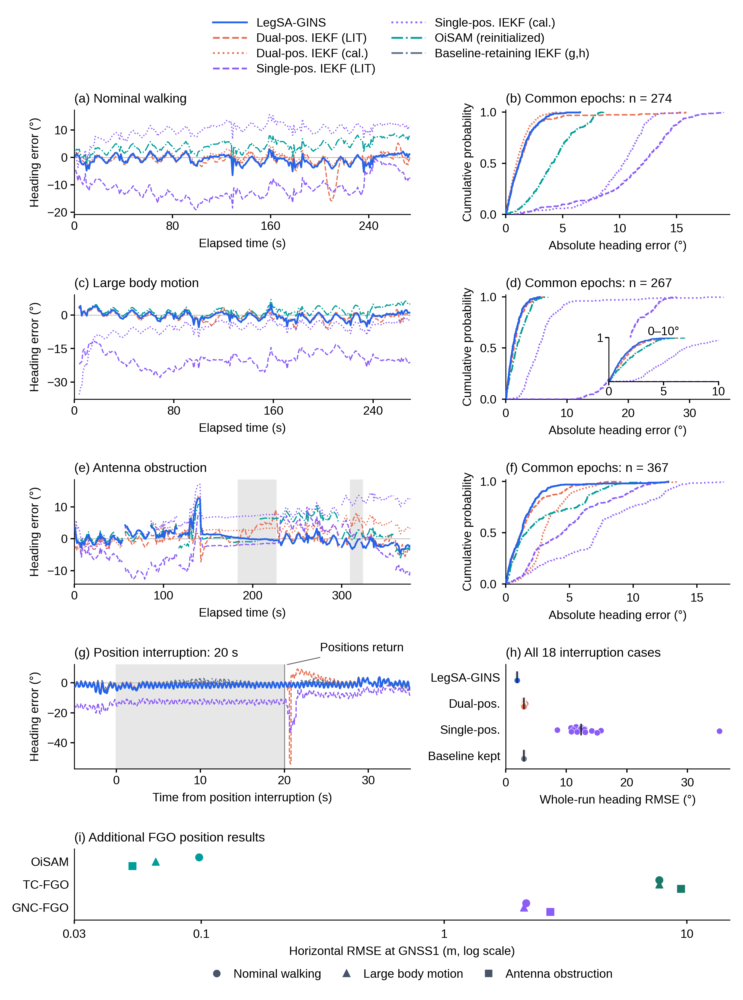

# 正文精修R2：高清、可编辑图与更完整的航向证据

本轮沿用作者确定的科学问题，以航向精度提升为中心。已认可的版式保留；颜色更鲜明，本文主结果统一蓝色。全部屏幕预览从绘图源导出，宽度至少2560像素、高度至少1080像素，保持各图原始纵横比。定量图保留出版PDF/SVG与600dpi PNG/TIFF。

## 图1　实物平台、安装局部与短基线定义

按作者选择去掉整机AI插画。(a)是真实平台照片的构图裁切，(b)为同一照片的传感器安装局部，(c)为简洁矢量几何。取消右侧像机器人或轮子的装饰，p1/p2与天线点分离，名义尺寸线独立，字母不再压住图形。坐标是定义示意，未把照片外观当作外参测量。

实际屏幕版2560×1147；右侧文字和几何可以无限缩放。中间局部来自现有照片中的345×295像素区域，其真实细节仍受原照片限制；若最终需要更清楚的硬件近景，需要更高分辨率原始照片。没有生成硬件细节。

## 图2　真正可编辑的矢量方法图

原位图已重建为矢量文字、框和连线。Frame rotation左右端口保持同一水平线，输入来自Body velocity，输出向上汇入事件门；预处理heading+tilt从下方进入。Roll/pitch沿独立支路到事件门，没有穿过坐标旋转框。

可编辑版本：[draw.io](schematics/editable/F02_method.drawio)、[SVG](schematics/figures/F02_method.svg)。draw.io有40个可编辑文字/形状节点和13条边，11条主边附着到源/目标节点；其余两条是支路与预处理注记。SVG保留40个text元素，不含图片。PNG/PDF为最终检查过的显示效果，第三方编辑器中的字体可能稍有差异。

## 图3　更长的转弯与遮挡上下文

前两场景由80–100s扩展至60–120s，能看到进入转弯、通过转弯和离开转弯的较长路径；遮挡由前后10s扩大到前后20s，即163.94–245.95s。路线主图仅保留参考细线与本文线，每行两个朝向箭头，完整路线仍为小定位图。

右列航向误差和位置误差同步延长，三场景都保留。参考事件决定窗口，方法误差不决定选窗。图6仍保留该长上下文中的较短细节放大。

## 图4　保留结构，改善方向的辨识

已认可的(a)不同绝对方向、(b)同一相对路径、(c)旋转消除后残差全部保留。三个代表方向改为鲜明蓝、珊瑚橙、青绿；其他四条采用可见的中灰，线型继续区分。所有路径、残差和指标与上一版一致。

## 图5　本文与横向比较一眼分清

上方图例分两组：左侧Our direction observations，只列本文采用方向与选择前输入；右侧Baselines，列RTKLIB、C-LAMBDA、C-WLS、DD-KF。本文使用蓝色粗线，选择前输入使用深灰蓝虚线。RTKLIB珊瑚橙、C-LAMBDA青色、C-WLS紫色、DD-KF深灰。

原始候选点和曲线提高可见度，原始/新增ratio筛选仍由点形及虚实区分。版式、已锁定的筛选规则、历元数量和全部指标保持不变。

## 图6　保留航向主图，统一配色

三场景航向全窗、事件细节、倾角配对的布局保留。完整方法蓝色，加入持续方向为珊瑚橙，基础GNSS/INS深灰，倾角关闭对照紫色。指标和事件窗口不变。蓝、橙接近仍然表达主要航向收益来自持续方向更新。

## 图7　作者通过版本

图面内容、布局、配色和统计完全保留。PDF、SVG、600dpi PNG/TIFF按字节复制原版；只将屏幕预览提高到3200像素宽。深浅状态条、20秒中断、位置恢复和九个布置的整窗统计继续按上一轮解释。

## 图8　三种质量变化下的航向表现

这一张重组为三个物理条件，每列按“全窗过程—相同20–60s局部—全部九个变体”阅读：

- 左列：位置加噪。代表案例航向RMSE从29.80°降至2.70°。
- 中列：坏方向及过于乐观的方向标准差。代表案例从1.73°降至1.63°，收益较小；各变体并非全部改善。
- 右列：位置受扰并伴随速度来源冲突。代表案例从28.28°降至2.70°。

这三列用真实保存时序说明质量变化可能如何影响航向；下排完整九个变体用于判断稳定性。右列保留完整方法55.8°和69.3°两个严重精度边界；缺失的关闭加权误差来自实际发散，不赋数值。D15与D59共享位置扰动基础但后者另有速度冲突，二者不是独立采集试验。原513共同完成案例、来源倍率与位置代价移到配套图S_quality_complete_statistics，仍在本目录中。

## 图9　在原航向比较中纳入其他FGO定位输出

原(a–h)八个航向面板和全部六方法共同历元结果保留。新增(i)汇总OiSAM、TC-FGO、GNC-FGO的三场景水平RMSE，用颜色区分方法、点形区分场景。该面板使用已有GNSS1天线点及共同动态支持274/267/369；与上方航向共同支持274/267/367分开。

TC-FGO/GNC-FGO在已有实现中没有自估航向，因此通过它们真正输出的位置加入图中。本文现有位置比较点是POI，未混入不同物理点的GNSS1面板。正文航向比较仍能看到标定双位置IEKF在常规场景更好、大幅运动与本文接近，本文在遮挡场景更好。

## 图10　以实际扰动过程增加证据

上排保留方向可用性、方向噪声、方向尖峰三个物理条件及各非零强度全部九个登记变体。中排使用原生运行真正读取的受扰方向输入（紫色）和融合后航向（蓝色），直接观察输入异常与输出精度。下排分别展开20s方向缺失与恢复、80–100s参考转弯、一个已核验的实际尖峰事件。

尖峰局部采用“评价开始40s后第一个实际注入事件”的固定规则：事件为42–43s，展示37–47s。这个窗口通过受扰/clean输入的逐时刻差核验，未根据参考误差或输出优劣选择。输入无效处留空；新输入误差只连接到原已保存的参考匹配时刻，不重新插值。每个案例1370条窗内输入都保留匹配状态。

严重跨源冲突的两例边界集中在图8，图10不再重复同一大面板。具体字段、来源哈希、角度单位和完整样本口径见aiding/README_R2.md。

## 本轮结果的使用

清晰度以原始尺寸文件为准，聊天界面可能自动缩小显示。图2可自行编辑后反馈修改版；其余数据图保留可重绘脚本。旧版不覆盖，图7保留批准版本。冻结V3、原生结果和全部实验分母保持原身份；这一轮不新增求解器或provider执行。
