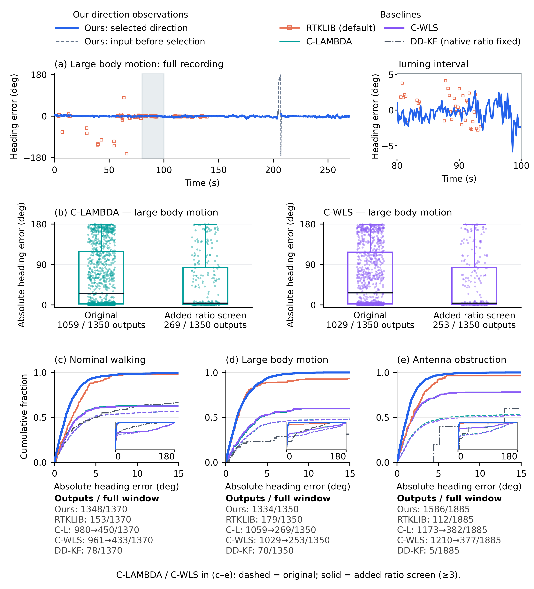
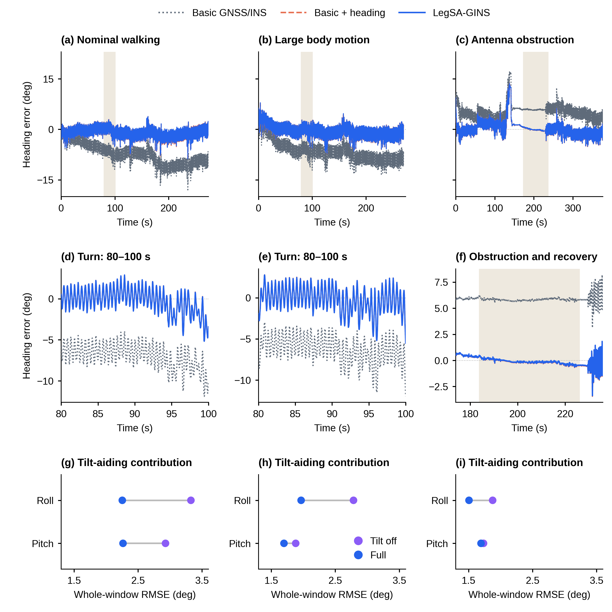
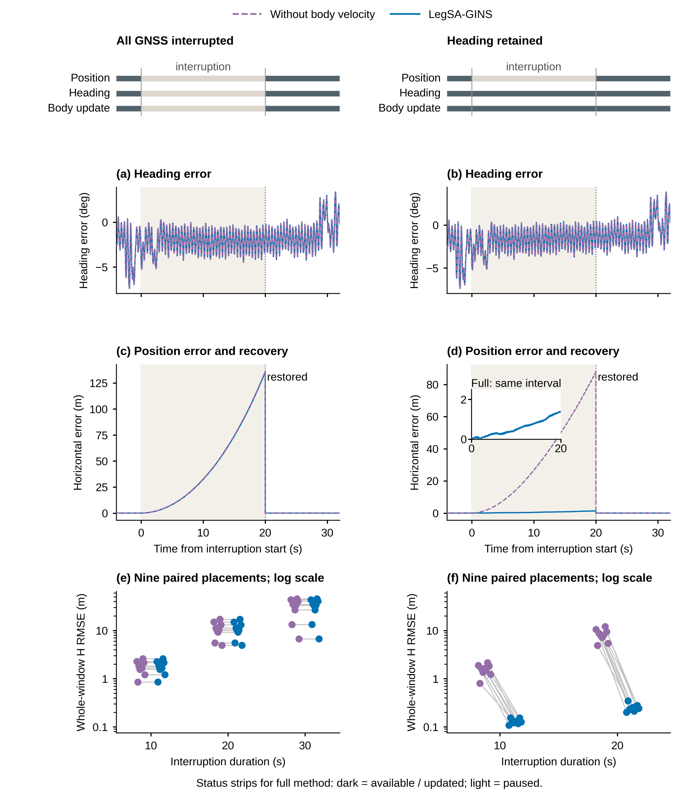
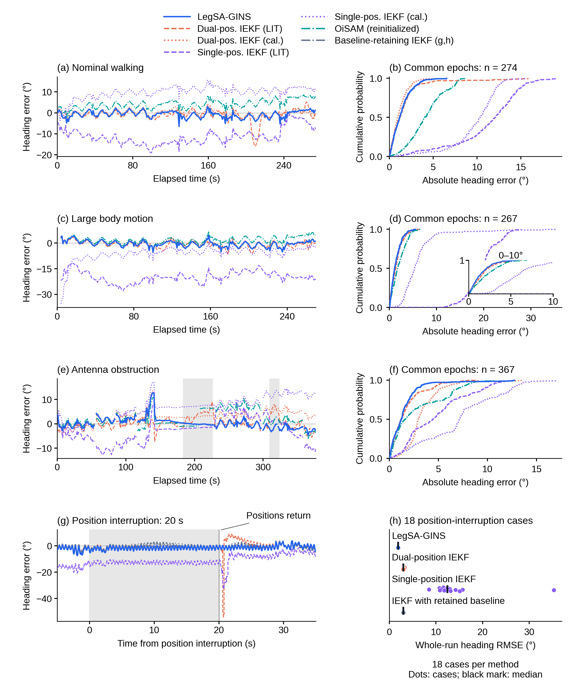

# R3 最新正文图、完整轨迹与重点解释

本轮新增完整轨迹组，延长图3到100s，图2按作者提供原图描摹。图4、6、7通过并保持；图10按作者要求保留并解释。图8作为减拥挤暂定稿。正文科学问题和冻结V3不变。

## 图1　恢复原平台插图

原实物照片、之前image绘制的解释性插图、已经修正的矢量几何并排展示。已移除模糊的实物放大面板，右侧p1/p2仍与天线符号分开。

## 图2　按作者原图描摹的编辑稿

这一轮恢复作者附图的横向构图、11个框的位置、五组图标、文字、公式及信息路径。主编辑文件为[SVG](schematics/editable/F02_method_traced.svg)，显示PNG与论文PDF直接由这份SVG生成。Frame rotation框位置不变，仅在入口侧折线对齐出口高度。文字采用原生字体，数学下标和少量间距做了微调；没有改成另一种布局。

## 图3　100s路线、空间放大与航向误差

三个场景保留100s的固定事件上下文：前两记录40–140s，遮挡记录154.945–254.945s。放大图采用围绕参考事件预先确定的实际空间方框，展示参考与各估计路径之间的厘米级差距。坐标等比例，不对误差乘倍数、不平移方法轨迹使其更好看。最终图和窗口定义见navigation说明。

## 图4　保留；(b)确实是已知初始旋转后的重合

七次运行使用相同IMU和足端接触输入，只改变初始全局航向。图(a)所以得到七个朝向不同的路径。图(b)把已知初始角度反向旋转回去，例如+100°运行整体转−100°；这只改变坐标方向，不改变轨迹形状和尺度。

如果不同初始朝向导致后续相对运动不同，仅靠一个固定旋转并不能使全程重合。因此，(b)检验全局方向变了以后，相对路径是否仍然等价。独立重算七次各63277个状态得到最大差1.89249×10⁻⁷m，与旧残差一致。这个数是两次估计结果消除已知旋转后的数值差，不是实际地理定位精度。

详细推导和逐步解释见[aiding/READ_F04_F07_F10_R3.md](aiding/READ_F04_F07_F10_R3.md)。

## 图5　中间面板改为筛选前后的误差分布

旧(b)把两个方法的原始候选和筛选后结果叠在一条时间轴上，结果高度重合，容易乱。新(b)分成C-LAMBDA与C-WLS两组，每组并列Original和Added ratio screen。

每个点是一个历元的绝对方向误差；箱体是25%–75%分位范围，中间黑线是中位数。水平散开只是为了显示所有点，没有时间意义。下方写输出数/完整窗数。

C-LAMBDA从1059减至269个输出，绝对误差中位数24.981°降至4.085°；C-WLS从1029减至253个，中位数27.004°降至4.044°。这回答“筛选留下的典型误差怎样变化、为此少了多少输出”。大误差点仍然存在，因此筛选不能当作整数必然正确。图(a)和三场景CDF仍保留。

## 图6　保留

已认可的自然场景航向、局部放大和倾角配对结果保持R2原图。主要航向收益来自持续方向更新；完整方法和基础加方向的接近程度如实保留。

## 图7　保留；曲线的凸起是误差增长与校正

先看右列(d)：0–20s没有登记的平移观测，但方向和辅助更新还在。蓝色完整方法和紫色关闭机身速度对照的水平误差，到中断末端分别约1.38m和88m。20s后绝对观测恢复，误差迅速被校正，所以形成上升后下降的形状。它不是机器人运动路径或地面高度。

再看左列(c)：全部GNSS观测中断时，当前实现里的辅助更新也暂停，所以两个配置接近。这说明机身速度的作用依赖可用的更新条件。最上方状态条表示实验条件，深色持续、浅色暂停。下面(e/f)是不同中断布置的全窗RMSE，与中断末端瞬时误差不是同一指标。

## 图8　六面板暂定稿

删去重复的一整排局部图，从九面板压到六面板。上排为相同三种质量条件的统一前120s过程，下排为各条件全部九个变体。RMSE仍标完整274s评价窗的结果，图内已写明。

完整0–274s时序移至S_F08_full_heading_histories，全部513对统计及位置代价继续保留配套。代表案例和数据未改变。中间方向质量例收益较小，下面也能看到并非所有变体都改善；右列两个严重边界保留。

## 图9　(h)说清18种中断条件；(i)移到定位配表

(h)不是轨迹或瞬时误差，而是18个位置中断条件的全窗航向RMSE。10s与20s各九个布置，每个方法有18个点，黑短线表示中位数。方法名字现在直接标在对应行；完整方法等点簇很窄，是因为这些条件结果接近。

四行中位数分别约1.885°、2.998°、12.431°、2.995°。原(i)是OiSAM、TC-FGO、GNC-FGO在GNSS1天线点的水平位置RMSE，用形状区分场景，和上面航向不是同一指标。为避免混排，全部九值已移入[navigation_comparison/METHOD_POSITION_TABLE.md](navigation_comparison/METHOD_POSITION_TABLE.md)，与新增完整轨迹组配套。原完整值和分母保留。

## 图10　保留；三排三列的读法

这张图有两个层次：上排比较三种估计配置，中下排比较受扰的方向输入与融合后的航向。紫色输入不是第四个算法。

| 列 | 上排：全部变体结果 | 中排：完整误差过程 | 下排：事件细节 |
|---|---|---|---|
| 左 | 方向中断0/5/20s | 20s方向观测中断 | 中断前、0–20s中断、恢复后 |
| 中 | 方向噪声σ=0/1/5° | σ5°受扰输入与融合输出 | 同一个80–100s参考转弯 |
| 右 | ±10°尖峰概率0/5/10% | 10%尖峰条件 | 42–43s实际+10°事件，窗口37–47s |

上排纵轴为全窗航向RMSE，横轴是故障强度。每个非零条件有九个登记变体，线连中位数；0条件只有真实clean运行一次。蓝灰是基础GNSS/INS，珊瑚是加入持续方向，蓝色为完整方法。

中下排横轴是时间，纵轴是相对参考的角度误差：紫色约5Hz方向观测，蓝色是较高频融合航向。第一列缺方向时紫色留空，蓝色仍输出；这与图7左列全部GNSS中断不同。第二列看输入噪声到融合输出的变化。第三列的+10°是加在原方向上的扰动，所以相对参考的紫色值不必每个点恰好等于10°；蓝线没有跟着产生同幅跳变。

灰带标具体事件或下排放大窗口，含义由面板决定，不是置信区间。42s窗口按原输入事件规则选取，未根据输出最好看来挑。详细说明、采样与原输入身份见[aiding/READ_F04_F07_F10_R3.md](aiding/READ_F04_F07_F10_R3.md)。

## 图11　新增完整轨迹组

这轮完整读取实际已有坐标结果，按评价点和原生输出身份绘制完整评价窗路线与部分输出。左列为同一POI机身评价点：参考、本文、单/双位置IEKF两种参数及单次初始化OiSAM。右列为GNSS1天线点：参考、按登记间断处理的OiSAM、TC-FGO、GNC-FGO。图中路线重合时意味着米尺度差距很小，需要结合空间局部和误差读图；各方法没有做视觉错位。

GINav只保存的有效输出点/段另放部分轨迹页；接触InEKF与接触运动学保留原生局部坐标，单列原生相对轨迹页，未把它们拟合旋转到参考上。所有位置/位姿方法去向见navigation的完整清单。只有方向输出的解算器继续放图5，不为其造空间轨迹。完整路线负责展示走过的空间过程，图3的局部和图9的误差负责展示细小差别。
