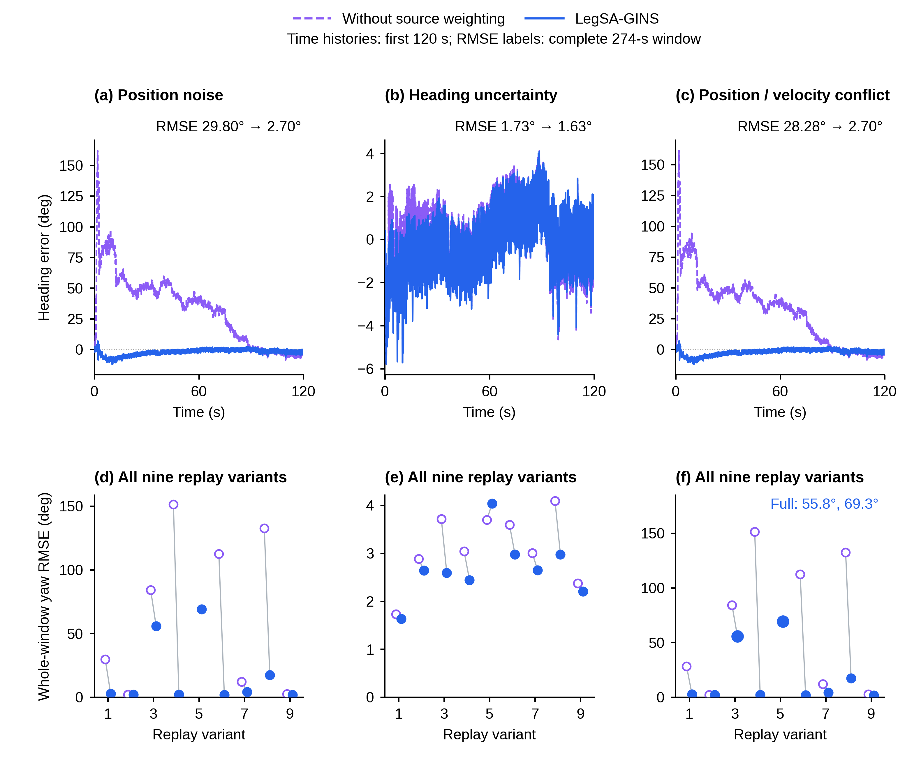

# R3：图 8 暂定精简稿，其余已确认图保持不变

本轮只重画图 8，图 4、6、7、10 的 PDF/SVG/PNG/TIFF 都原样复制。图 4(b) 另做独立逆旋转核验；详细读法统一见 [READ_F04_F07_F10_R3.md](READ_F04_F07_F10_R3.md)。没有新运行 solver、provider 或 evaluator，也没有重新选择代表 seed。

## 图 8：六面板暂定稿

原来三列质量条件不变：位置加噪、方向噪声与乐观 std、位置异常叠加速度源冲突。删除重复的 20–60 s 放大排，改为两排六面板。

- **上排 (a–c)**：统一显示三种既有代表例的前 120 s，让读者一次看清主要起始变化与回归过程。图上明确标注 RMSE 来自完整 274 s 评价窗，而不是只计算前 120 s。
- **下排 (d–f)**：每类全部九个既有变体。空紫点关闭来源加权，蓝点完整，细线配对同一变体。没有删除失败，也没有把未完成填成零；三类完成数仍为完整各 9/9、关闭加权 8/9、9/9、8/9。

代表例的整窗 yaw RMSE 仍为 29.80→2.70°、1.73→1.63°、28.28→2.70°。中间一列的收益较小，保留其原始差异。跨源冲突中的完整方法 55.8°、69.3° 两例大误差仍可见；位置加噪中的大误差也全部保留。

三例的完整 0–274 s 原始时序在 [S_F08_full_heading_histories](preview/S_F08_full_heading_histories.png)。全部 513 配对分布、位置代价与真实来源倍率继续在既有补图、表格与 R2 说明中。代表位置加噪案例的水平 RMSE 3.166→3.557 m 没有被隐去或改写。D15 与 D59 有共同的位置扰动成分，三列是三个处理条件，不是三次独立外场验证。

**英文图注**：Heading response to three executed observation-quality conditions. (a–c) The first 120 s of the same retained representative histories for position noise, degraded heading with optimistic uncertainty, and degraded position with a velocity-source conflict. RMSE labels refer to the complete 274-s evaluation window; complete histories are provided in the supplementary figure. (d–f) Original whole-window heading RMSE for all nine registered variants per condition. Open purple markers denote weighting off and filled blue markers denote the full method; lines join the same variant. The full method completes nine in each condition, while weighting off completes eight, nine and eight. Missing numerical points denote actual divergence, not zero error. Large full-method errors remain visible. These variants share one recorded route; no new representative or favourable seed was selected.

图宽 174 mm、高 151 mm、最小 8 pt；主 PNG 600 dpi，预览 3082×2675 px。数值、分母、原输入与观测匹配协议均继承 R2，数据表完整保留。图 8 的 render-time 对齐、PDF 字体与碰撞检查写入 `qa/`。

## 已确认图的保留与核对

- 图 4(b)：独立复数逆旋转重算全部 7×63,277 样本，确认最大位置差约 1.89×10⁻⁷ m，含义是坐标变换后的数值一致性，不是地理定位精度。
- 图 6：保留 R2 最终配色、蓝线层级和事件窗口，图形字节不变。
- 图 7：保留 R2 的内容、样式、数值和高分辨率预览，图形字节不变。
- 图 10：保留 R2 原始受扰输入→融合输出对照和 42 s 尖峰，图形字节不变。R3 只增加逐排逐列解释。

R2 的技术说明和协议仍保留作为来源记录；当前图 8 解释以本文件为准。运行 `python build_heading_first.py` 在 R3 中只重绘图 8 及其完整时序补图，不会覆盖已确认的图 6/7/10。
