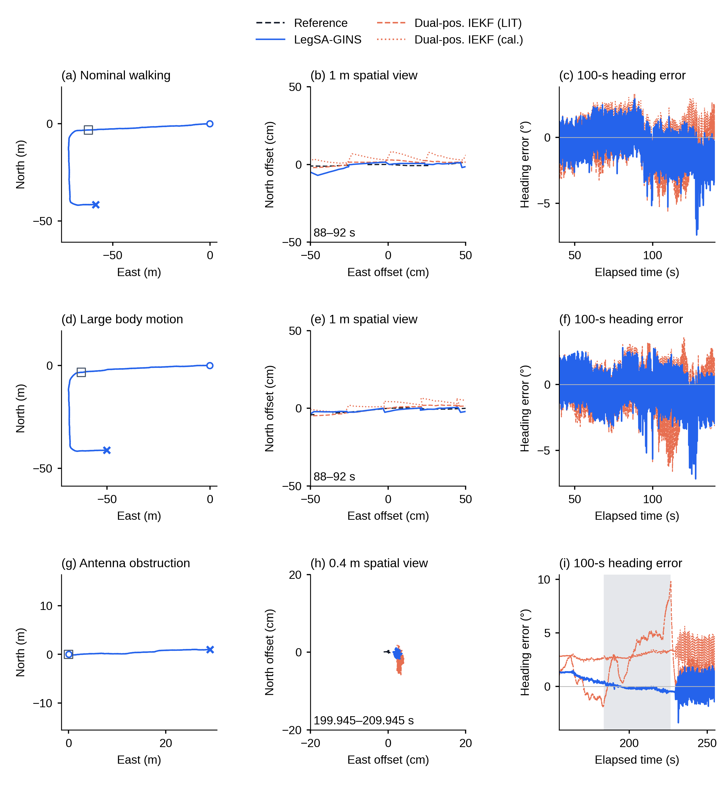
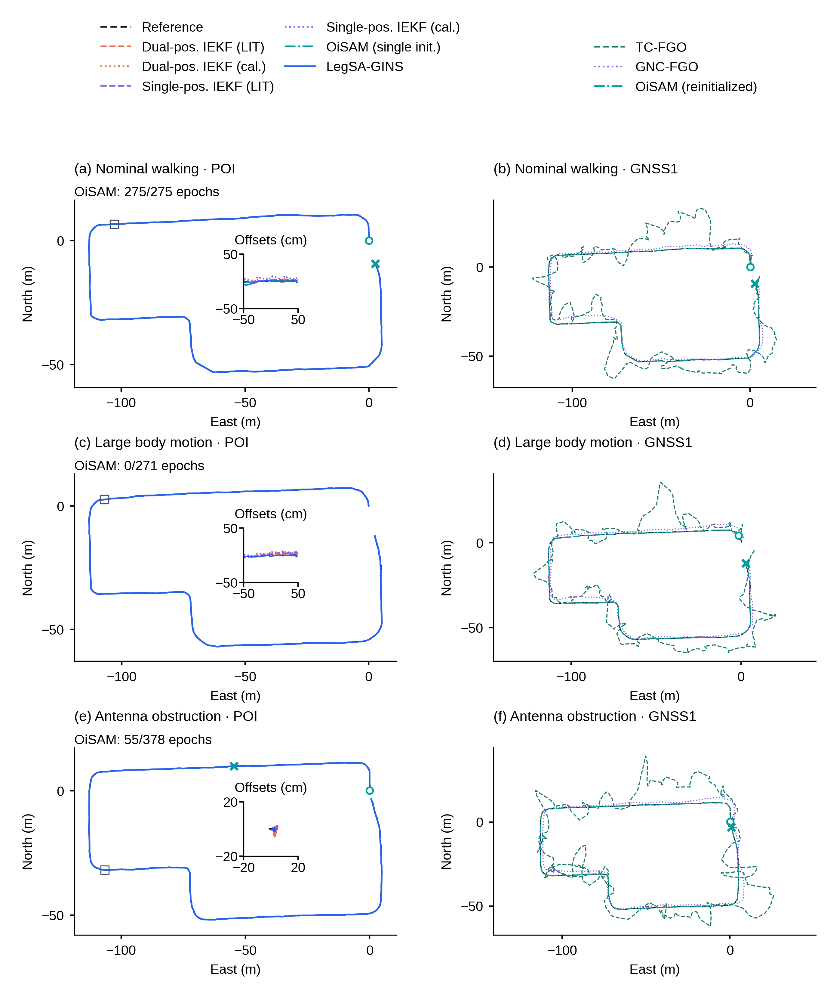
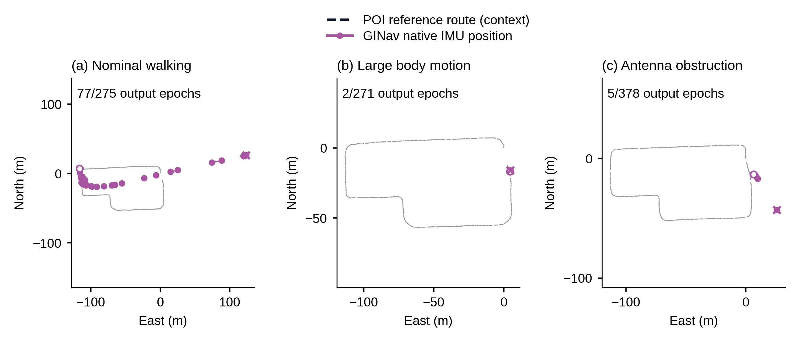
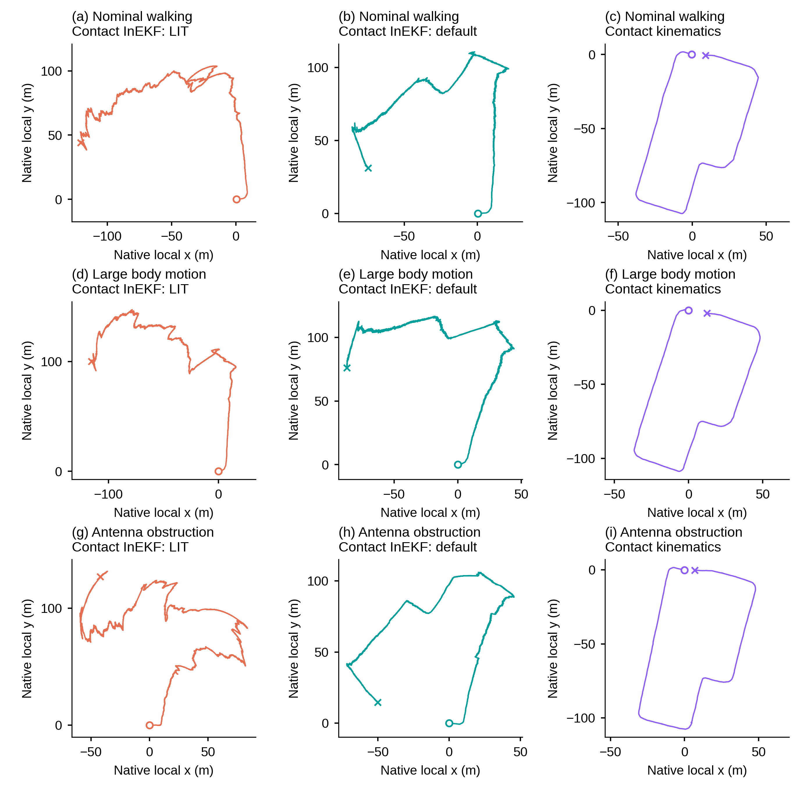

# R3：100秒事件局部与完整轨迹组

这轮补齐的是**现有结果的轨迹展示**。没有重新跑导航算法，也没有从水平误差大小猜测一条路径。全部方法按原始物理点和坐标系分开，采用真实保存的NAV/ECEF轨迹；V3仅使用已有E/N/U有符号误差与同一参考做已验证的坐标重建。

## 图3：100秒路线、实际空间差距和航向



三行仍对应常规、大幅运动、遮挡记录。每行从左向右为：100秒路线、真实空间局部放大、同100秒航向误差。

- 前两行固定**40–140s**，把原来80–100s转弯放在较长上下文里。第三行固定**154.945–254.945s**，中心是原登记首段遮挡的中点。
- 局部方框只依据参考位置确定。前两行以90s参考位置为中心，显示真实**1m×1m**空间，源时间为88–92s。遮挡中点附近接近静止，显示真实**0.4m×0.4m**空间，源时间为199.945–209.945s。
- 中列坐标单位是厘米，不是将误差乘一个倍数。不同方法没有人为错位、旋转或平移。方框外按空间坐标裁剪，完整源时间段仍保存在表里。
- 主路线圆圈/叉号为片段首末位置，方框定位局部。中列可以看到参考、本文与两种双位置IEKF之间的实际差距。右列仍以航向为主，灰带只标实际登记遮挡183.94–225.95s。

精确窗口、参考中心和物理尺寸见`data/F03_EVENT_WINDOWS.csv`。长路线中位置曲线高度重合是正常结果；真正的厘米级差别在中列读，方向偏离在右列读。

## 图11：全部自然窗的同点完整轨迹



**左列为POI中点。** 同时绘制本文、单/双位置IEKF文献与标定参数，以及OiSAM单次初始化的全部有效输出。全路线有大量重合；左列小窗在固定参考位置展示厘米级差异，不为了让曲线分开而人为错位。

**右列为GNSS1天线点。** 同时绘制OiSAM按已登记输入缺口恢复后的动态输出、TC-FGO与GNC-FGO。这些路线的米级差距可直接在完整路线看到，已移除会压住路线的多余小窗。

两列各用自己的同点参考。OiSAM圆圈/叉号表示首末动态输出。单次初始化的三个支持分别为275/275、0/271、55/378；H场景没有动态轨迹就不造一条曲线，O场景的末点表明只有开始一段输出。按记录缺口恢复的OiSAM在右列展示更完整的动态记录，未只用早停来概括其表现。

不同物理点不合并成一个位置排名。已有FGO九项同GNSS1位置误差与覆盖配表见[导航比较配表](../navigation_comparison/METHOD_POSITION_TABLE.md)，其原共同支持为274/267/369；原36行结果也在该目录保留。本轮没有改写这些精度数值。

## GINav：保留真实部分输出



GINav输出实际位于INS/IMU点，不能因输入文件名带GNSS1就称作天线位置。三条记录窗内分别有77、2、5个实际输出，均在图中保留；大于1.5s的缺口断线，首末点明确标记。常规和遮挡记录触发原速度界限失败，图中不把这些有限坐标叫作成功完整运行。

淡灰POI路线只作地理背景，说明部分输出发生在路线哪里；由于物理点不同，没有用它在此重算GINav误差。GINav较大偏离单独展示，使其尺度不会压扁图11的其他结果。

## 相对状态估计：保留原生局部坐标



这页完整读取并绘制官方接触InEKF文献/默认参数和接触运动学积分的九条原生轨迹。不同方法原生局部方向不同，图中不新拟合到北向或地理参考。因此这页展示真实输出形状与范围，不做绝对位置排名。相关“开始10s一次对齐”的既有误差结果仍是另一项评价，不能把已对齐指标与这里未经新对齐的坐标混读。

## 全部方法都去了哪里

- `data/TRAJECTORY_METHOD_DESTINATIONS.csv`逐条列出本轮49条坐标来源（含参考），注明完整自然窗、部分输出、零动态支持、相对轨迹、不同起点和实际输出点。
- `data/ALL_REGISTERED_METHOD_TRAJECTORY_DESTINATIONS.csv`保留原登记方法的全部去向，不只列正文画的六种方法。C-LAMBDA、C-WLS、DD-KF、FAR/PAR和动基线RTKLIB是方向/相对基线结果，不把其0.35m基线向量当机器人全局运动轨迹。
- 单/双位置IEKF全部16个配置/起点身份均读取。正文使用原登记主起点；四个不同起点结果有完整坐标文件和状态。校准单位置IEKF的大幅运动文件起点已被原记录判为发散，其后有限浮点坐标可达约10^17m，属于数值失控，不能称作物理上成功的完整轨迹。全部原值仍保留，不用其巨大尺度破坏正文路线。
- 保留基线IEKF只实际执行于登记中断协议；去向表指向全部18例和原图9中断结果，不虚构一个自然工况运行身份。
- 未执行、取消或历史版本项目仍按原状态记录，不借“完整轨迹”之名变成已完成实验。

## 来源与核验

1. V3：已有同点参考和E/N/U有符号误差重建。与原显示坐标逐点一致，最大差在10^-9m量级。
2. IEKF：直接读取原先已转到POI的`EVALUATOR_INPUT.nav`，逐点核对其与参考之差等于保存的有符号误差；15条有评价记录的路径加3条V3显示检查共18项，最大差小于4×10^-9m。另一个失败身份没有伪造评价指标。
3. OiSAM、TC/GNC：直接读取已有正式ECEF轨迹和同点参考列，没有从H标量反推。
4. GINav和相对方法：直接读取原生坐标，保留自身点定义和局部方向。

每条场景采用同一个固定WGS84投影原点与坐标轴，不针对某个方法拟合。坐标验证只用于确保画回了原结果，没有执行新导航求解、provider或评价器。

主图均174mm宽，最小字8pt，PNG/TIFF600dpi、屏幕预览2740px宽。主要路线为矢量；固定空间小窗的曲线按600dpi嵌入以严格保留裁剪，文字和坐标轴仍可编辑。每张均有正式PDF字号、碰撞与1.5pt对齐检查和实际彩色/灰度查看。

再生成：

```bash
python3 prepare_trajectories.py
python3 build_trajectories.py
python3 finalize_delivery.py
```

完整来源、窗口和状态分别在`COORDINATE_SOURCES_READ.csv`、`COORDINATE_PROTOCOL.json`、`COORDINATE_PARITY_CHECKS.csv`、`TRAJECTORY_COVERAGE.csv`；成图信息见`SECTION_PACKAGE.json`和`DELIVERY_CHECKS.json`。
