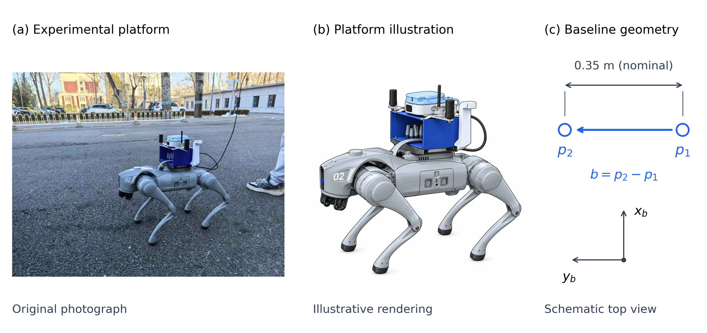
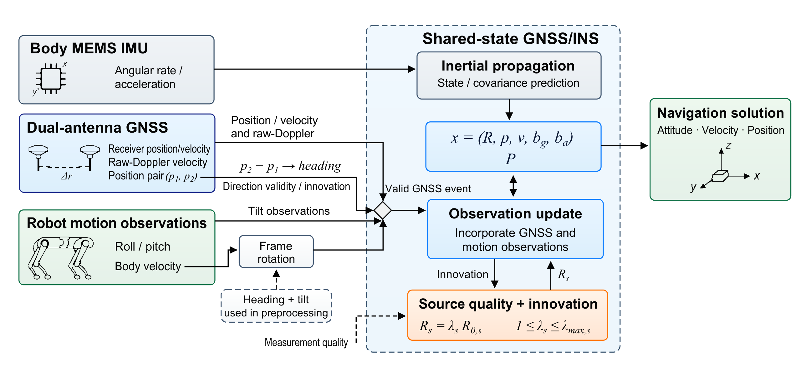

# 原构图描摹与平台插图恢复

## 图1

作者本轮要求恢复此前image绘制的机器人图。本图使用同一1254×1254原插图，未重新生成。左侧仍是完整真实照片，中央是解释性插图，右侧保留R2已纠正的矢量几何：字母不压图，名义尺寸、基线和机体坐标分开。低分辨率实物放大面板已移除。

English caption: Experimental platform, illustrative rendering and short-baseline geometry. The original photograph and the previously generated platform illustration are shown separately. The schematic defines the position-pair baseline and body axes with a nominal separation of0.35m; it does not specify surveyed lever arms. The central illustration uses the previously disclosed AI-generated asset.

## 图2：原图的可编辑描摹版

**主编辑文件是[SVG](editable/F02_method_traced.svg)。本页PNG和论文PDF直接由这份SVG生成。** 框、文字、公式、图标和线路使用作者所附图的1815×866坐标系逐项定位；没有使用R2另行设计的布局。

11个原位置框、38个文字/公式对象、原芯片/天线/机器人/坐标轴图标和接线保留。图标是从原黑色笔画描出的矢量路径，SVG中不嵌入参考位图。Frame rotation框位置不变，将Body velocity支路在框左侧折到与出口一致的y=568，再接入框；其他信息路径保持原图。

原位图字体没有可恢复的字体文件信息。本稿使用Arial与Times New Roman，按原视觉宽度排字；数学下标和几处间隙有数像素调整。没有声称像素逐一相等，主要框位置与整体构图是原图坐标，不再改成另一个框图。

- 主稿：[可编辑SVG](editable/F02_method_traced.svg)
- 排版：[矢量PDF](figures/F02_method.pdf)
- 辅助编辑：[draw.io](editable/F02_method_traced.drawio)。该格式保留可编辑文字、形状、线路及可移动的矢量图标；编辑器的字体/公式渲染可能不同，因此以SVG与其直接导出的PNG为视觉主稿。
- 复现：[描摹脚本](trace_method.py)、[对象坐标](editable/F02_scene.json)

屏幕图2560×1221，出版PNG为约4110像素宽并保留600dpi标记。SVG/PDF放大不损失文字和线路细节。按原构图缩放到174mm时常规正文约6.5–7.5pt，主标题约9–10pt，最小数学下标约5.16pt；后续正式栏宽排版应再确认字体，不能把原图描摹说成全图8pt。

## 实际检查

图1由Matplotlib生成，对齐记录及碰撞审计完成。图2使用Python构造原生SVG并由CairoSVG导出。标准字体扫描器将其unit Tf误认为1pt，而PDF实际Tm已缩放；标准碰撞器也把跨行texttrace并为一个框。原工具输出保留，另用PyMuPDF实际变换后的字号与逐行框调用同一碰撞判据，最终0fail/0warn、最小有效字号5.16pt。`F02_TRANSFORM_AWARE_QA.json`与`audit_traced_pdf.py`给出可复查的处理。

根代理和独立代理都对照了作者原图：确认同一构图、同一图标与接线，修复了下标缺字和Measurement quality贴线问题。最终SVG没有raster image元素。参考图和原生成插图按原文件保留。
