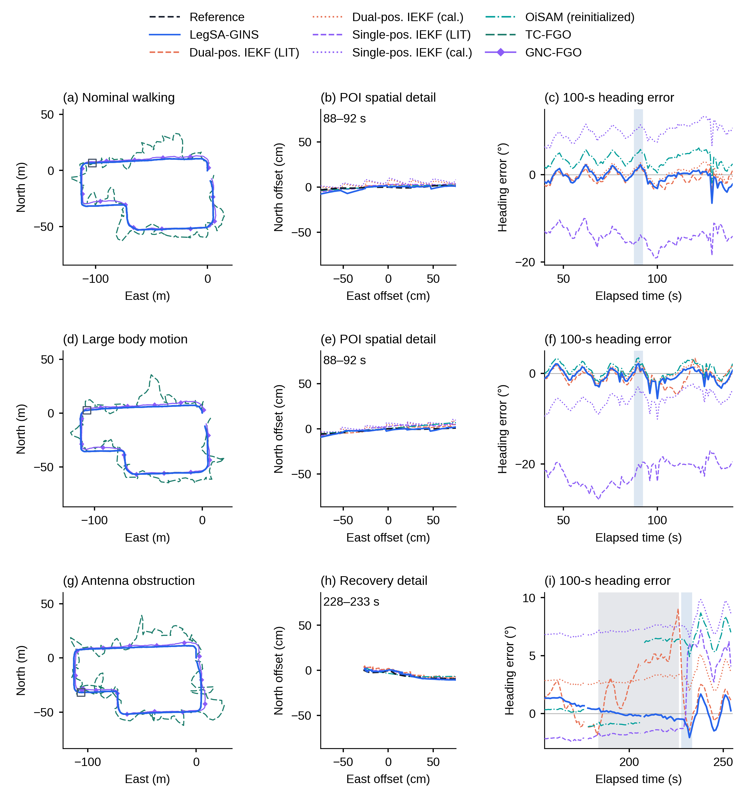
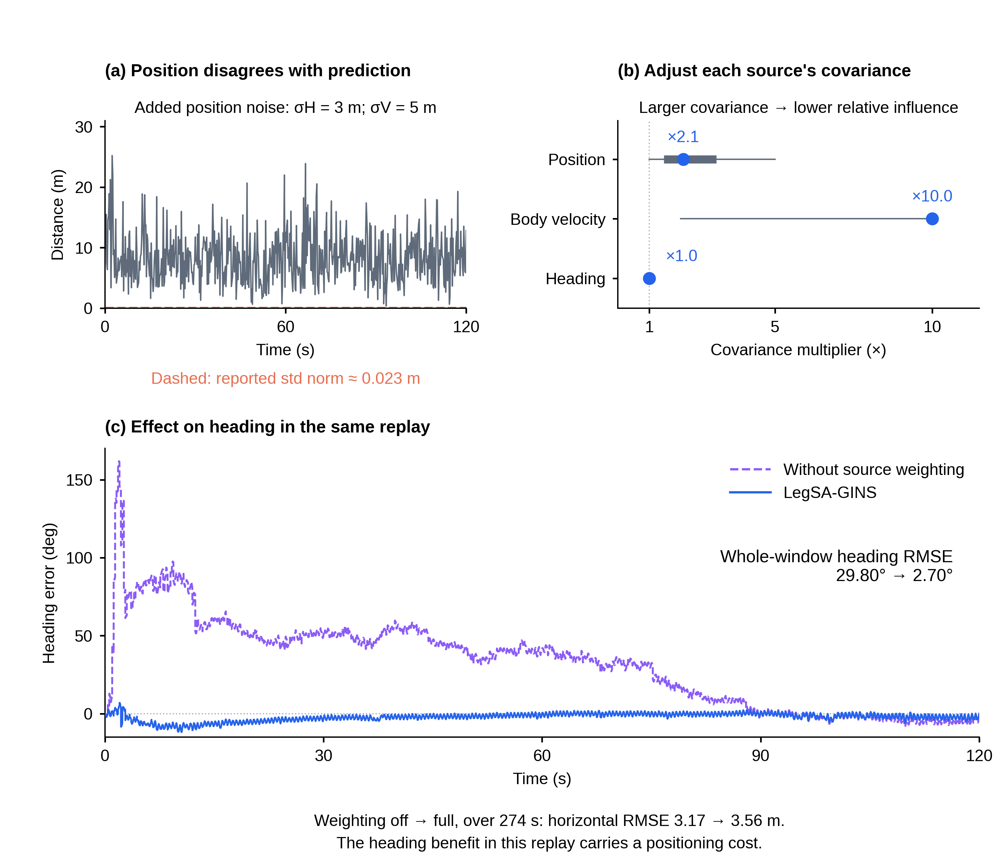

# R4 当前正文图与作者问题

原图11已与图3融合，正文按图1–10继续。图1、4、5、6、7、9、10图面保留；图4图注纠正来源和职责。

## 图1　保留

保留真实照片、之前生成的平台插图和已修正短基线几何。

## 图2　保持原样式，提高原文件可读性

原母版SVG和排版PDF未改。PNG直接从矢量源重渲染为3840×1832及7680×3664。作者确认原文件也显模糊，因此另有放大阅读PDF，包含完整图及两页分区；图2普通文字缩到原174mm时约6.5–7.5pt，放大页面尺寸后便于检查。矢量阅读页可实际放大至200%/400%并拖动，不再限制在屏幕宽度。

[7680px原图](schematics/figures/F02_method_8K.png) · [矢量阅读页](schematics/F02_矢量放大查看.html) · [放大PDF](schematics/figures/F02_method_reading.pdf) · [编辑SVG](schematics/editable/F02_method_traced.svg)

## 图3　完整路线、局部差距和航向合成一张

左列是完整地理路线，汇总本文、双位置IEKF两配置、单位置IEKF两配置、恢复协议OiSAM、TC-FGO、GNC-FGO，共八个主导航配置。中列是统一POI物理点的真实空间局部，右列是实际输出航向的六方法在固定100s内的共同动态时刻误差。图9采用相同的航向支持。TC/GNC没有自估计航向，不为它们补一条假曲线。

原图3只包含本文与双位置IEKF两种参数。新图已补入其他主配置，OiSAM也与图9的恢复协议一致。全路线中的TC/GNC保留GNSS1原生点，作为米尺度地理概览；厘米局部只比较同点坐标。GINav部分输出及接触估计器局部坐标轨迹在配图保留。

原遮挡局部199.945–209.945s中，参考首末位置差只有6.13mm；机载SDK原速度模长中位数约0.02275m/s，也处于低速。因此这类厘米坐标局部呈点团，不适合作为“行走路线细节”。新局部采用228–233s的恢复运动，原遮挡183.94–225.95s仍在右列灰带中保留。

SDK记录是另一来源的弱辅助旁证；最准确表述是“参考轨迹近静止，与SDK低速读数一致”，不把精简参考中数值valid当成设备质量状态。窗口、源文件和对齐信息见navigation诊断文件。

## 图4　同一种方法的七个初始朝向

七条全部属于同一种项目实现的接触辅助InEKF，使用同一次BY2采集。设置为−150°、−100°、−50°、0°、+50°、+100°、+150°。0°复用H5主运行，另外六个是H6各自逐历元的原生回放，原日志、输出hash和代码支持这一点。图用的不是七次采集，也不是七个横向算法。

你说“同输入理论上应重合”是对的：若完整初值和坐标表达也一样，确定性运行应重合。本图故意改变初始世界朝向，并同步变换世界表达初始量和协方差，因此(a)是不同坐标朝向下的路径，(b)消除已知旋转后应重合。该结果说明已知性质的实现一致性，不能当作七份独立精度证据。

七份数据于H5/H6阶段归档；图注已明确实际来源，避免与后续H6R的其他验证混称。完整身份和证据见[observability_audit/README.md](observability_audit/README.md)。

## 图5　保留

保留已通过的方向比较与筛选前后分布。算法、历元接受状态、误差和图面不变。

## 图6　保留

沿上一轮认可版保留自然场景航向与倾角结果。

## 图7　保留

保留观测可用性与条件性机身辅助结果，不再重画。

## 图8　改为一个可读的质量处理过程

前几版把三个案例并排，但两个案例由相同坏位置成分主导，曲线近乎重复；方向质量例改善较小。这样既没说明处理做了什么，也容易暗示各条件都普遍变好。

新图只使用之前已经选定的位置加噪回放，分成三步：

- (a) 已知向位置量测加入水平3m、垂向5m噪声，实际位置创新达到米级，但报告标准差的合成量仍约0.023m。这里画的是观测与预测之差，不是对真值的位置误差。
- (b) 记录中的来源协方差倍率分别变化：位置中位约2.08、机身速度约10、方向约1。更大协方差降低相对影响。圆点是中位数、粗横线为IQR、细横线为范围；倍率不是卡尔曼增益精确倒数。
- (c) 同一回放关闭／启用来源加权的航向误差。全274s RMSE为29.80°→2.70°，同次位置RMSE3.17→3.56m的代价仍明确显示。

该图支持“部分退化条件下，来源处理减少较大的航向偏离”。513个共同完成对照中190例航向RMSE降低、323例升高，中位降低量−0.000258°，不支持普遍提升典型精度。它比较整套来源加权开关，不能把效果全部归于单独的位置倍率。原三案例、各九变体及总体结果保留配套。

## 图9　保留

保留自然场景六方法与18个中断条件的航向比较。

## 图10　保留

保留方向缺失、噪声和尖峰的整体结果与真实输入—输出过程。
