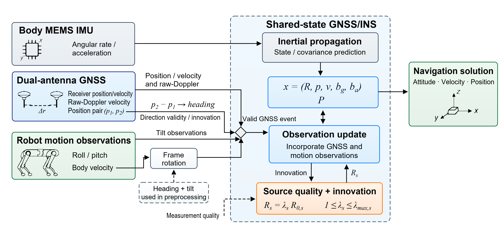
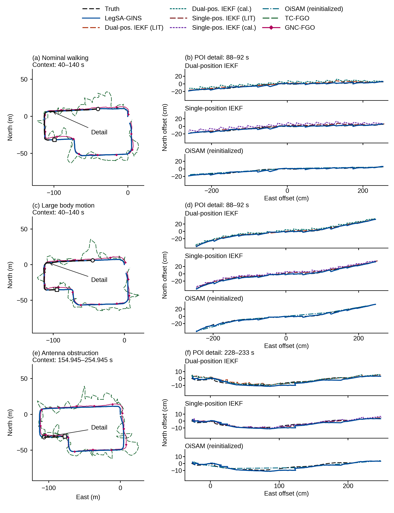
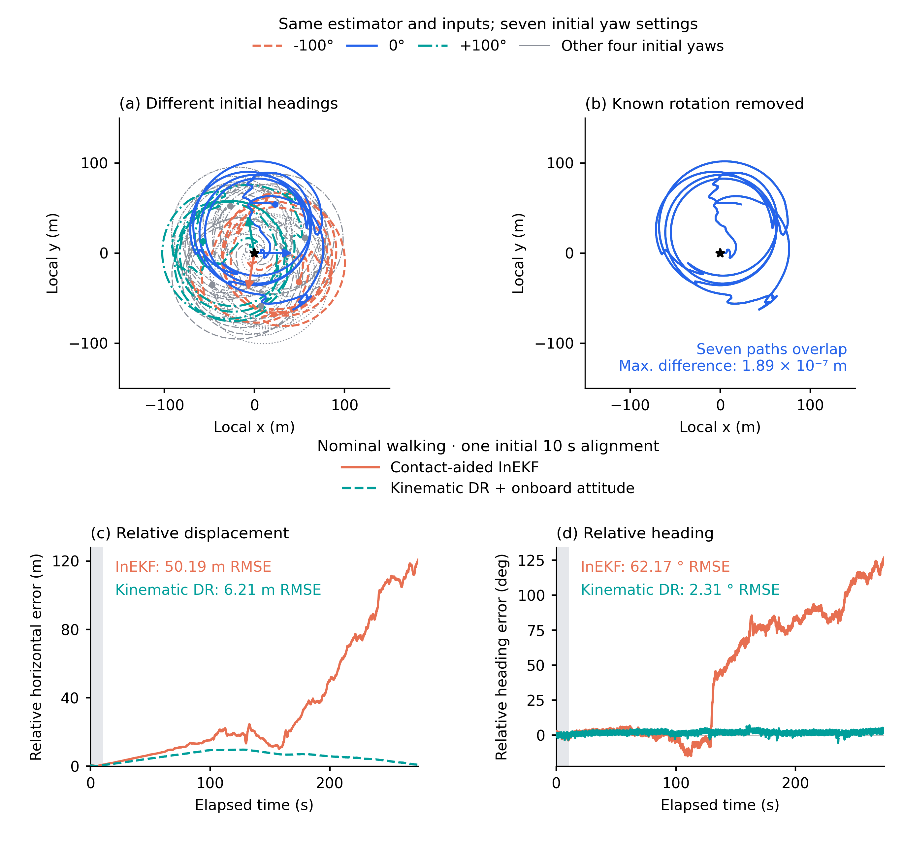
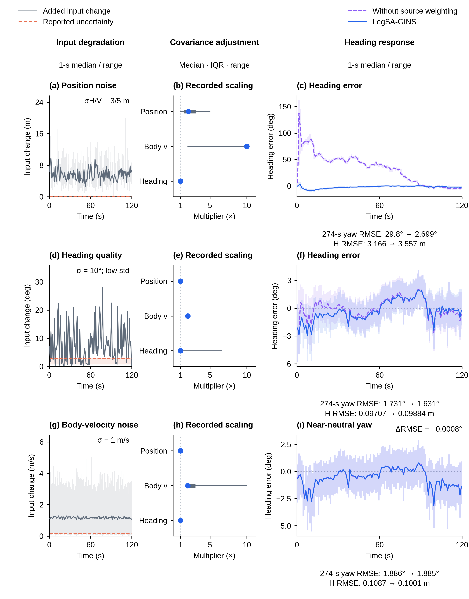
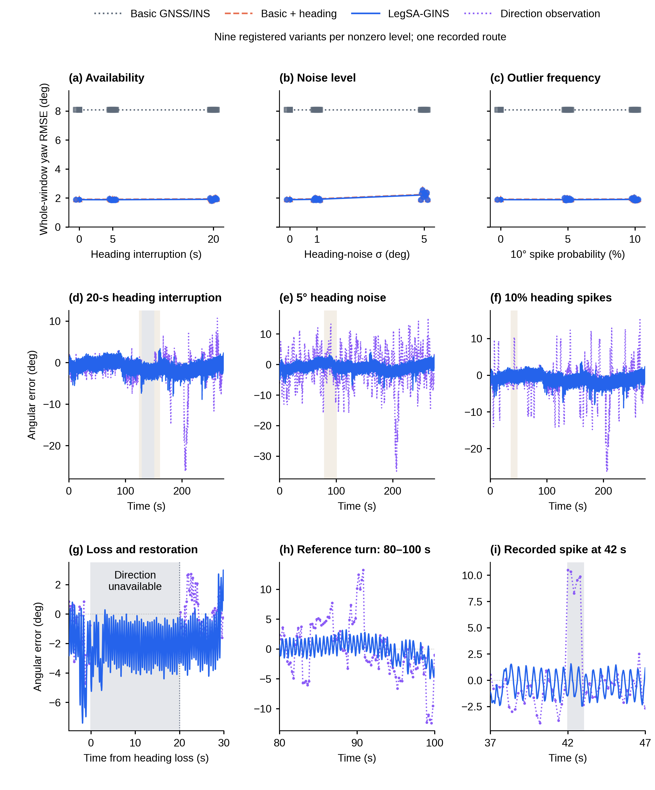

# R5 当前正文图与解释

本轮修改图3、4、8。图1、2、5、6、7、9、10沿用R4。原图11已并入图3，不另增正文图号。

## 图1　平台与短基线几何：保留

保留作者认可的平台照片、生成插图和短基线几何版式，图面不变。

## 图2　共享状态估计框架：保留高清版本

沿用R4的构图及可编辑矢量母版。图说明IMU传播、GNSS位置/速度与短基线方向、机身姿态/速度辅助如何更新共同状态，以及来源质量与新息怎样调整观测协方差。

[7680px PNG](../heading_polish_20261013_R4/schematics/figures/F02_method_8K.png) · [真正可缩放的矢量阅读页](../heading_polish_20261013_R4/schematics/F02_矢量放大查看.html) · [放大阅读PDF](../heading_polish_20261013_R4/schematics/figures/F02_method_reading.pdf) · [编辑SVG](../heading_polish_20261013_R4/schematics/editable/F02_method_traced.svg)

## 图3　完整路线与分组空间局部

原图把八个主配置、狭窄局部和航向曲线放在同一张三列图中。地图线条互相覆盖，厘米局部又用了大量纵向留白；R5将图面重心调整为空间轨迹，航向比较由图9承担。

每个场景保留完整路线作为位置索引，局部按双位置IEKF、单位置IEKF、OiSAM分组。各组重复同一参考与LegSA-GINS，以少量深色实线、虚线直接比较；重复锚点不是增加独立运行。空间视图采用相同真实坐标，不人为平移方法结果或夸大误差。

完整路线纳入八个主配置：LegSA-GINS、双位置IEKF两配置、单位置IEKF两配置、恢复协议OiSAM、TC-FGO、GNC-FGO。TC/GNC现有输出位于GNSS1，其余路线经已有合法变换到POI；完整图用于米尺度概览，同点厘米细节不混入无法转换的TC/GNC轨迹。GINav部分路线与机器人本地坐标路线仍有补充图。

三场景分别为正常行走、大幅机身运动、单天线遮挡。保留此前100s上下文；遮挡期间原局部的参考近静止且SDK低速读数一致，因此空间局部沿用228–233s恢复运动段，而非将近静止点团称为行走路线。全部方法和窗口的确切对应见navigation的图注和数据映射。

## 图4　两种机器人运动估计与初始方向

作者确认要比较的两条路线是接触辅助InEKF、足端运动学航位推算，不是另一种EKF，也不是把同一方法的两套参数称为两个算法。

前两个面板保留同一既有实现、同一输入、七个初始全局朝向的轨迹和逆旋转后的重合。这个结果说明已知全局旋转自由度在该实现中的一致性；数值重合残差不是定位误差。后两个面板新增官方接触InEKF与足端航位推算的已完成相对误差时序。

常规行走示例采用两条路线原有的起始10s一次对齐，未重新拟合。原冻结表中的水平RMSE为InEKF 50.19m、航位推算6.21m，对齐后航向RMSE为62.17°、2.31°。曲线说明在该平台已有输入配置下，后续相对运动和朝向变化如何累积偏差。另有三场景完整配图与方法配置表。

两条路线的信息不同：InEKF由机体IMU与接触/足位代理估计姿态；航位推算利用机载姿态旋转足端运动学速度后积分。较小的对齐后航向误差不能直接解释为航位推算独立估计了全球绝对朝向。前两个面板是结构性质说明，后两个是现有两路线的实际相对表现，不能互相替代。

## 图5　短基线方向方法比较：保留

保留作者通过的方向比较、历元接受状态和筛选前后误差分布，未改变算法结果、配色和图面。

## 图6　自然场景姿态：保留

保留自然场景下的航向与倾角结果，用于观察短基线方向与机身姿态辅助的实际作用。

## 图7　条件性平移辅助：保留

保留观测可用性与机身辅助的条件性结果。

## 图8　三种不同退化下的质量调整与响应

使用三个物理机制不同且有完整时序的既有seed00案例：位置噪声、方向噪声伴随乐观精度上报、机身速度噪声。固定种子来自原保留规则，没有为更大收益更换种子。没有把共同坏位置成分主导的两个案例当成不同机理重复展示。

每行按相同顺序阅读：实际输入扰动、记录中的来源协方差倍率、完整方法与关闭来源加权的航向响应。左列直接比较已保存的受扰输入与原始干净输入：位置用三维距离，方向用圆周角差的绝对值，机身速度用水平速度差的模长；这些量说明实际注入了什么。中列的点、粗线、细线分别为实际更新倍率的中位数、四分位距和范围。

右列三组均采用每秒中位线与最小—最大范围带，防止高频曲线互相遮盖；统计包括各时间箱内的全部原始样本，范围带表示时间内波动，并非跨种子置信区间。主图展示前120s，所标RMSE沿用完整274s的冻结指标。协方差倍率反映对同一来源影响的调整，不是卡尔曼增益的精确倒数。

位置噪声案例航向RMSE从29.7985°降至2.6986°，水平位置RMSE从3.16555m升至3.55690m。方向质量失配案例航向从1.7308°降至1.6314°，水平位置从0.09707m升至0.09884m。机身速度噪声案例航向为1.886240°与1.885432°，基本不变，而水平位置从0.108699m降至0.100066m。

这些案例共同说明质量调整的效果取决于受损来源及其与当前状态的耦合：可出现显著航向保护、小幅收益，或航向接近中性而位置改善。不能把三个例子统称为同样显著的航向增益。

整体统计仍保留：541登记配对中513组双方完成，190组完整方法航向RMSE较低、323组较高；另6组仅完整方法完成、22组双方未完成。该图比较整套来源加权开关，不能把结果归因于单独某个倍率。曲线时间窗、完整指标时间窗和各来源有效更新样本数见aiding图注。

## 图9　航向横向对比：保留

保留自然场景六方法与18个中断条件的航向比较。图3现在主要负责空间路线可读性，图9继续承担完整的航向横向比较。

## 图10　方向信息退化敏感性：保留

保留方向缺失、方向噪声和尖峰的整体结果与输入—输出过程。
