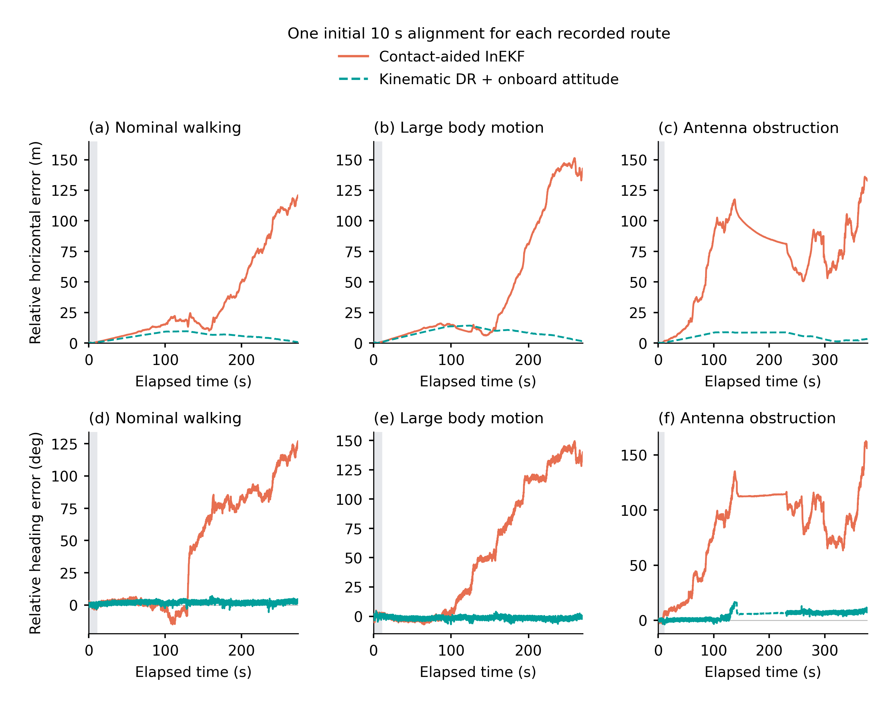

# 图4：把两条已完成的机器人运动估计路线放回正文

本轮按作者确认，比较的是 **接触辅助 InEKF** 与 **足端运动学航位推算**。之前正文图4只显示了一种估计器的初始航向试验，确实没有呈现另一条已完成路线。现在主图保留原(a,b)，并新增两路线直接可读的(c,d)。

## 先看两种方法到底有什么不同

|路线|本轮所用已完成实现|主要输入|航向来自哪里|
|---|---|---|---|
|接触辅助 InEKF|未修改官方 `RossHartley/invariant-ekf`，OFF-LIT 登记参数|机体IMU、接触标签、足端位置代理|估计器自己估计姿态，没有额外绝对航向量测|
|足端运动学航位推算|HX05 LEG-DR 已完成结果|接触足位置/速度、角速度，以及SDK机载姿态|直接沿用SDK姿态进行坐标转换，不在航位推算中另行估计航向|

航位推算使用的速度为 `−mean_contact(ω × p_foot + foot_speed_body)`，再经机载姿态旋转并积分。它既不是第二套接触 EKF，也不是把 SDK 的 velocity 字段直接积分。图中写明 **Kinematic DR + onboard attitude**，以便读者第一眼看见信息差别。

## 四个子图怎样衔接

- **(a) 不同初始航向。** 保留同一历史项目 InEKF 实现、同一采集的七份初始航向输出，用来展示这个传感器组合的已知全局航向自由度。七条不是七种算法。
- **(b) 去掉已知旋转。** 仍仅消除初始yaw对应的已知旋转，七条路径重合，原最大位置差约1.89×10⁻⁷m保留。这里是数值等变性残差，不是真实定位精度。
- **(c) 两条路线的相对水平误差。** 常规行走主记录中，接触InEKF与航位推算分别沿用原评价窗最初10s的一次yaw和三维平移对齐，随后不重拟合。全部2741个保存评分历元都画出，原水平RMSE为50.19m与6.21m。
- **(d) 同一窗口的相对航向误差。** 沿用同一对齐协议，原RMSE为62.17°与2.31°。这些是对齐后的相对表现，不是未经对齐的绝对航向精度。曲线使用原保存误差，没有重新拟合或评分。

上半部与下半部的实施身份有区别：(a,b)使用早期项目的reported-IJRR后端；(c,d)使用后期正式登记的官方库结果与LEG-DR。因此没有给官方OFF-LIT或LEG-DR虚构七初始航向实验。

## 如何解释很大的性能差异

下半部展示的是当前平台、原输入适配和登记参数下已得到的相对误差。两路线并不拥有相同信息：InEKF自行估计姿态，LEG-DR额外使用SDK提供的姿态。机载姿态的内部来源没有在本图中被假定为纯IMU积分；它也没有因被本方法使用就自动成为经独立验证的绝对航向量测。

所以，(c,d)不能单靠“大漂移”证明不可观测，也不能把差异唯一归因于滤波公式。初始方向自由度由(a,b)及此前的理论/秩分析支持；(c,d)把两条已完成路线的实际相对表现展示出来。本文后续航向收益仍由方向观测、融合误差和内部消融直接证明。

## 同一官方库的参数敏感性没有隐藏

下面同时列出官方文献参数、示例参数及航位推算。每格依次为 **相对水平RMSE（m）/相对航向RMSE（°）**，全部沿用原保存指标。

|场景|InEKF 文献参数（主图）|InEKF 示例参数（敏感性）|足端运动学航位推算|
|---|---:|---:|---:|
|常规行走|50.187 / 62.173|35.464 / 42.276|6.209 / 2.306|
|大幅机身运动|68.545 / 77.485|51.282 / 57.618|9.178 / 2.148|
|单侧天线遮挡|77.504 / 90.896|30.683 / 35.655|6.322 / 6.006|

OFF-DEF 是同一库的参数配置，不作为第三种算法。完整精度、漂移指标、有效历元、来源和对齐窗口保留在 [原指标表](source_data/ROBOT_RELATIVE_RESULTS.csv) 及 [身份表](audit/METHOD_IDENTITY_AND_EXISTING_RESULTS.csv)。本轮没有根据结果重新选择参数。

## 三场景完整配图

两条主路线在三场景中分别各有2741、2700、3771个评分历元。大幅机身运动中一个无支持网格沿用原缺失状态。全窗曲线与完整原始表都保留，不用只选一段有利窗口。

## 本次身份核对的范围

作者明确确认之前，我们也查到历史PAPER10G中的LSE02 QEKF命名，但它不是此次要呈现的第二条路线。R3旧S11的源码实际已列出官方InEKF两参数和LEG-DR，未列第二套contact EKF。本次不把历史QEKF标签、同库参数、运动学积分混成同一类别，见 [身份候选与最终选择](audit/IDENTITY_CANDIDATES_AND_FINAL_SELECTION.csv)。

七初值来源的上一轮只读审查保留在 `audit/README.md` 和 `audit/SEVEN_RUN_IDENTITIES.csv`。两条当前比较路线的原RESULT副本、代码/输入身份和来源行号均在audit目录。

## 交付与检查

- 主图仅一个正式彩色预览：`preview/F04_proprioceptive_heading_and_two_routes.png`。
- 配图：`preview/S04_two_proprioceptive_routes_all_scenes.png`。
- 均提供174mm的PDF、SVG、600dpi PNG/TIFF，以及400dpi高清预览。
- 最小字号8pt；彩色/灰度实际查看，检查对齐、文字和碰撞。
- 完整数值源逐字节复用，原始结果/旧图未改。无solver、provider、evaluator或新对齐拟合。
- 详细检查：[QC_SUMMARY.json](QC_SUMMARY.json)。双语图注：[CAPTIONS_ZH_EN.md](CAPTIONS_ZH_EN.md)。
