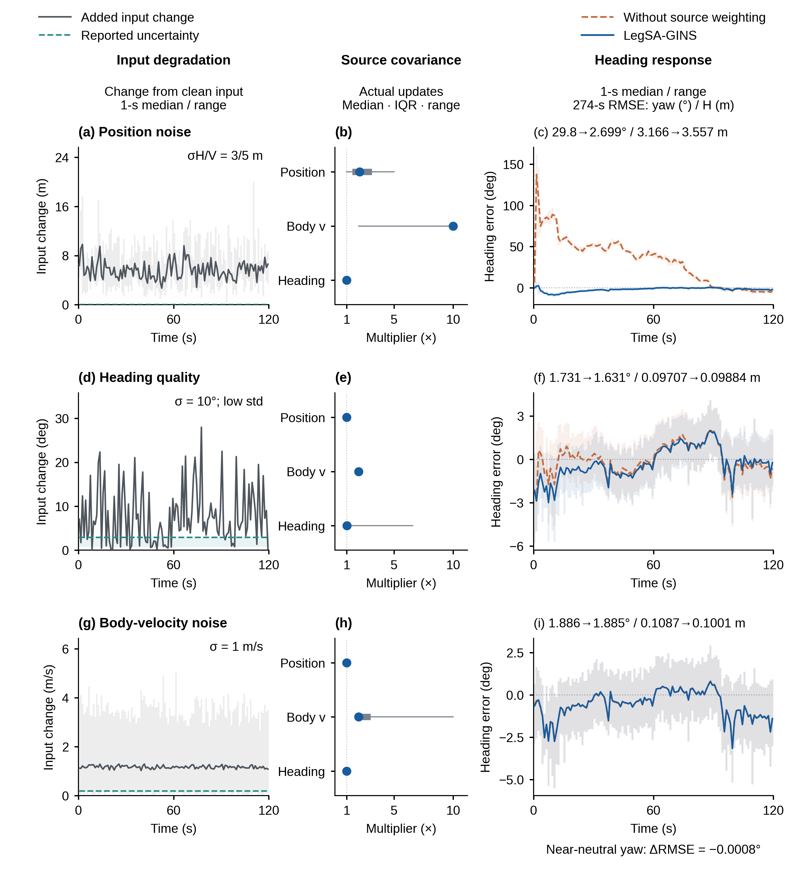

# R6 正文图说明

本轮调整图3、图8，图4恢复此前版本。其余正文图保持R5。

## 图1　保留

平台照片、示意图和短基线几何保持作者认可的版本。

## 图2　保留高清与可编辑版本

保留共享状态估计框架及8K原图、矢量母版与放大阅读PDF。

[矢量放大阅读](../heading_polish_20261013_R4/schematics/F02_矢量放大查看.html) · [8K PNG](../heading_polish_20261013_R4/schematics/figures/F02_method_8K.png) · [可编辑SVG](../heading_polish_20261013_R4/schematics/editable/F02_method_traced.svg)

## 图3　回到整齐的路线、近景、航向三列

三行对应正常行走、大幅机身运动、单天线遮挡。每行按完整路线、单个空间近景、100s航向误差的顺序阅读。取消上一版按方法拆开的九条细长局部，恢复统一的主面板尺寸、轴对齐和顶部图例。

深蓝色突出本文方法，黑色虚线为参考；对比方法按类别使用协调配色与线型。完整路线保留八个主配置，同点空间近景及航向仅使用有相应输出的配置。TC-FGO/GNC-FGO的GNSS1原生点在完整路线中作为地理概览，近景采用统一POI。

中列是明确的空间放大框，从既定4s或5s时间窗口中查看框内细节，框外轨迹仍在原数据与全路线中保留。所取时间窗口没有改变：前两个场景为88–92s，遮挡场景为228–233s的恢复运动。航向列保留原有100s窗口，蓝色窄带定位选取的局部时段，灰带标出登记遮挡区间。

正文采用图内完整坐标和图注读取空间范围；没有为分离重合曲线而平移某个方法的结果。

## 图4　恢复原版，并明确七次运行

本轮直接恢复R4的原图：左、右两个轨迹主面板，以及下方的数值差值条。

**七次运行指：同一个接触辅助InEKF、同一段机器人日志，七种初始全局朝向设置。** 七个角度为−150°、−100°、−50°、0°、+50°、+100°、+150°。0°复用已有主运行，其他六个来自先前已经完成的回放。每次输入的IMU、足位代理、接触记录与算法参数相同，世界坐标中的初始状态和协方差按相同角度同步旋转。

图(a)把七份输出放在各自的全局坐标表达中，因而方向不同。图(b)去掉各次已知的初始旋转，七条路径重合。图(c)量化逆旋转后的各条路径与0°结果的差值；1.89×10⁻⁷m是运行一致性残差，不是真实定位误差。

这说明相同相对运动可以用不同全局朝向表达。增加短基线绝对方向信息的作用，是进一步约束相对于地理方向的朝向。图4负责解释这一点；精度提升由后续误差对比与消融展示。

图例中彩色突出−100°、0°、+100°，另外四种设置用灰色画出。R5中增加的InEKF与足端航位推算比较已从当前正文图4撤下，结果仍保存在R5补充材料中。

## 图5　保留

短基线方向方法、接受状态和误差分布保持认可版。

## 图6　保留

自然场景中的航向与倾角比较保持原版。

## 图7　保留

保留观测可用性与条件性平移辅助结果。

## 图8　三种退化不变，重配颜色与列宽

保留位置噪声、方向质量失配、机身速度噪声三种已有seed00案例。左列显示输入变化及上报不确定度，中列概括实际协方差倍率，右列显示关闭来源加权与完整方法的航向响应。

完整方法改用深蓝，对照改用暖朱红；输入变化使用深灰，上报不确定度使用冷青。三列宽度更均衡：输入列加宽，倍率列紧凑，航向列仍最大但不再占据半张图。压缩重复标题和行间空白，保留清楚的指标标注。

所有输入、曲线、窗口和RMSE保持R5。时序仍为前120s内的固定1s中位线与最小—最大范围，标注指标仍取完整274s。第一行航向RMSE为29.7985°→2.6986°；第二行为1.7308°→1.6314°；第三行为1.886240°→1.885432°，航向近中性而水平位置有所改善。范围带表示时间箱内波动，不是跨种子置信区间。

本轮直接复用R5的1s汇总、倍率摘要和原指标，不重新挑案例或重算导航结果。完整541配对及所选27个变体的去向沿用R5记录。

## 图9　保留

保留完整航向横向比较与连续性结果，图3中的局部时序用于辅助理解空间片段。

## 图10　保留

保留方向缺失、噪声与尖峰条件下的敏感性结果。
