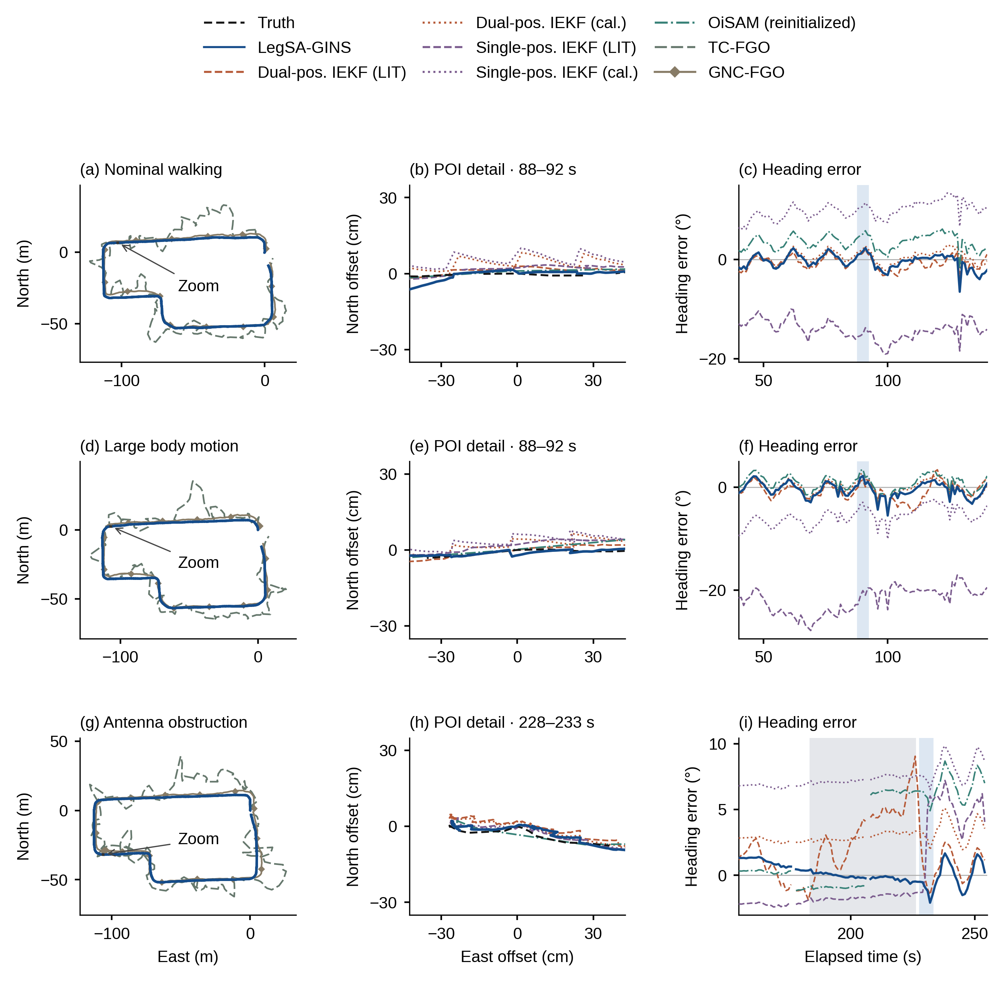

# R6 图 3：导航路线、空间近景与航向误差

恢复经典三场景 × 三列布局：左列完整路线，中列单个空间近景，右列 100 s 航向误差。本文用深蓝强调，双位置 IEKF、单位置 IEKF、OiSAM 分别用协调的暖褐、紫、青色；同类参数以虚线与点线区分。全部配置共用一个顶部图例，不再拆成九条窄带。

- **(a,b,c) 常规行走：** 先看路线覆盖，再看同一位置附近的真实厘米差异，最后比较该 100 s 内航向误差。全路线接近不代表航向表现相同。
- **(d,e,f) 大幅机身运动记录：** 保留同一分工。场景名称描述这条记录，局部沿用参考定义的 88–92 s 事件窗，不以方法输赢选窗。
- **(g,h,i) 单侧天线遮挡：** 中列为 228–233 s 的恢复运动近景；右列灰色是实际遮挡 183.94–225.95 s，浅蓝对应近景时间。恢复段与遮挡期间明确区分。

空间近景使用同一公共原点，不是位置误差图；各方法未单独平移、旋转或放大偏差。本版明确使用固定空间视窗，**只显示给定事件时间窗中落在近景框内的轨迹部分**。图上矩形与引线对应真实近景范围；全路线仍保留全部原生有效输出。视窗实际边界及窗口记录见 `data/F03_EVENT_WINDOWS.csv`，源点计数见 `data/FIGURE_SOURCE_COUNTS.csv`。

八种主配置是本文、双位置 IEKF 的 LIT/cal.、单位置 IEKF 的 LIT/cal.、重新初始化 OiSAM、TC-FGO、GNC-FGO。左列 TC/GNC 为原生 GNSS1 点，其余为 POI，因此左列用于地理概览，不作同点厘米排名。中列全部统一 POI；OiSAM 沿用已核验的自身姿态与杆臂转换。右列仅使用六种实际航向输出，与图 9 的共同动态支持一致。图 9 继续提供全窗口航向汇总与连续性比较。

实际坐标源直接引用 R3/R4；方向方法、GINav 的短输出、strict OiSAM、相对方法和历史配置的完整去向沿用既有表，详见 `SOURCE_MAPPING.md`。原图 11 继续留补充 / 历史记录，不增加重复正文路线图。

本图为 174 × 174 mm、最小 8 pt；交付 PDF/SVG、600 dpi PNG/TIFF 和 2740 × 2740 高清预览。文字、全路线与航向为矢量；中列密集轨迹以 600 dpi 嵌入，保留准确的边界裁剪。正式预览只有一张，灰度检查在 `qa`。最终 PDF 字号、碰撞、面板对齐及实际读图检查见 `QA.md` 和 `DELIVERY_CHECKS.json`。本轮只重排与绘图，未运行新求解、provider 或评价器，R4/R5 未修改。
