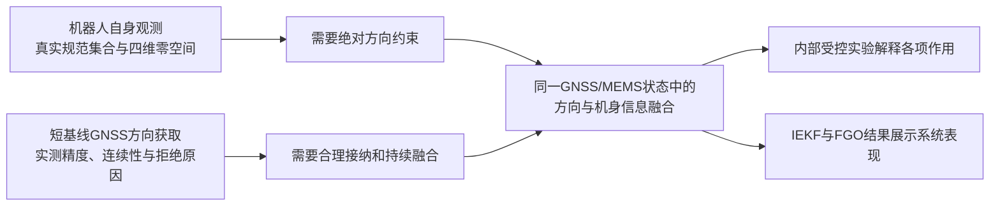

> 阶段记录：以下保留组图生成前的结果恢复与规划。文中的待办和候选主线反映该阶段；当前决定与下一步以[交接入口](../README.md)为准。

# V3研究记录恢复与论文组织建议

日期：2026-10-11。

**你的三条研究线都已经有成套工作，而且相当一部分关键结果没有进入最近的组图。当前应优先恢复这些证据之间的联系。此前把可观测性验证、输入诊断、受控外部比较和FGO缺测处理笼统列成待补工作，判断不准确。**

本轮沿历史请求、原研究记录、配置、实际运行产物和结果时序追查。新增内容只有本目录中的读取脚本、索引和报告；原始数据、科学代码、冻结结果和旧图均保持原样，没有新求解或重评。

## 先看这些文件

- [机器人状态估计线](robot/ROBOT_RECORDS.md)：可观测性、规范变换、官方Hartley、接触运动学积分。
- [双天线航向与模糊度线](heading/HEADING_RECORDS.md)：原始质量诊断、四变体RTKLIB、EXT V2、固定失败原因。
- [外部导航融合线](fusion/FUSION_RECORDS.md)：IEKF受控对照、外部退化、严格与分段FGO、GINav。
- [V3内部实验与对照](internal/INTERNAL_RECORDS.md)：自然配置、基础航向对照、单开关消融和中断实验。
- [论文主张与已有证据对应表](CLAIM_EVIDENCE_MAP.csv)。
- [横向比较组织](横向比较组织.md)。
- [组图重组方案](组图重组方案.md)。

## 1. 已完成研究的全貌

| 研究问题 | 已完成工作 | 找回的关键证据 | 论文中的任务 |
|---|---|---|---|
| 机器人自身观测能否确定绝对方向？ | Hartley模型、规范自由度推导、真实输入规范集合、五窗口可观测性、官方实机运行 | 七初始方向集合；四维零空间；官方六条轨迹及接触积分三条参照 | 建立绝对航向约束的必要性，并说明自身运动信息仍有价值 |
| 紧凑装配下方向观测有多可靠？ | 原始观测诊断、钟差/半周/转换核查、RTKLIB四变体、文献双天线核心九组合、trace4分支分析 | 低连续有效支持、旧值保持误差、AR前拒绝、ratio拒绝、Q1长度异常 | 展示当前平台方向获取的质量和连续性问题 |
| 现有融合路线在同一机器人数据上表现怎样？ | 双/单位置IEKF、LIT/S配置、Classic-18+A2、保留相对基线控制、三篇FGO严格/分段运行 | 396逻辑退化结果；LC01-BR；FGO输入缺口控制；GNSS1同点与共同支持 | 展示系统表现，连接信息约束与导航效果 |
| 本文方法的各类信息如何起作用？ | 冻结V3自然三记录、541矩阵、45中断布置、11配置、单开关消融 | 基础航向对照、RP一致姿态收益、HV条件位置收益、SA收益与代价 | 解释本文方法及三个贡献候选 |

可把现有研究按下列关系组织：

## 2. 这次需要明确更正的判断

| 先前遗漏或过度概括 | 找到的记录 | 现在的结论 |
|---|---|---|
| 需要补不可观测性验证 | H6R七航向集合、五个输入预选窗口、30行阈值结果 | 结构验证已完成；恢复组图即可 |
| 机器人比较只有很大的漂移误差 | H6R结构分析、HX02D分解、HX02E官方六次运行、HX05三条积分参照 | 已有结构、实现、实际漂移及输入作用四层证据 |
| LEG-DR就是SDK velocity积分 | HX05原公式、代码、RESULT | 应写“接触运动学积分（使用机载姿态）” |
| 航向低可用率尚无原因分析 | DG01/DG01R、HX07R、10月6日RTKLIB trace4 | 观测资格、输入历史和执行分支均已有深入诊断 |
| DD宽分布可以直接归于非整数硬件偏差 | DG01R钟差修正后的结果 | 后续结果明显收窄分布，采用修正后的解释 |
| 外部比较缺受控信息对照 | LC01/EXT05C、LC01-BR、LIT/S、Classic-18 | 已有同一骨架的输入控制和相对基线保留实验 |
| LC01-BR没有有效结果 | HX03R2 | A2为18/18有限；旧观察器造成的不可用状态已更正 |
| FGO缺少缺测策略与公平评价 | strict、segmented、BY2 exact控制、GNSS1同点表、共同支持 | 上述工作已完成；现在选择如何展示两套协议 |
| 尚无V3与OiSAM同点比较 | strict COMPARISON_TABLE的COMMON_POI_OISAM_V3_TIME | 已有POI_MIDPOINT共同时间比较，常规274点、遮挡54点、大幅运动空交集均保留 |
| 以前没有系统做过同后端QA对照 | PAPER2A/PAPER4A历史汇总，BY2 840、BY3 497、XB 560可评价行 | 已完成过1897行共同后端QA封装研究；单独记录历史版本，不冒充冻结V3结果 |
| H/O基础航向对照因runtime_role不同待补 | 实际RUN_MANIFEST、配置模型、输入时间快照 | 三记录的对照存在；H/O实际port_role相同，文本缺字段不构成实验缺失 |

历史原记录保留。上述更正只影响本轮如何读取和组织，不反向改写以前的失败或部分完成状态。

## 3. 现在可以怎样理解你的原思路

第一段“机器人状态估计说明航向问题”成立，而且已有结构证据。它回答为什么需要外部绝对方向，也展示接触/机身运动信息的作用。

第二段“双天线模糊度方法的实测表现”也有充分材料。应围绕本次短基线、低成本硬件和实测工况下的方向精度、有效输出及连续性来写。本文本身依赖两路接收机RTK位置产品，因此论文需要区分跨两天线直接相对模糊度解算和上游RTK定位解，清楚说明选择的方向观测路线。

第三段“滤波与因子图比较说明本文效果”已有实际运行、修正、控制和评价资料。最近的两位置IEKF承担自然与退化下的系统对比，OiSAM承担位置/姿态及输入缺口下连续性的对比，Wen/GNC展示原始码层定位路线。正文以各自实际信息条件解释结果，一张Methods比较表即可集中说明输入、初始化和评价点，图注无需反复写审查记录。

进一步找回的strict共同点表已经包含V3/OiSAM比较：常规行走274共同点上，水平RMSE为V3 0.096757 m、OiSAM 0.105953 m，航向为1.778176°、4.659461°；遮挡记录的54点短支持上，水平约0.04028 m相当，OiSAM航向0.985923°低于V3 1.211164°。应将精度与完整输出时间线一起展示。当前C02只有三个FGO方法的位置曲线，漏掉了这张已完成的本文对照表。

三段之间最有价值的连接，是已经完成的LC01-BR与本文速度辅助实验。前者说明保留基线方向并不会自动产生较好的位置结果，后者说明在保留航向的平移缺测条件下，机身速度辅助怎样抑制漂移。二者分别是外部系统控制和内部消融，共同引出“方向信息如何参与导航”的问题。

## 4. 可供下一轮定稿的中心问题与贡献

**中心问题候选：在紧凑足式机器人上，如何获得并合理利用短基线绝对方向约束，使机身运动信息在GNSS观测退化时有效辅助低成本GNSS/MEMS导航？**

三个贡献候选均落在同一个导航估计器中：

1. **短基线方向观测的构造与质量接纳。** 由当前平台的观测质量和方向获取实验提出需求，用冻结V3航向链、基础航向对照和实际接纳记录说明实现与效果。
2. **方向约束下的机身状态辅助。** 用倾角和速度的单开关实验分别解释姿态与平移收益，突出已完成的平移中断实验。
3. **异质观测质量变化下的来源加权。** 用固定输入的加权开/关实验解释发散及尾部保护，同时保留其典型精度代价。

机器人可观测性和文献方法比较是支撑上述问题的研究证据。论文创新表述仍应围绕本文实现及实验发现，不把已有通用可观测性理论计为原创贡献。

## 5. 可直接引用的几个结果锚点

- **机器人结构：** 含偏置四接触模型rank/nullity=23/4，双接触=17/4；三个阈值倍数下稳定。六个非零航向规范分支的逆变换最大接触点差为1.8978e−7 m。
- **原始方向生成：** RTKLIB多星座条件在三记录上的有效航向为154/1370、186/1350、117/1885。原始完整BY2输入域的trace4分析还区分了AR前SPP拒绝、ratio失败和固定解长度异常；该域不是1370历元评价窗，分母不可混。
- **基础航向作用：** 基础GNSS/INS→加入双天线航向，三记录航向RMSE由8.090/7.137/5.739°变为1.916/1.941/2.432°。
- **速度辅助：** 保留航向的20 s平移中断、9个布置中，关闭/开启HV的全窗H-RMSE中位数为7.961/0.241 m。
- **外部方向保留控制：** LC01-BR的18个A2条件已完成且有限，H-RMSE中位2.786 m，对应LC01为1.407 m。该控制保留方向但没有带来相应位置收益。
- **FGO：** OiSAM主动态有效支持从严格协议275/0/55，变为预登记分段协议275/267/370；两套结果均保留，BY2无缺口控制保持原状态/事件一致。

这些结果的单位、窗口、状态与版本在各分报告和CSV中逐项保留。当前常规场景不是所有指标全面领先，正文优势应由具体条件和对应指标表达。

## 6. 本轮工作范围

内部账本进行了全表机器读取；关键配置、实际运行记录、输出时序和科学解释进行了针对性检查。三条外部线逐项记录全文读取、选段解释或数组结构检查的深度，不声称人工逐字审完全部仓库与原始传感器数据。

合并读取清单在READING_COVERAGE.csv，机器人133条、航向166条、融合180条、内部142条来源读取记录，共621条分线记录，其中可能包含跨线重复来源；它不是621次实验。额外有界关键词检索的10,601个文件只计作搜索覆盖，不计作逐份人工审阅。

历史对话只选取与本任务直接相关的两段记录，提取7条作者研究要求保存于HISTORY_TASK_TRAIL.csv，作为检索线索；数值与完成状态均回到项目原记录确认。敏感且与研究无关的登录信息未保留于新索引。

尚未定位的项目列在后续定位表中，例如当前七类R倍率形状的完整性能矩阵，以及历史PAPER2A逐行载荷的位置。已找到的1897行历史QA封装研究与这七种形状并非完全同一集合；V3/OiSAM同点评价已找到。后续定位事项没有被转成“从零补做实验”的任务。

**下一步适合进入已有图源的重新编排。优先恢复机器人结构图和方向获取质量图，再调整导航系统比较，最后把内部消融接在相应科学问题之后。** 本轮停在证据与组图方案交付，不自动开始新实验或批量重绘。
