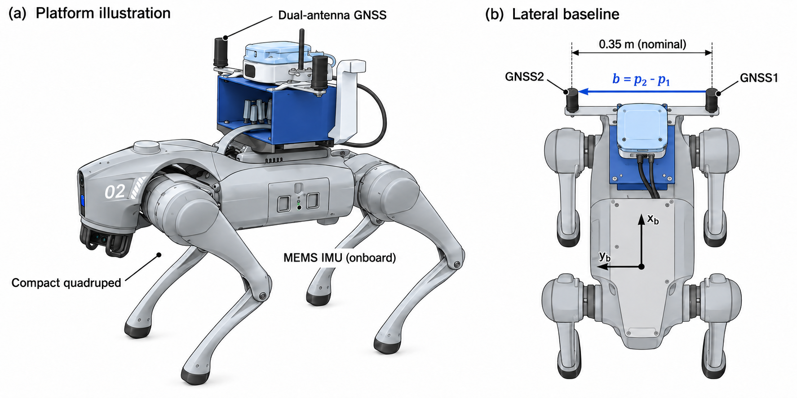
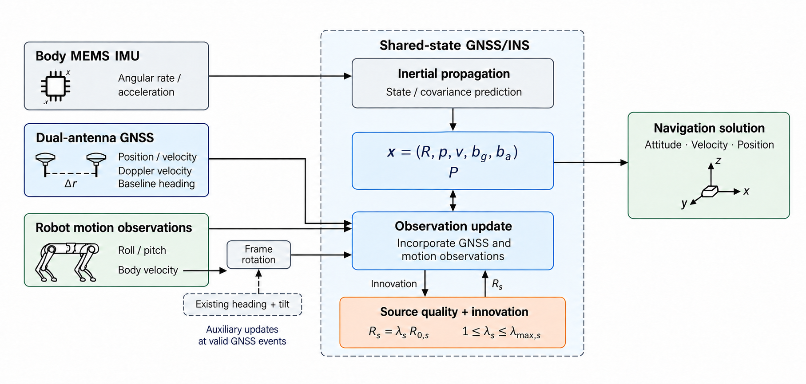
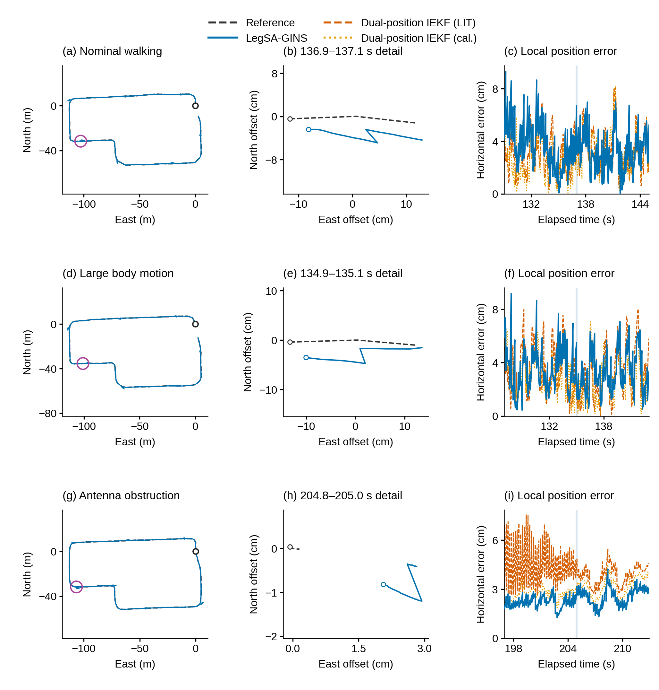
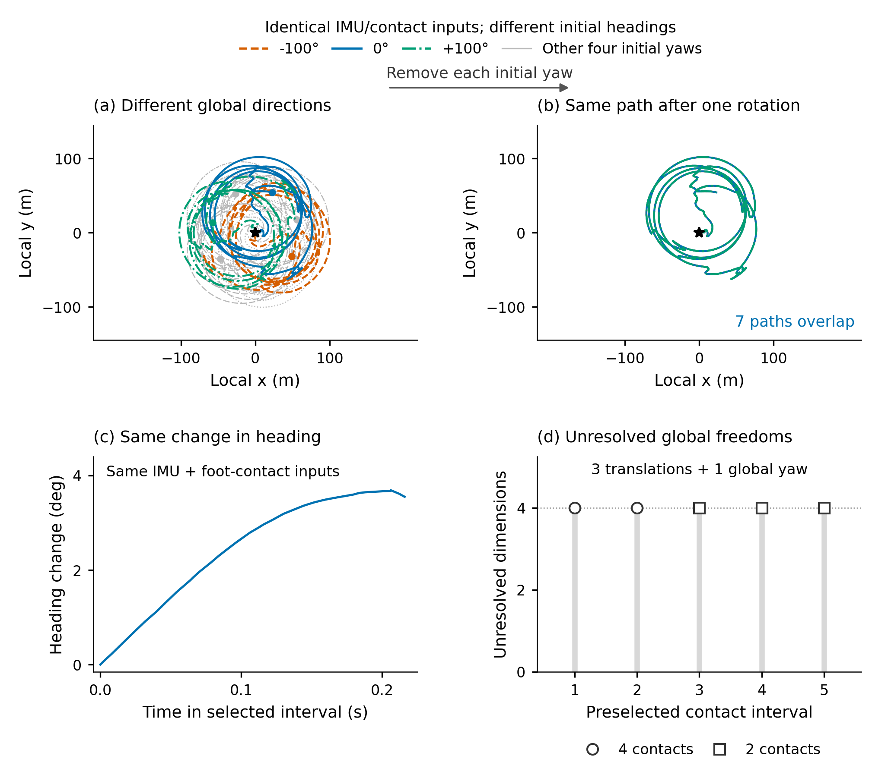
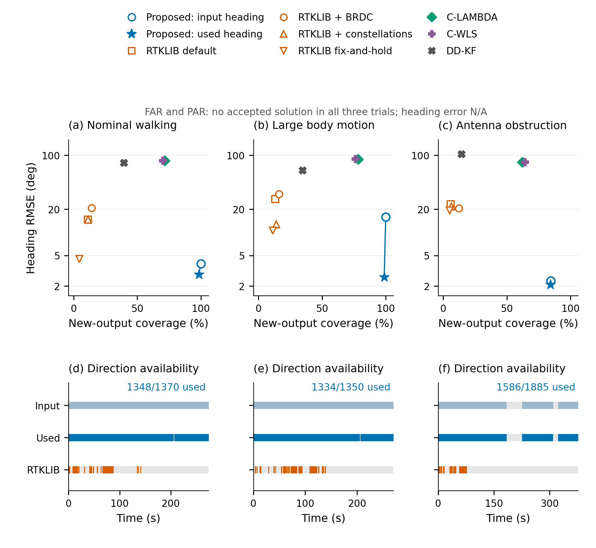
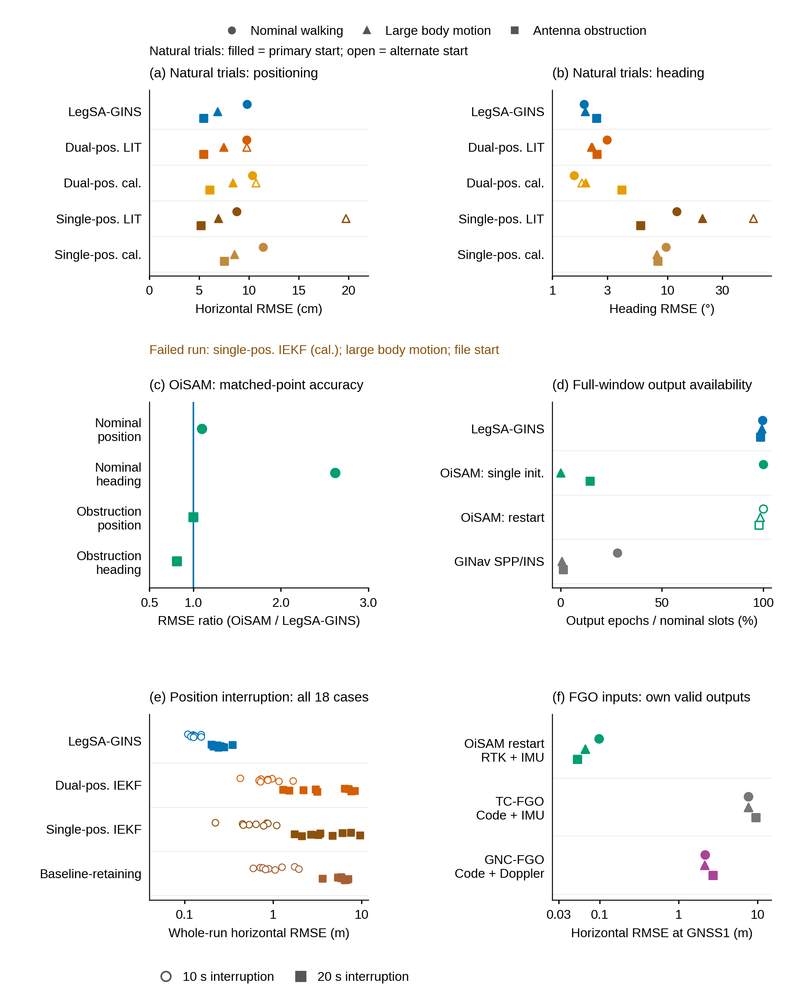

# 正文重绘：10组图与作者意见逐项回应

**最新只读审阅：[当前10图完整读法与问题](当前10图_完整读法与问题审阅.md)。图10的登记条件分组需要修正，图5/9比较层次及图3事件窗口仍待调整；当前图像保持不变。**

本轮按作者给出的示例与本地文献重新组织正文图。图1/2实际调用image生成，并逐步校正安装标注和科学关系；图3–9重绘；新增图10把完整受控扰动与内部消融用于正文。原图与冻结科学结果继续保留。

科学问题：在紧凑四足机器人的GNSS/INS中，短基线方向信息与机身运动观测如何共同改善姿态和平移估计，这种互补在什么观测可用性与质量条件下成立，又在何时失效？

本轮未重新运行导航求解器、provider或评价器。图5新增基于已保存输入、日志和参考序列的观测层派生统计，与原冻结导航指标分开保存。

## 本轮完整图件

## 图1　紧凑四足平台与侧向短基线

按真实安装照片生成技术示意，保留蓝色安装组件、四足本体和0.35m侧向基线。去掉会暗示精确IMU位置的错误引线。

原始照片保留；该图是image生成的示意，不替代实物证据。当前为原生像素讨论稿。

## 图2　共同状态中的方向与机身观测融合

image重新制作科研信息流。IMU进入传播，GNSS与倾角进入观测更新，机身速度经既有方向/倾角旋转，质量与创新决定Rs。

逐项修正生成稿中的错误连线及P/Rs混写，最后核对同一状态输出与辅助事件条件。当前为原生像素讨论稿。

## 图3　路线、局部位置与横向误差

三场景×完整路线/厘米级局部几何/同一时间邻域的V3与双位置IEKF误差。固定窗口与原参考运动绑定。

只在同一物理点可比较的数据上作局部曲线；没有从标量误差伪造外部方法轨迹。

[矢量PDF](navigation/F03_route_local_comparison.pdf)

## 图4　相同相对运动与不同全局方向

不同初始航向给出旋转轨迹；移除各自已知初始旋转后七条轨迹重合；局部转角一致；五窗口保留四个全局自由度。

这解释自身观测不能唯一确定全局方向；未用参考拟合旋转，也没有重跑机器人估计。

[矢量PDF](heading/F4_relative_motion_global_heading.pdf)

## 图5　各方向处理路线的精度与可用性

本文输入方向与原生实际采用的观测，与RTKLIB四配置、C-LAMBDA、C-WLS、DD-KF同组比较；FAR/PAR零接受为N/A。

新增的是配图层观测匹配统计：用冻结GNSS18、原日志、已有参考时序，未以posterior yaw冒充输入方向；各自支持单列。

[矢量PDF](heading/F5_heading_accuracy_availability.pdf)

## 图6　姿态消融的全时序与全窗差异

保留三场景×yaw/roll/pitch布局，并在各面板用对应颜色列出RMSE，直接读出差异。

F01/F03/F04解释持续方向作用，A05/F04解释倾角作用；不平滑或抽样来放大优势。

[矢量PDF](aiding/figures/F06_attitude.pdf)

## 图7　机身速度辅助何时改善平移

明确全部GNSS中断时辅助暂停、保留方向时辅助持续；标出20s恢复，保留九布置统计与完整方法米级细节。

凸起为中断期间误差累积，恢复时被绝对观测校正。两列不是仅改变方向有无的独立二因素控制。

[矢量PDF](aiding/figures/F07_conditional_translation.pdf)

## 图8　来源质量处理的收益与代价

代表yaw时序与位置误差ECDF并列；实际R倍率用分布概括；541状态和513配对变化清楚呈现。

示例yaw29.80→2.70°，H3.17→3.56m；513配对H中位变化+0.981mm。减少发散与更准确分别解释。

[矢量PDF](aiding/figures/F08_quality_tradeoffs.pdf)

## 图9　滤波与因子图路线的整体比较

双/单位置IEKF文献与标定参数、基线保留IEKF、OiSAM两协议、GINav均有去向；原始码FGO另列信息层。

六个面板分别保留自然精度、同点共同支持、全窗输出和18中断条件；失败没有赋予任意RMSE坐标。

[矢量PDF](navigation/F09_navigation_all_families.pdf)

## 图10　完整受控扰动与内部消融

全部60扰动类型按八类受影响信息组织，四个单开关对照分别看H/yaw/roll/pitch的配对变化。全61类×11配置保留两幅扩展图。

核心每类九个是注册变体，并非九次独立实机试验。记录属于semisynthetic/controlled replay，不能自行改称硬件在环。

[矢量PDF](aiding/figures/F10_semisynthetic_complementarity.pdf)

## 内部消融与半合成证据怎样贯穿全文

图6说明不同观测对姿态分量的作用；图7说明保留方向和有效更新条件下HV带来的平移收益；图8说明质量处理的收益与代价；图10使用全部60类受控扰动检验这些作用如何随观测条件变化。四张图共同支撑科学问题，而不是只在文末列实验计数。

完整5951核心运行记录、495追加条件运行、2164单开关配对、541注册条件定义及61类×11配置结果在[aiding配表](aiding/README.md)中保留。图9的所有方法与协议见[navigation方法去向](navigation/data/METHOD_DESTINATIONS.csv)。

## 关键新读法

- 图5大幅运动：原始方向RMSE15.745°，原生采用观测RMSE2.615°；它直接说明输入异常与质量控制。三场景采用覆盖1348/1370、1334/1350、1586/1885，对应可评分n为1348、1333、1582。具体匹配规则见[匹配协议](heading/INPUT_HEADING_MATCH_PROTOCOL.json)。
- 图10倾角辅助在不同扰动组中，roll/pitch配对中位改善约29–36%/20–25%。来源加权的典型roll/pitch存在代价，HV在基础60类的H收益较小，强收益集中在图7的保留方向平移中断。
- 核心九个变体不都是独立随机实现；原registry中部分条件seed_effective=false。追加中断的九个布置与此分别说明。

## 文件质量与尚需制版的部分

图3–10按174mm宽、最小8pt正文图字输出，包含PDF/SVG、600dpi PNG/TIFF；导航两图另有EPS。各组已检查真实导出尺寸、文字、对齐、碰撞与实际图像。图8有一项文本与稀疏栅格包围框边缘相交提示，已逐像素位置核对为空白，未覆盖曲线。

图1/2为image原生PNG，约1774×887及1815×866像素。它们完成了设计与科学关系校正，但174mm通栏下原生分辨率约260dpi，尚需最终高分辨率/可编辑制版，不把上采样当作新增信息。详见[image生成记录](schematics/IMAGEGEN_RECORD.md)。本轮作为作者审阅的完整设计版本交付。

[文献样式阅读记录](LITERATURE_STYLE_NOTES.md) · [修改任务记录](REVISION_PLAN.md) · [图6/7/8/10图注](aiding/CAPTIONS.md) · [图4/5图注](heading/CAPTIONS.md) · [图3/9图注](navigation/CAPTIONS_ZH_EN.md)

第三方论文全文、页面截图和作者所给论文风格截图只保留在本地阅读目录，不发布到Git。大型TIFF/EPS和600dpi全图保留本地，Git保存预览、PDF/SVG、代码、配表和来源说明。
