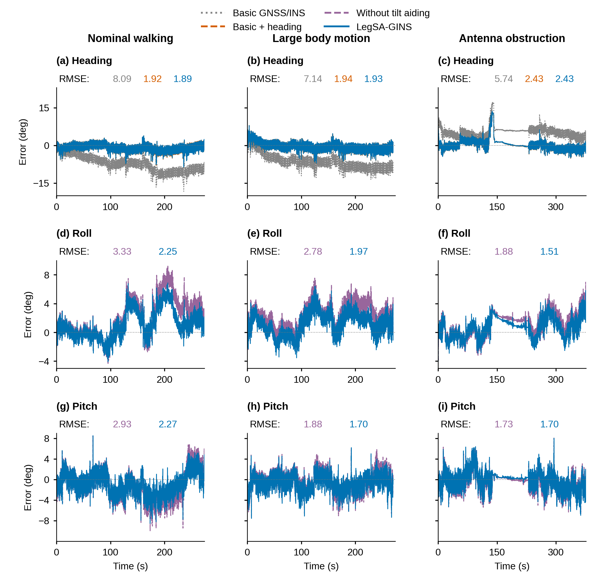
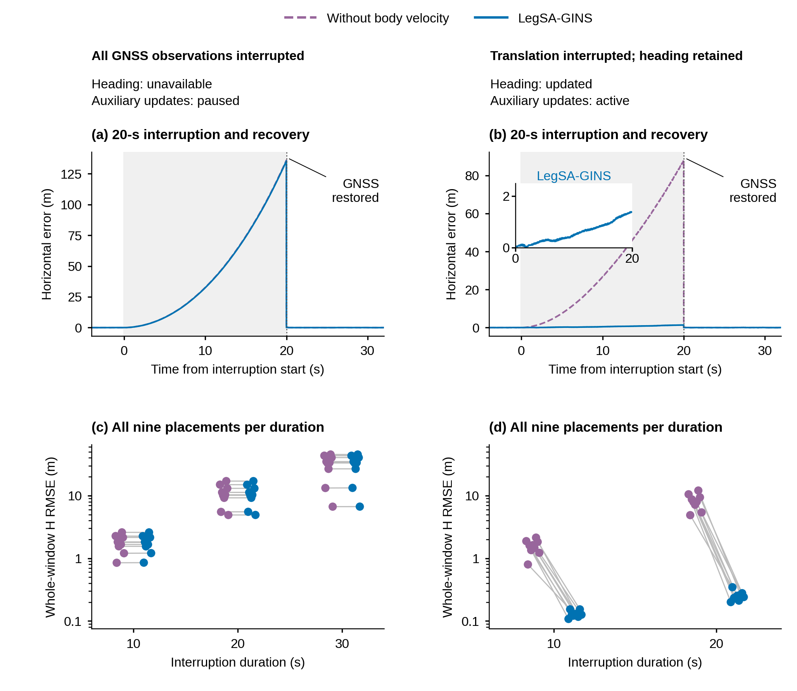
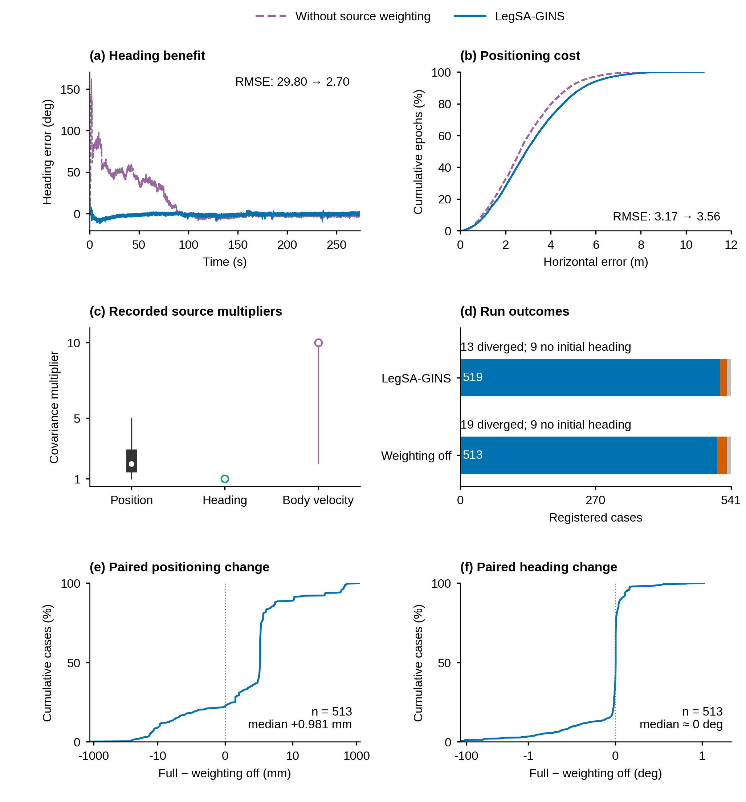
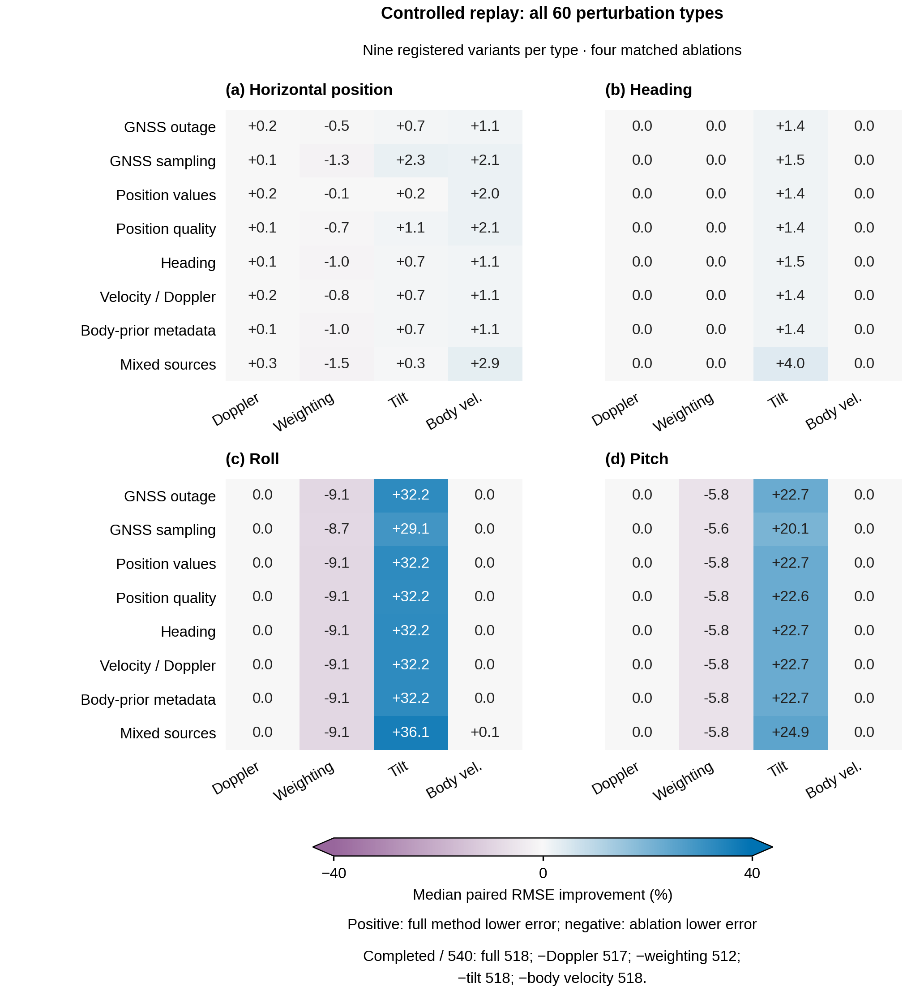

# 姿态、条件平移与受控回放：正文重绘

本轮只读取冻结 V3 的既有结果，不运行估计器、评价器或观测生成器。正文科学问题是：短基线方向信息与机身观测怎样共同改善姿态和平移，这种作用在何种可用性与质量条件下成立或失去作用。

## 正文图 6：不同观测支持哪些姿态分量

维持三场景 × 航向、横滚、俯仰的结构。每格增加曲线同色全窗 RMSE，避免读者必须从重叠的高频曲线中猜测差异。航向的灰、橙、蓝分别为 F01、F03、F04；倾角的紫、蓝为 A05、F04。图中的 F01/F03 才隔离持续航向链，F04 与 F01 还相差其他辅助开关。原始全时序、突变和小收益均保留，没有平滑、降采样或改变误差。

常规记录航向 8.090°→1.916°，完整方法 1.886°；横滚 3.326°→2.254°，俯仰 2.929°→2.265°。遮挡记录的俯仰只改善约 0.039°，不能为了“看得出差异”把微小收益放大成主要收益。

## 正文图 7：为什么出现凸起，何时机身速度有效

上方直接列出两列条件：全部 GNSS 中断时航向不可用且辅助更新暂停；仅平移观测中断时航向继续更新且辅助更新持续。上排的凸起是中断期间误差积累，20 s 的竖虚线对应 GNSS 恢复后误差被校正。右图插图展示完整方法在同一段中断中的全部误差，未作阈值过滤。下排保留每个时长的全部九个布置，细线连接同一个布置的速度辅助开关结果。

右列 20 s 的全窗水平 RMSE 中位数 7.961 m→0.241 m。此值与上排单个布置的中断末端约 1.5 m 分属不同统计量。左右列包含更新调度条件差异，不能把左列重合作为“物理上没有航向时机身速度没有作用”的证明。

## 正文图 8：质量处理的收益和代价

(a) 保留代表位置加噪案例的完整航向时序；(b) 把看不清的密集水平误差时序改为同一案例全部历元的经验累积分布，两种方法的精度差异因此直接可见；(c) 用真实来源倍率的全范围、四分位区间、中位数替代密集三线图；(d) 全部 541 个注册结果包括完成、发散、无初始方向；(e,f) 所有 513 个共同完成案例的水平和航向变化分布。

代表例航向 RMSE 29.799°→2.699°，同时水平 RMSE 3.166 m→3.557 m。513 对全窗 H RMSE 变化中位数为 +0.981 mm。完整方法从 513→519 个完成、发散 19→13；增加的六个完成案例没有加入 513 对的误差分布。完成不等同于准确，六例完整指标保留在 `tables/SA_SIX_EXTRA_COMPLETIONS.csv`，其中仍有两个约 69° 的航向误差。

图中倍率越大表示量测协方差增大、相对信任降低。来源倍率三种代表全部按原始记录统计，全部六来源完整记录保留在配表。样本分布而非时间平滑，不重新调参。

## 正文图 10：全部半合成条件中消融效应怎样变化

这张新增正文图实质使用了全部 60 种扰动、每类 9 个注册变体及四项单开关控制。八行按扰动物理来源分组，四列是 Doppler、来源加权、倾角和机身速度；四个面板分别是 H、yaw、roll、pitch 的配对百分比改善。正值支持完整方法，负值支持相应消融。数值没有舍弃负结果。格内变化先逐例计算，再在该组取中位数；未完成配对不填入数值，而是在完整状态和配表中保留。

这使“互补的条件性”更清楚：倾角在多类条件下保持约 29–36% 的横滚和 20–25% 的俯仰收益；来源加权减少失败，但典型 roll/pitch 中位数可能有约 9%/6% 的代价；基础 60 条件下的机身速度 H 收益中位数多为 1–3%，其强收益集中出现在追加的保留方向平移中断，即图 7 所示条件。

核心矩阵并不是 540 次独立外场采集。原始注册表区分随机种子、时间布置和种子无实际作用的重复配置；例如若干质量元数据条件标记 `seed_effective=false`。因此正文使用“9 registered variants”，而图 7 的追加中断确实使用“9 placements”。完整参数、受影响源和随机性标志见 `REGISTERED_541_CASE_DEFINITIONS.csv`。

数据标签为 semisynthetic：在实测观测上施加受控扰动并离线回放。现有记录不提供在线硬件闭环证据，所以本图不称 hardware-in-the-loop。

## 全配置扩展图与完整配表

- [61 类条件 × 11 配置的水平 RMSE](figures/E10_all_configurations_horizontal.pdf)
- [61 类条件 × 11 配置的航向 RMSE](figures/E10_all_configurations_heading.pdf)
- `tables/ALL61_TYPES_ALL11_CONFIGURATIONS.csv`：包含干净条件和全部 60 种扰动的 671 个单元格，每格有注册数、完成数、条件中位数。
- `tables/CORE5951.csv`：全部核心原生执行，包含失败状态。
- `tables/ADD495.csv`：全部追加中断和所有 11 配置。
- `tables/SINGLEMODULE_CASE_PAIRS2164.csv`：四个单开关全部配对及失败成员。
- `tables/REGISTERED_541_CASE_DEFINITIONS.csv` / `REGISTERED_61_TYPE_DEFINITIONS.csv`：真实注册参数与受影响来源。

扩展图的叉号表示无完成运行，数字表示完成不足 9 的实际数量；干净条件仅 1 次。十一列是内部配置，不能写成十一种外部算法。完整每例数值在 CSV 中，颜色只表现已完成案例的中位数。

## 文献图式学习与输出

本轮实际检查了用户文献库中 *Constrained MEMS-Based GNSS/INS Tightly Coupled System With Robust Kalman Filter for Accurate Land Vehicular Navigation* 第 7–9 页的图 8–11，以及 *A Robust Adaptive Extended Kalman Filter Based on an Improved Measurement Noise Covariance Matrix…* 第 16、18 页的图 14–17。借鉴其共同横轴、清楚的对照、受控扰动区间和局部细节组织，不复制文献图形或虚构数据。`literature/` 中的阅读页截图仅供本地视觉检查，不纳入 GitHub 交付。

所有主图宽 174 mm、字号不小于 8 pt，采用 Arial 优先的无衬线字体；PNG/TIFF 600 dpi，另有 PDF/SVG 可编辑文字及 300 dpi 预览和灰度预览。全部图形由 `build_revised_aiding.py` 从已有结果生成。`audit_and_package.py` 只检查排版及摘取已登记条件，无估计执行。

`SOURCES.json` 给出绘制时序的原文件与 run id。重建时需要本地冻结结果库；本次没有复制大型原始数据。`CAPTIONS.md` 为中英文图注讨论稿。`qa/` 保存最终几何、字号和碰撞记录。
