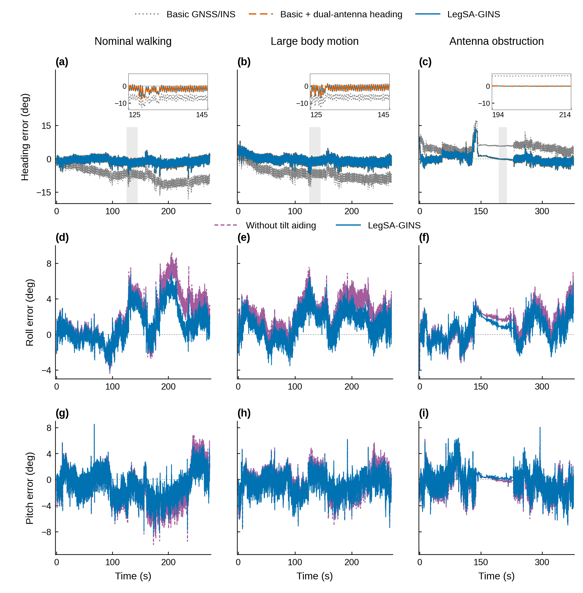

# 正文姿态合图：短基线航向与机载倾角的作用

本图合并原 S9 和 S8，作为正文姿态图的讨论版本。当前不指定最终图号；旧图和原结果保留。三列依次是常规行走、大幅机身运动、单侧天线遮挡；三行依次是航向、横滚、俯仰误差。

[PDF](M_attitude_heading_and_tilt.pdf) · [SVG](M_attitude_heading_and_tilt.svg) · [600 dpi PNG](M_attitude_heading_and_tilt.png) · [源数值表](NATURAL_ATTITUDE_METRICS.csv) · [绘图代码](build_attitude_main.py)

## 本图回答的问题

短基线方向观测与机载倾角辅助分别改善哪些姿态分量，这些作用在三条实测记录中有多大？

它位于全文“方向信息的可用性与质量”之后、“方向与机身速度共同影响平移”之前。当前合图呈现自然场景中的姿态作用；后续平移图接着解释这些信息怎样产生位置收益。

## 先读图例与坐标

蓝色实线始终为完整 LegSA-GINS。航向行中，灰色点线为基础 GNSS/INS，橙色长虚线为该基础配置加入双天线航向更新。横滚与俯仰行中的紫色短虚线为完整方法关闭倾角辅助。橙色与紫色是两个不同对照。

横轴为各自评价窗起点之后的时间（秒），纵轴为有符号角度误差（度），越接近零越好。每行统一纵轴尺度，每列三行使用同一时间支持。灰色区域仅标记航向局部放大的时段；不自动代表遮挡事件。

## 逐子图说明

| 子图 | 内容 | 应当看到什么 | 全窗 RMSE（°） |
|---|---|---|---|
| (a) | 常规行走的航向 | 基础配置逐渐产生航向偏离；加入航向链后整体更接近零。小窗展开 125–145 s 的局部波动。 | 基础 8.090 → 加航向 1.916；完整 1.886 |
| (b) | 大幅机身运动的航向 | 在该运动记录中，持续方向更新仍减小航向偏离；完整方法与仅加入航向链接近。小窗同为 125–145 s。 | 基础 7.137 → 加航向 1.941；完整 1.934 |
| (c) | 单侧天线遮挡记录的航向 | 全窗误差改善，同时仍存在较大瞬态。194–214 s 小窗展示局部差异，不能代表整段都无误差。 | 基础 5.739 → 加航向 2.432；完整 2.434 |
| (d) | 常规行走的横滚 | 倾角辅助减小部分较大偏移，蓝线在这些时段更接近零。 | 关闭倾角 3.326 → 完整 2.254 |
| (e) | 大幅机身运动的横滚 | 相同单开关对照，在大幅动作中也得到更小的全窗横滚误差。 | 2.785 → 1.966 |
| (f) | 单侧天线遮挡记录的横滚 | 有改善，但幅度小于前两记录；局部偏差仍保留。 | 1.877 → 1.507 |
| (g) | 常规行走的俯仰 | 多段负偏差有所减小；判断标准是距零线多远，而非蓝线是否更低。 | 2.929 → 2.265 |
| (h) | 大幅机身运动的俯仰 | 整体有收益，幅度小于该记录的横滚改善，局部振荡仍存在。 | 1.882 → 1.698 |
| (i) | 单侧天线遮挡记录的俯仰 | 两曲线接近，真实反映这一记录中的有限收益；不是漏画对照。 | 1.734 → 1.695，降低约 0.039 |

这些数值直接取自原 NATURAL33 表，未用显示窗口重算。三种航向配置共享初始方向；图中比较的是运行过程中持续航向更新的作用。完整方法与加航向配置近重合，说明这三条自然记录的主要航向收益来自航向链。横滚/俯仰对照则只关闭机载倾角辅助。

## 图注讨论稿

**暂定名称：短基线航向与机载倾角观测对姿态估计的影响。**

三列依次为常规行走、大幅机身运动和单侧天线遮挡记录。(a–c) 基础 GNSS/INS、基础配置加入双天线航向以及完整方法的航向误差；三种配置共享初始方向，灰色时段在插图中放大。(d–f) 横滚误差与 (g–i) 俯仰误差，比较完整方法和仅关闭机载倾角辅助的配置。横轴为评价窗口内的相对时间，纵轴为相对参考的有符号姿态误差。所有主图保留已有完整时序，局部放大沿用原图时段。

**English draft:** Effects of short-baseline heading and onboard tilt observations on attitude estimation. Columns show nominal walking, large body motion and single-antenna obstruction. (a–c) Heading errors of basic GNSS/INS, the basic configuration with dual-antenna heading updates, and LegSA-GINS. All three share an initial direction; insets enlarge the shaded intervals. (d–f) Roll errors and (g–i) pitch errors of LegSA-GINS and the configuration with only tilt aiding disabled. Time is relative to the evaluation-window start, and signed attitude errors are measured against the reference. Full saved histories are retained in the main panels.

## 当前解读与下一步

可供讨论的结论是：短基线航向观测主要减小持续航向偏离，机载倾角辅助补充横滚、俯仰约束；收益大小随姿态分量和记录而变化。本图先说明不同观测对姿态的作用，下一张平移图再回答这些信息怎样共同改善位置。

下一步讨论这一组图的标题和结论强度，之后再正式重编号并更新 Results。当前未把“每个瞬时点都更好”“所有姿态分量都显著改善”或“519 次独立实测”写入图注。

## 生成说明

使用已经完成的冻结 V3 结果，求解器/评价器/provider 新运行均为零。原 S9/S8 不改写。绘图不平滑、不抽样，真实时间缺口大于 0.1 s 时断线；全部时序以 600 dpi 栅格线层进入 PDF/SVG，文字、坐标及放大窗为可编辑矢量。尺寸为 174×177 mm。

`SOURCES.json` 与 `SOURCE_PROFILE.csv` 保存来源和数据概况。绘图脚本的 `BASE` 指向本地五问题图册根，原始误差时序位于 `SOURCES.json` 所列本地路径；从其他目录再生成时需配置该根路径。输入为已保存的评价结果，不重新运行评价器。
